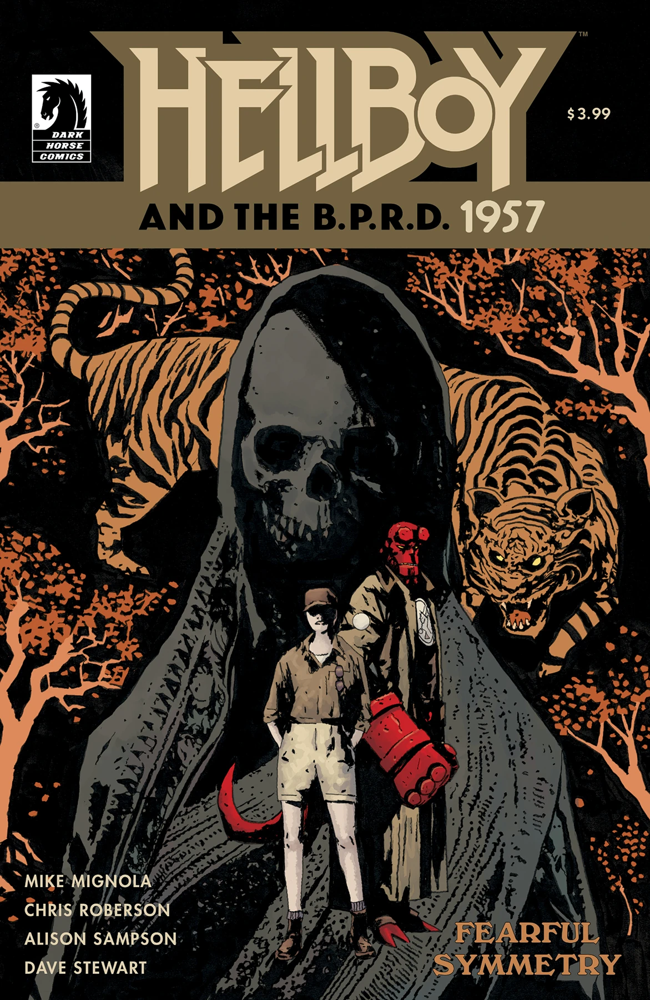

***《可怖的对称》（Fearful Symmetry）*** 是 *[《地狱男爵与超自然调查防御署》（Hellboy and the B.P.R.D.）](/entry/Hellboy_and_the_B.P.R.D.)：1957* 的一个单期故事线，由迈克·米格诺拉（Mike Mignola）与克里斯·罗伯森（Chris Roberson）编剧，Alison Sampson 绘制。

## 剧情简介

地狱男爵奉命前往印度调查一连串神秘的动物袭击事件，在那里与一张熟悉的面孔重逢。他们一同搜寻那头恐吓小村庄的奇异野兽，但这起谜团——以及其背后的神话——比他们想象的要深远得多。

## 画廊

封面由 [Laurence Campbell](/entry/Laurence_Campbell) 绘制。

*《地狱男爵与超自然调查防御署》：  
1957——可怖的对称*
