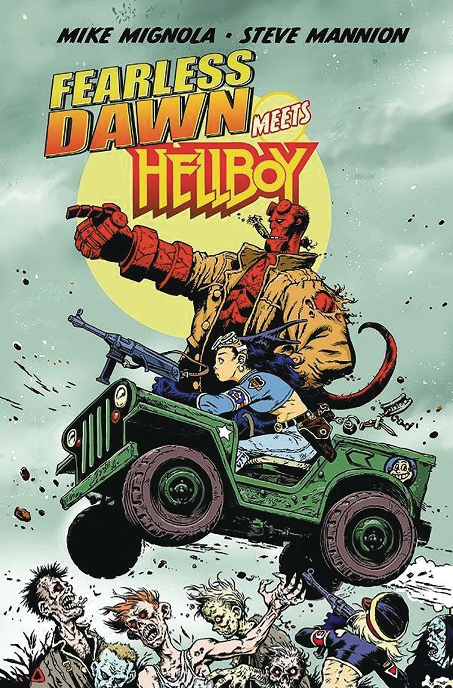

***《无畏道恩遇见地狱男爵》***（Fearless Dawn Meets Hellboy）是由 Albatross Funnybooks 出版的一部脱离正统剧情的单期跨界漫画。由[迈克·米格诺拉](/entry/Mike_Mignola)与 [Steve Mannion](/entry/Steve_Mannion) 共同编剧并绘制。

## 剧情简介

这是一场彻头彻尾的低俗冒险：迈克·米格诺拉笔下的地狱男爵，与 Steve Mannion 笔下传奇的地下漫画英雄无畏道恩（Fearless Dawn）联手！在罗马尼亚的一场倒霉遭遇中，地狱男爵一头撞进了无畏道恩小队的超自然任务当中。而当不死的第666装甲师现身时，这场英雄相会可就绝非什么轻松郊游了。

## 画廊

Steve Mannion 封面

Mike Mignola 变体封面

|Steve Mannion cover
