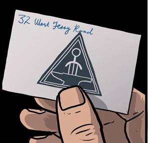

 **铸造厂（Foundry）**是 19 世纪末维多利亚女王统治时期、隶属大英帝国管辖的一个准军事组织。

## 背景

1879 年，Burke 上校和他的部下 McMann 在阿富汗开伯尔山口巡逻搜捕叛乱分子时，意外发掘出属于极北时代（Hyperborean Age）的古老科技造物。Burke 将这些器物带回伦敦，成为历史学家和考古学家深入科学审视的对象。后来各类探险家又发现了更多此类物品，几年之后女王终于对此产生了兴趣，亲自挑选了一批人秘密合作。铸造厂由此诞生，使命是解开这些奇异造物的秘密。铸造厂派出多支远征分队，在全球范围内搜寻更多尚未被发现的器物，无论地点多么偏远、环境多么恶劣。大量研究投入到破解它们的秘密、并为帝国寻找可能的用途上。此外，女王还会要求铸造厂提供各种秘密性质的服务。

## 历史

铸造厂的总部设在伦敦西特里路 12 号（12 West Terry Road），位于狗岛（Isle of Dogs）卡利伯恩钢铁造船有限公司（Caliburn Ironworks and Shipbuilding Ltd.）地下。1884 年 10 月，维多利亚女王得知伦敦塔发生了一起劫案——爱德华·格雷爵士收集的神秘学器物原本存放于此——便指示他前往铸造厂，看能否找到答案。[1] 在那里他了解到，铸造厂自身的安保也出现了漏洞：他们中的一员 Aldous Middengard Sinclair 从设施中偷走了一件敏感物品。得知 Sinclair 一直与 [拉神赫利奥皮斯兄弟会](/entry/Heliopic_Brotherhood_of_Ra) 有往来后，Singh 加入了格雷的调查。[2]

## 已知成员

- [James Fraiser Burke 上校](/entry/James_Fraiser_Burke)
- [Quinlan Maddox 教授](/entry/Quinlan_Maddox)
- [Karam Singh 少校](/entry/Karam_Singh)
- [Aldous Middengard Sinclair](/entry/Aldous_Middengard_Sinclair)（前成员）

## 参考资料

<references />

[1] [*The Gates of Heaven* 第 1 期](/entry/The_Gates_of_Heaven)

[2] [*The Gates of Heaven* 第 2 期](/entry/The_Gates_of_Heaven)
