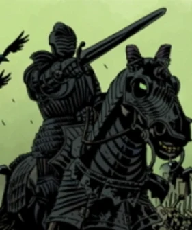

**启示录四骑士**（Four Horsemen of the Apocalypse）是侍奉[奥古·桀哈](/entry/Ogdru_Jahad)的存在，曾在[诸神黄昏](/entry/Ragna_Rok_(event))期间为其效命。

## 历史

有人看见这四位骑士打着[巨龙](/entry/Ogdru_Jahad)的旗帜，在[维格里德](/entry/Vigrid)平原上率领天启大军与英格兰骑士们交战，并最终殒命于此。

## 成员

- [战争](/entry/War)
- [瘟疫](/entry/Pestilence)
- [饥荒](/entry/Famine)
- [死亡](/entry/Death)

## 画廊

战争

瘟疫

饥荒

死亡

|War
## 登场

- [*《地狱男爵：唤醒恶魔》*](/entry/Wake_the_Devil)（被提及）
- [*《地狱男爵：风暴与狂怒》*](/entry/The_Fury)
