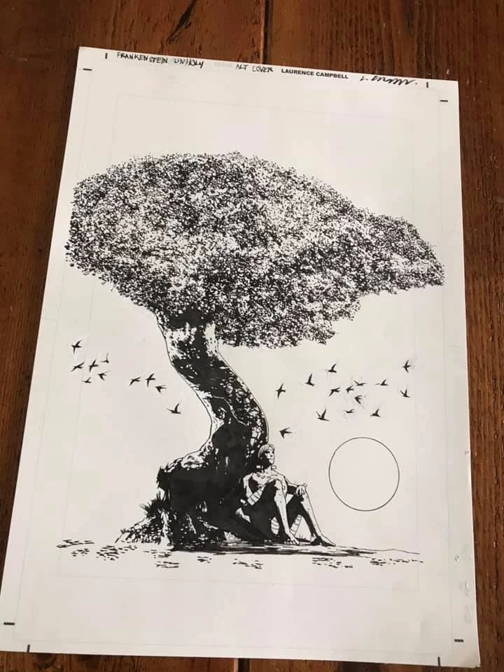

*本条目仍是一个小作品（stub）。你可以帮助地狱男爵维基扩充它。*

***Frankenstein***（弗兰肯斯坦）是围绕[维克多·弗兰肯斯坦](/entry/Victor_Frankenstein)及其造物展开的一系列故事。该系列包括漫画*[《Frankenstein：地下世界》](/entry/Frankenstein_Underground)*和*[《Frankenstein：新世界》](/entry/New_World_(Frankenstein_story_cycle))*，以及玛丽·雪莱1818年的小说*[《弗兰肯斯坦；或，现代普罗米修斯》](/entry/Frankenstein%3B_or%2C_The_Modern_Prometheus)*。2020年，该系列本计划推出迷你系列*[《Frankenstein：未解》](/entry/Frankenstein_Undone)*，但后来因[迈克·米格诺拉](/entry/Mike_Mignola)选择终止与编剧[斯科特·阿利](/entry/Scott_Allie)的合作而被取消。第三个 *Frankenstein* 系列 *Frankenstein Unholy*（弗兰肯斯坦：邪恶）原计划作为 *Frankenstein Undone*（《Frankenstein：未解》）的续集，同样遭到取消。不过该作已开始了部分创作，例如[劳伦斯·坎贝尔](/entry/Laurence_Campbell)绘制的一张变体封面。

