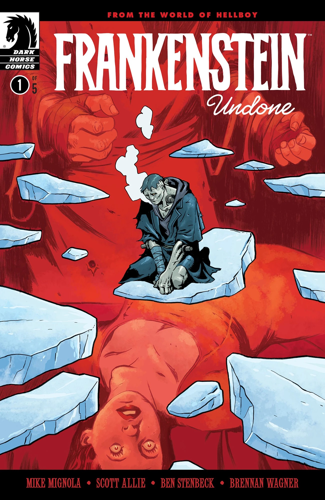
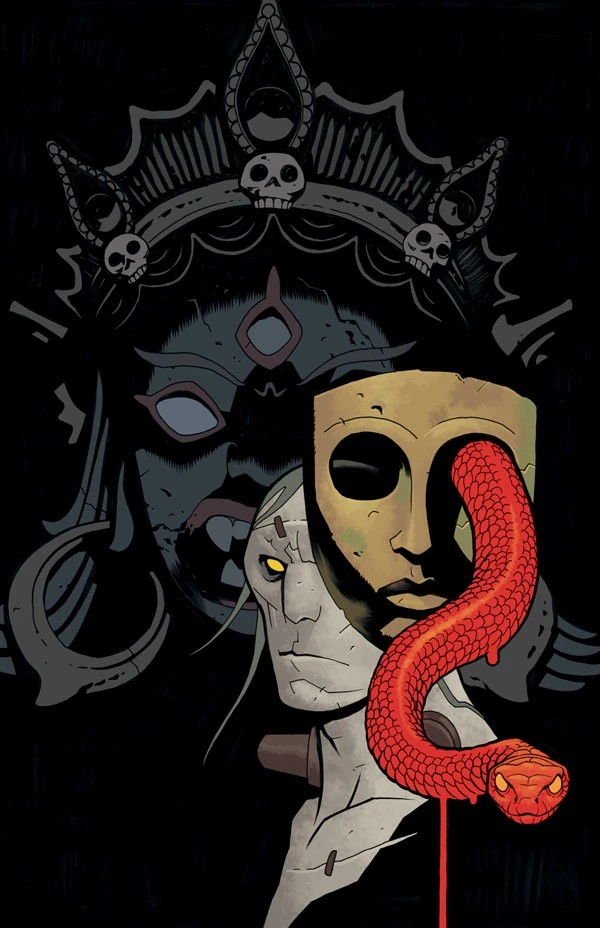
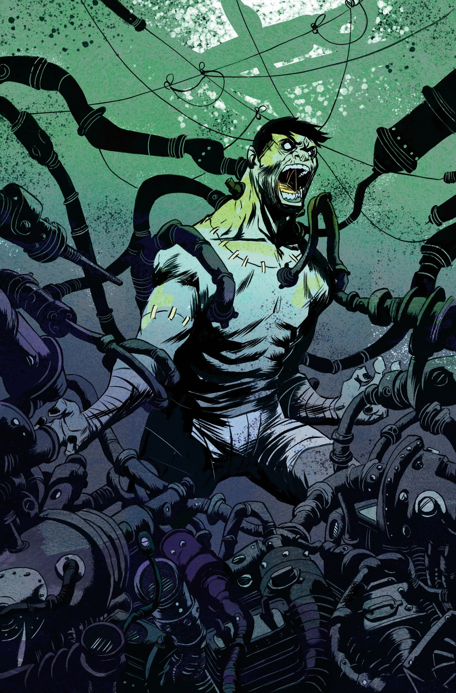
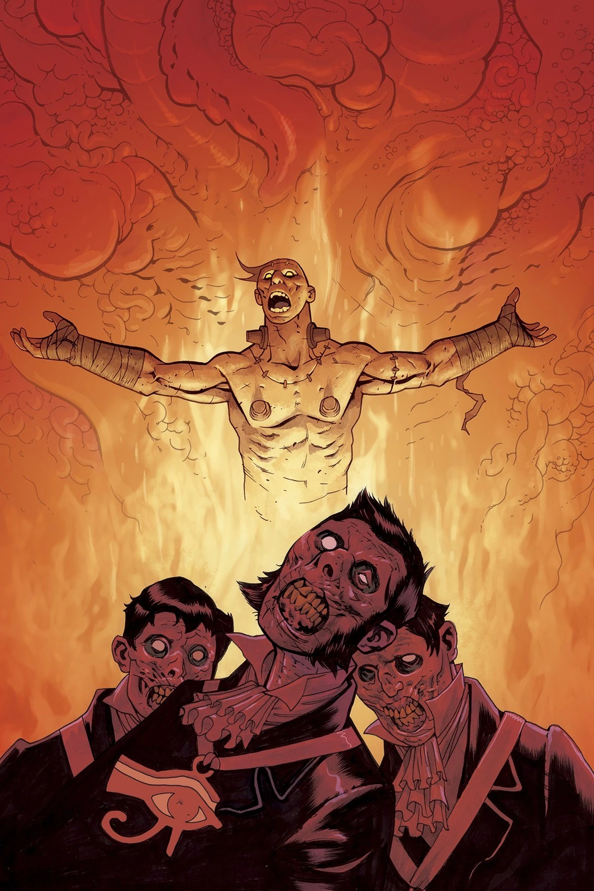
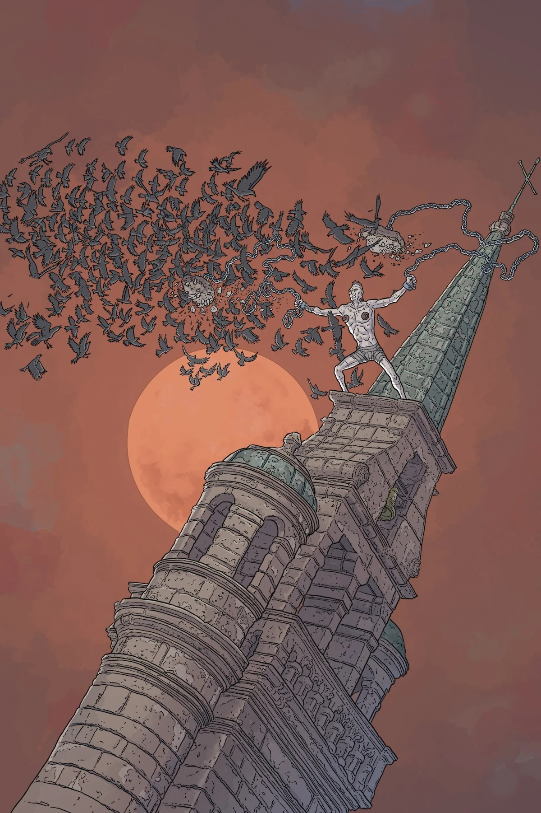
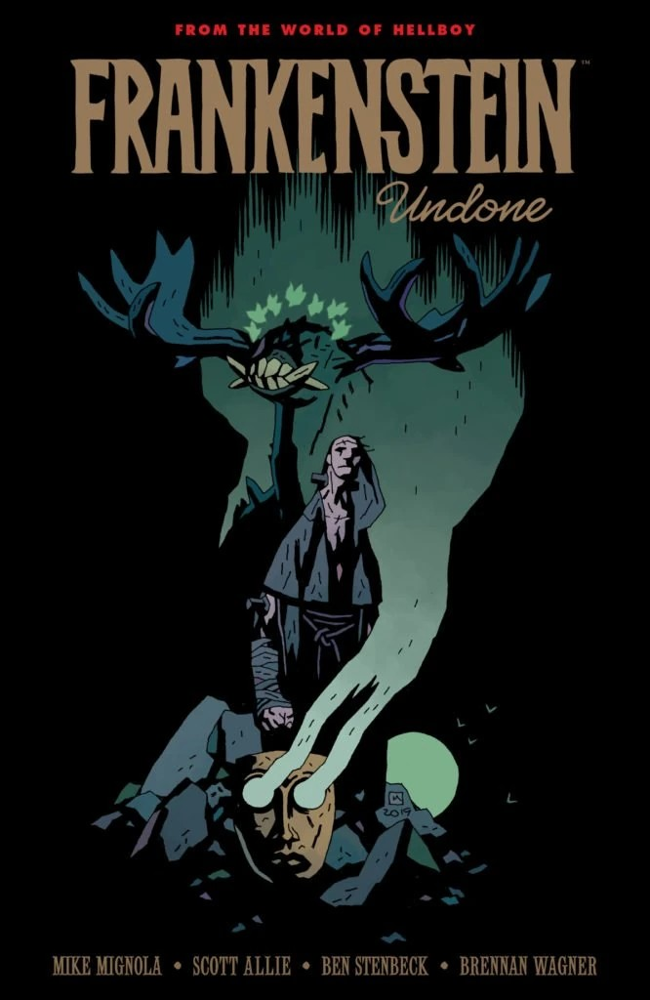

***《未竟的弗兰肯斯坦》*** 是一部五期限定迷你连载，作为 *[《地下弗兰肯斯坦》](/entry/Frankenstein_Underground)* 的前传。该系列在第二期出版后被取消。

## 出版历史

*《未竟的弗兰肯斯坦》* 最初由 Multiversity Comics 于 2019 年 10 月 16 日在 Twitter 上透露风声，次日该系列正式公布。

第一期于 2020 年 1 月出版，但后续各期因 COVID-19 疫情而延期。第二期于 5 月出版，其余三期原定 9 月至 11 月推出。然而，在联合编剧 [Scott Allie](/entry/Scott_Allie) 的性侵骚扰行径曝光之后，这部迷你连载遭到取消。

当 Mignola 被问及日后是否会换一位作者重启这个系列时，他说：“不会——这条故事线不存在了。抱歉。我们大家好好地长谈了一次，所有人都一致认为这样处理最好。”因此，*《未竟的弗兰肯斯坦》* 被视为正典之外的作品。

## 出版方故事梗概

### 第一部分

弗兰肯斯坦的创造者陈尸在北极的冰原寒抱之中，怪物则在寻找新的生存意义。就在他以为自己在一群意想不到的同伴中找到了归宿时，灾难骤然降临——怪物被猛然抛出玛丽·雪莱的小说，落进了地狱男爵所在的世界。

### 第二部分

作为广受赞誉的系列 *《地下弗兰肯斯坦》* 的铺垫，“怪物”弗兰肯斯坦继续向北跋涉。他仍被困在负罪的重负与赎罪的渴望之间，而当他与一艘被困冰中的船的船员相遇、被引向冰原上的险境时，弗兰肯斯坦或许不得不做出一了百了的抉择！

### 第三部分

“怪物”弗兰肯斯坦与一群北极探险家意外结伴，追寻着自己的人性，却在不知不觉中沦为一个古老教派的棋子！与此同时，他尚不知道，当地一位权势人物已经认出他是维克多·弗兰肯斯坦的造物——此人的影响力足以让他身陷囹圄……或者落得更糟的下场！

### 第四部分

弗兰肯斯坦发现，同行的水手中有人一直在为一己私利利用他。与此同时，一件从北极冰层中取出的神秘器物开始对戴明斯（Demmings）施加黑暗影响，唤醒了一个古老教派的阴谋。

### 第五部分

这一次，不死者或许真的要彻底“完结”了。

就在弗兰肯斯坦开始感受到与同伴之间的同袍之情时，一股黑暗力量现出真身，威胁要将他们全部吞噬。戴明斯的黑暗面具开始执行它致命的计划，而横亘在人类与他渴求已久的黑暗之间的唯一屏障，就是弗兰肯斯坦！

## 画廊

除特别注明外，全部封面均由 Ben Stenbeck 绘制。实际只有第 \#1 期与第 \#2 期得以出版。

第 \#1 期

第 \#1 期  
变体封面作者：Mike Mignola  
与 [Dave Stewart](/entry/Dave_Stewart)

第 \#2 期

第 \#2 期  
变体封面作者：Simone D’Armini

第 \#3 期

第 \#3 期  
变体封面作者：Steve Purcell

第 \#4 期

第 \#4 期  
变体封面作者：Sanford Greene

第 \#5 期

第 \#5 期  
变体封面作者：Geof Darrow

*《未竟的弗兰肯斯坦》* 平装合订本封面  
作者：Mike Mignola

|第 #1 期

|第 #4 期

|Issue #4 variant by Sanford Greene

|第 #5 期

|Issue #5 variant by Geof Darrow

|Frankenstein Undone TPB cover by Mike Mignola
