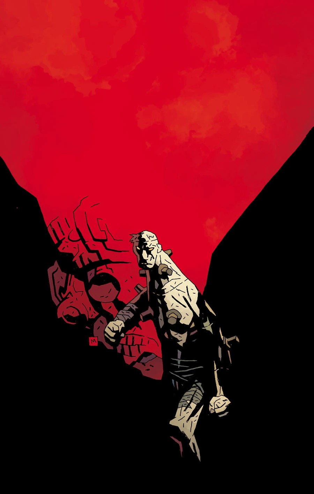
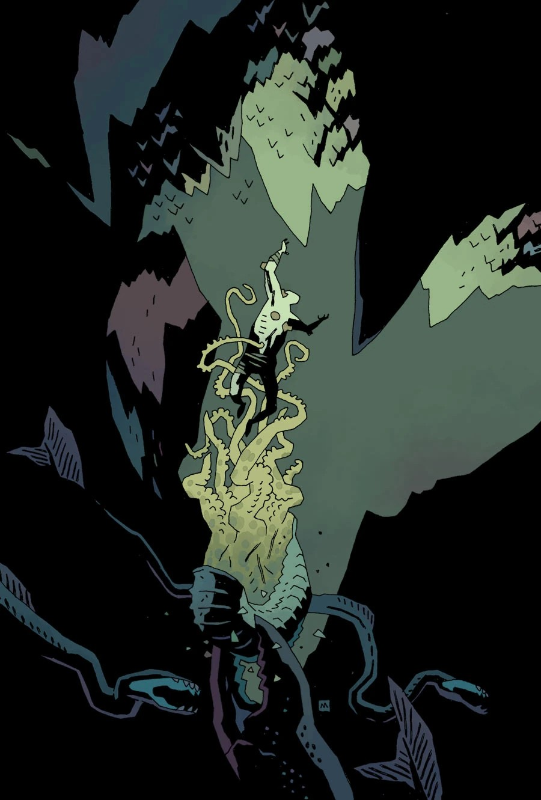
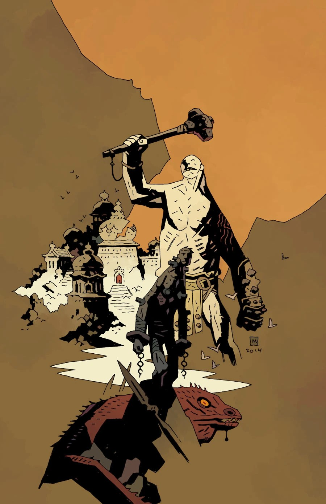
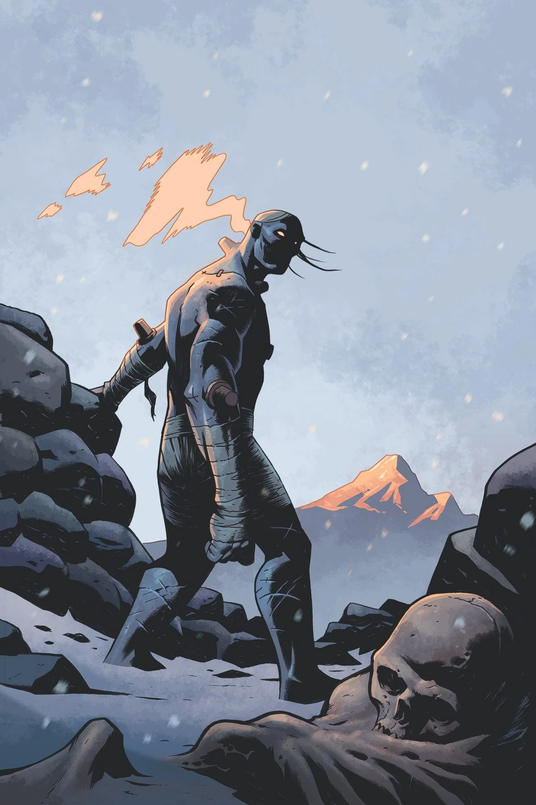
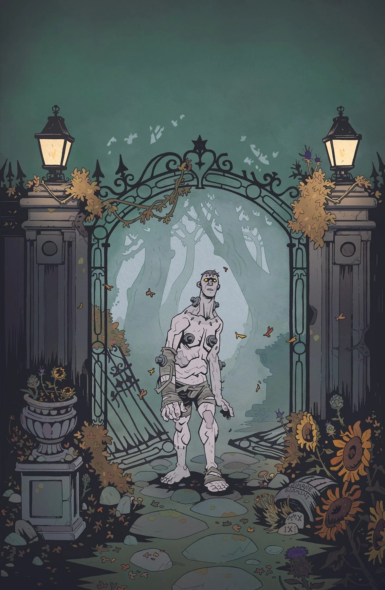
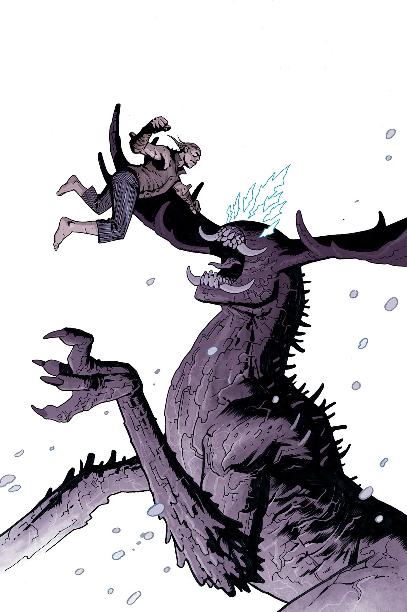
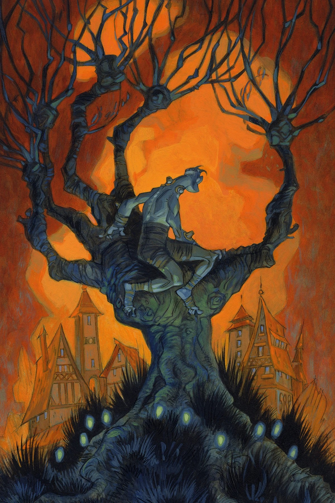

**弗兰肯斯坦的怪物（Frankenstein's Monster）**（有时简称"弗兰肯斯坦"）是由[维克多·弗兰肯斯坦博士](/entry/Victor_Frankenstein)创造的人造生命。

## 历史

1792 年，在德国因戈尔施塔特，年轻的医学生维克多·弗兰肯斯坦用拼凑起来的尸块造出了这个生物。凭借某种奇迹，一道奇异的闪电赋予这具构造体生命，使它拥有了生命与智慧。后来揭示，它其实是被 [Vril](/entry/Vril) 之力激活的。

一获得生命，弗兰肯斯坦就被创造者抛弃，被迫逃走。外面的世界也毫不宽容，所有人都惧怕他怪物般的外形。他纠缠自己的"父亲"，承诺只要给他造一个伴侣、让他不再孤独，他就永远离开人类的世界。他的创造者拒绝了，盛怒之下，弗兰肯斯坦失手杀死了维克多的爱人。

这个生物的故事启发了玛丽·雪莱的哥特小说[《弗兰肯斯坦；或，现代普罗米修斯》](/entry/Frankenstein%3B_or%2C_The_Modern_Prometheus)，于 1818 年出版。自从离开主人后，这个生物一直存活到 20 世纪。

在被赶出出生地后，他于 1863 年在法国被士兵抓获，后来于 1911 年被囚禁在奥地利，成为供大众取乐的马戏团怪胎。后来这个生物被交易，于 1955 年被运往墨西哥，用来参加墨西哥拳击赛打斗。

1956 年，他与[超自然调查防御署（B.P.R.D.）](/entry/Bureau_for_Paranormal_Research_and_Defense)探员[地狱男爵](/entry/Hellboy)交过手。混乱之中，趁主人们与这位美国探员缠斗，怪物悄然溜走。后来他和地狱男爵在一家酒吧相遇，还一起喝了龙舌兰。[1]

同年晚些时候，弗兰肯斯坦在一座废弃的神庙中避难，在那里第一次遇到一位善良的年老灵媒妇人，她对这个怪物心生怜悯。此时，[阿杜埃·德·法布尔侯爵](/entry/Adoet_de_Fabre) 也在追捕他，想把他收入自己的珍奇异兽收藏。为了抓住他，侯爵派出了当时还是他奴隶的 [伊布利菲卡](/entry/Iblifika)。伊布利菲卡试图劝说弗兰肯斯坦加入她，但由于老妇人的干预，弗兰肯斯坦逃脱了。冲突中老妇人被杀，盛怒之下弗兰肯斯坦摧毁了神庙，坠入地下的一片隐秘之地。[2]

进入隐秘之地后，他与数只史前生物搏斗，最终被居住在那里的一群形似人类的部落民抓获。他们把他带到一座城市，在那里他遇到了 William——一位科学家，曾率领一支由 [Heliopic Brotherhood of Ra](/entry/Heliopic_Brotherhood_of_Ra) 委托的探险队，在地下世界建立殖民地。讨论过他们是如何来到地下世界之后，弗兰肯斯坦被锁链锁住，但被一个精灵释放；精灵带他来到一个房间，他在那里见到了探险队的几名成员，他们实际上已是行尸走肉。

他们解释说，这座城市由 Hyperboreans 建造，这些人后来转而崇拜赫卡特，结果城市被沉入地下，邪灵作祟。在最初一段幸福时光之后，William 被一个邪灵（向读者揭示为一只[奥格德鲁·赫姆](/entry/Ogdru_Hem)）附身，杀害了自己的女儿，并强迫幸存的殖民者在肉体腐烂的情况下继续活下去。弗兰肯斯坦把 William 的女儿带到探险队成员、科学家 Lubitsch 那里——此人希望终结那里发生的邪恶——请求复活她。Lubitsch 起初答应，随后却背叛弗兰肯斯坦，企图窃取驱动他的 Vril 能量，但他们被 William 打断，Lubitsch 在随后的混战中被杀。

弗兰肯斯坦与 William 搏斗，扭打中奥格德鲁·赫姆的灵魂从 William 体内被释出。城市崩塌，弗兰肯斯坦逃出，而获得实体形态的奥格德鲁·赫姆在后面紧追。他找到了先前释放自己的那个精灵，精灵消灭了奥格德鲁·赫姆，并让新的植物在整个地下世界萌发。不朽的弗兰肯斯坦被独自留在那里，度过了漫长的岁月。[3]

当世界末日降临、地表化为焦土时，弗兰肯斯坦是第一个迎接那些循着洞穴来到中空地球的人类幸存者的人。

弗兰肯斯坦教会了人类幸存者如何在中空地球生存，甚至分享了他关于 Vril 的知识。最终，弗兰肯斯坦进入深度冥想，以与 Vril 沟通。千年光阴流转，他成为人类后裔崇拜的偶像，被称为"神谕者"。

弗兰肯斯坦从沉睡中醒来，部分原因是一个名叫 [Lilaja](/entry/Lilaja) 的小女孩——她不断收到一位[封在水晶中的神秘女子](/entry/Elizabeth_Sherman)托来的梦。弗兰肯斯坦意识到这是来自地表的召唤。尽管许多听着神谕者传说长大的僧侣恳求他留下教导他们，弗兰肯斯坦还是告诉他们：若愿遵从他的教诲，就善待彼此；而他必须前往地表，这一需要十分迫切。Lilaja 试图请求神谕者允许她随他同行，却被拒绝，因为这位血肉魔像不愿让她受到伤害。

## 名字

有些人从玛丽·雪莱的小说中认识这个角色，叫他"弗兰肯斯坦的怪物"，但这个称呼并不符合他的自我认知。在《Frankenstein: New World》中，他特意强调自己不是怪物。这一主题在《Frankenstein Undone》中也有探讨：他明确选择自称弗兰肯斯坦，以此确认自己的人性——他沿用了父亲维克多·弗兰肯斯坦的姓氏。[尽管《Frankenstein Undone》已不再属于正史](/entry/Frankenstein_Undone)，但故事的这一层面至少与弗兰肯斯坦在地狱男爵宇宙其他故事中的塑造是一致的。

## 画廊

FrankensteinUnderground 1.jpg FrankensteinUnderground 2.jpg FrankensteinUnderground 3.jpg FrankensteinUndone 2 Stenbeck.jpg FrankensteinUndone 2 DArmini.jpg FrankensteinUndone 3 Stenbeck.jpg FrankensteinUndone 3 Purcell.jpg

|

|

|

|

|

|

|
## 参考资料

[1] [*《Hellboy: House of the Living Dead》*](/entry/House_of_the_Living_Dead)

[2] [Frankenstein Underground #1](/entry/Frankenstein_Underground)

[3] Frankenstein Underground #5
