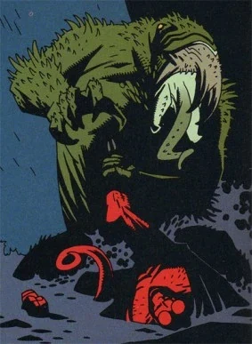
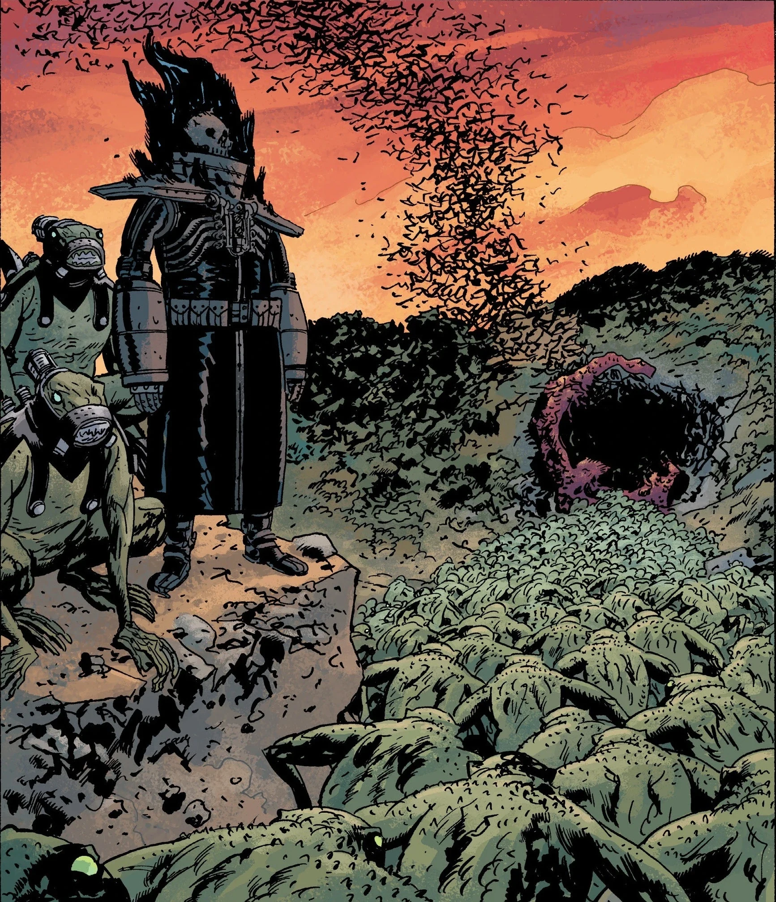
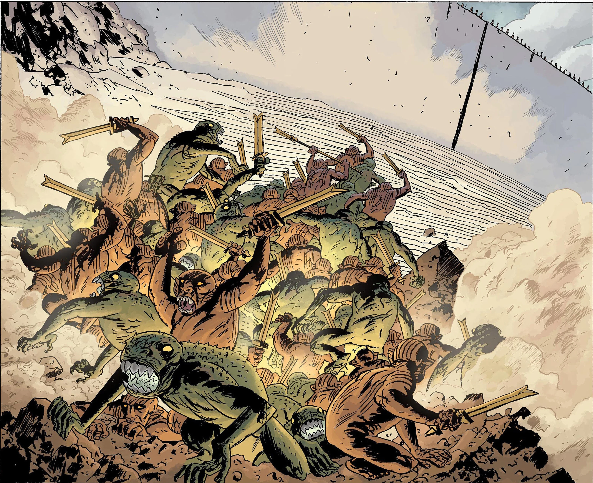
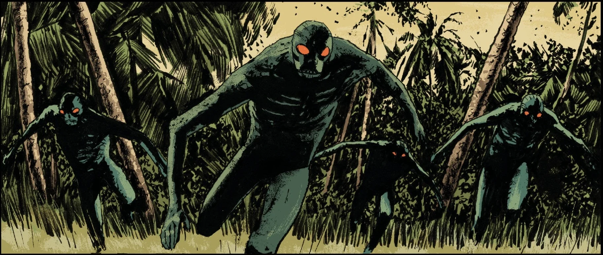

**蛙怪（frog monsters）**是一个具有智能的类人蛙族，由受[萨杜-赫姆](/entry/Sadu-Hem)及其他[奥格德鲁·赫姆](/entry/Ogdru_Hem)力量影响的人类转化而成。据说这些生物是取代人类的、新的“最终”人类种族，注定要继承那个从[奥古·桀哈](/entry/Ogdru_Jahad)对地球的毁灭中升起的新世界。

## 概述

这些怪物在肉体和精神层面都极为强大。单只蛙怪便能制服[地狱男爵](/entry/Hellboy)，不过这只特定的蛙怪似乎比普通个体更强壮、更有力量。蛙人能够在人形与蛙形之间转换，使他们可以在人口稠密地区不被察觉地活动。此外，蛙人还能对受害者施加一定程度的心灵影响，用幻象和精神诡计迷惑他们。最后，它们舌头的一触极为疼痛，会在受害者皮肤上留下凹痕。

它们的巢穴与藏身处通常设有某种供奉奥格德鲁·赫姆的原始祭坛，整片区域还往往刻着或写满一种神秘的语言。津科公司的研发部门发现，蛙怪的语言在某种程度上是本能性的。也就是说，蛙怪从不需要被教授自己的语言——它就存在于它们的 DNA 中。借助一套机械束具，它们被教会了说英语。

人类转化成的蛙怪似乎存在不同的变种，具体取决于导致其变异的是哪一只奥格德鲁·赫姆。并非所有奥格德鲁·赫姆都能制造蛙怪，有些拥有的是它们自己特有的怪物物种。

在《地狱男爵》和《B.P.R.D.》中登场的主要蛙怪是萨杜-赫姆的子嗣。[征服者蠕虫](/entry/Conqueror_Worm)实体和伊斯特拉-赫姆也能用呼吸把人变成蛙怪。防毒面具对奥格德鲁·赫姆的呼吸几乎没有防御作用，只能保住受害者的心智，使其不至于变得野性难驯。这些蛙怪后来全被蠕虫吞食，而那只奥格德鲁·赫姆在造出更多蛙怪之前就被霍尔蒙克斯[罗杰](/entry/Roger)杀死。巨大的[卡塔-赫姆](/entry/Katha-Hem)则产生了一种蛙怪变种，它们从朝天的头颅中喷出蓝色火焰，但这些蛙怪大概也与其创造者一同消亡了。

蛙怪——至少那些刚由人类转化而成的——拥有灵魂。当[约翰·克劳斯](/entry/Johann_Kraus)帮助一群蛙怪的灵魂超度时，他目睹一扇通往它们来世的恐怖大门开启：在它们眼中，那里宛如天堂，还有形似昆虫的天使般存在把它们带往永恒的安息。

## 历史

蛙怪首次出现于 1993 年，由萨杜-赫姆所造：卡文迪什探险队在北极圈以远的一座[海伯利亚城市](/entry/Hyperboreans)中发现了它的巢穴，萨杜-赫姆就此被唤醒。其中一只蛙怪杀死了[特雷佛·布鲁姆](/entry/Trevor_Bruttenholm)，企图把地狱男爵诱入拉斯普廷的魔爪。另外两只蛙怪——转化后的卡文迪什家兄弟——杀死了他们的母亲，随后消失在卡文迪什庄园下方湖泊的漆黑深水中。

蛙怪的下一次出现是在 2001 年，征服者蠕虫从外太空返回奥地利的洪特城堡。那生物用呼吸把在场的纳粹科学家变成蛙怪，结果却只是把他们吞食，以满足自己的饥饿、供自己生长。随着征服者蠕虫被击败，再没有蛙怪出现。

### 蛙之瘟疫

卡文迪什庄园事件之后，超自然调查防御署开始定期到现场检查。十年间一无所获，直到他们在残骸中发现了一块真菌。这块真菌在无人察觉的情况下正是萨杜-赫姆最后的残余，他们把它带回新泽西的实验室重新培育。一名邪教徒闯入，主动让这只奥格德鲁·赫姆附身，随后逃回邪教位于密歇根州克拉布角（Crab Point）的总部。尽管超自然调查防御署派出了强化特遣队与邪教对峙并杀死了萨杜-赫姆，蛙怪们还是逃脱了超自然调查防御署的追捕。

接下来的三年里，蛙人开始繁殖并扩散到北美乡间，随着时间推移一路向西蔓延。它们日益增长的数量促使超自然调查防御署从康涅狄格迁往科罗拉多群山中的一座旧军事基地，以抢在它们前面。到 2006 年，它们甚至越境进入了加拿大。

### 黑焰

蛙怪很快与[兰迪斯·波普](/entry/Landis_Pope)——[津科公司](/entry/Zinco_Corporation)的首席执行官——结盟，后者错误地以为自己能控制它们。曾有一段时间，津科公司的研发部门里关着几只蛙怪。它们还是蝌蚪时就被捕获，公司一直在秘密研究这些怪物。津科有一项有趣的发现，那就是破解了蛙怪的语言，使波普得以与蛙怪交流并充当它们的领袖。他自封为[黑焰](/entry/The_Black_Flame_(character))，打造了一副能生成假蓝色火焰的铠甲来领导蛙怪。后来，他和几只蛙怪通过一场涉及献祭其中一只蛙怪的神秘仪式，取得了真正的[黑色火焰](/entry/Shakti)。有了黑焰之后，蛙怪们改变行进方向，向内布拉斯加州的一个洞穴汇集，因为那里是地脉能量的中心。在洞口，蛙怪们透露自己自始至终都在利用波普来唤醒奥格德鲁·赫姆，并解释说他的黑色火焰将充当一座信标，照亮奥格德鲁·赫姆长久以来黯淡的双眼。它们一同唤醒了卡塔-赫姆；尽管这座如山般巨大的可憎之物造成了巨大浩劫，最终还是被[丽兹·舍曼](/entry/Elizabeth_Sherman)击倒。

### 盟友

随着卡塔-赫姆被摧毁，蛙怪们退回地下，还带上了此时已不情愿的波普。在大地深处，它们遇到了[左手仆从](/entry/Servants_of_the_Left_Hand)及其领袖[恐惧之王](/entry/King_of_Fear_(character))，并与之结盟。当蛙怪之患在美国遭到清剿时，蛙怪和新盟友把攻势转向欧洲；在那里，恐惧之王让它们与他族人一直维护的海伯利亚战争机械融合。八台这种致命的巨型机甲组成的大军破土而出，将慕尼黑夷为平地，随后才被击落。在作战过程中，这些战争机械慢慢转变为有机生命体，随时间推移变得越来越坚韧。

蛙怪／鼹鼠人联盟后来又在海伯利亚城市萨德雷提斯（Thadrethes）郊外现身，该城位于俄罗斯与中国边界的斯塔诺夫山脉。这座城市被神秘术士梅姆南·萨及其追随者重新整修——后者是一个自称承袭人类第一种族的修会，还有形似雪人的野人。幸运的是，超自然调查防御署以一整营武装部队迎战他们，城外爆发了一场恶战。蛙怪们投入了更多被改造的战争机械，甚至还有它们自己的战争巨兽。然而，当[梅姆南·萨](/entry/Martin_Gilfryd)利用丽兹的力量把数只蛙怪变成喷火的巨龙、令其大军惨遭屠戮时，它们又一次落败。最终它们无法攻入城市，只得撤退。

### 灭绝与残余

在蛙怪大军及其盟友的主力被击败、摧毁之后，蛙怪们退回地下。黑焰凭借它们残余的海伯利亚战争机械，企图借它们使奥格德鲁·赫姆降临。最后的蛙怪与黑焰及地下鼹鼠人一道，被丽兹·舍曼释放的滔天烈焰所杀。由于黑焰声称在场的蛙怪已是仅存的个体，这一种族似乎已经灭绝，只有最后的一只留在津科公司手中。几年后，这最后一只蛙怪被复活的黑焰杀死。

黑焰在全球范围内重新唤醒奥格德鲁·赫姆之后，其中一只——伊斯特拉-赫姆——产生了新一代一模一样的蛙怪。然而与从前不同，这些蛙怪完全野性难驯，也无意离开其创造者的活动范围，因此它们的活动被限制在[伊斯特拉-赫姆](/entry/Istra-Hem)所矗立的、半被洪水淹没的萨旺尼镇（Suwanee）。当亚伯·塞皮恩试图攻击伊斯特拉-赫姆时，那生物反击后逃入大海，蛙怪们也跟随它而去。

随着拉斯普廷作为巨龙的化身复活，他复活了地球上的每一只奥格德鲁·赫姆，包括萨杜-赫姆。此时的萨杜-赫姆比以往任何时候都更加强大，制造出更多蛙怪，开始追击试图逃往地下的人类最后的残余势力。这些新造的蛙怪很可能在诸神黄昏之际丽兹·舍曼炙烤大地时，与其创造者一同被消灭。

## 真正的最终人类种族

在空心地球与黑焰对峙时，超自然调查防御署从他口中得知，[亚伯拉罕·塞皮恩](/entry/Abraham_Sapien)本人就是第三种族真正的代表，是他们一直与之战斗的原始蛙怪的完美版本。

这番揭示几个月后，亚伯本人面部中弹，受了致命伤；他从康复管中出来时，有了一张新面孔，还具备了与现已灭绝的蛙怪相似的能力。他被自己在末日中所扮演角色的忧虑所困扰，一度逃离超自然调查防御署，以正视自己的真实本性。后来，一个围绕这位离群鱼人和奥格德鲁·赫姆兴起的新宗教甚至把他头部纹路的图形当作旗帜。他最终发现了布鲁姆教授留下的一段秘密录音，那是一次被遗忘的催眠疗程，揭示了教授知晓亚伯的过去——他曾是兰登·埃弗里特·考尔（Langdon Everett Caul）。亚伯随后从萨满之魂尚钦（Shonchin）那里得知，那个把考尔转化为鱼人形态的、形似水母的神秘实体，曾是尚钦的朋友、一位萨满；这位萨满遭到左手道追随者的迫害与折磨，却拒绝放弃对[右手](/entry/The_Right_Hand_of_Doom)之道的信仰，于是升华成了水母般的存在。因此，真正的人类第三种族并非诞生自奥格德鲁·赫姆，而是诞生自[维利](/entry/Vril)的力量与人类高贵的精神。

亚伯还前往英格兰——这片土地在地狱男爵的最终决战之后已从地图上消失。在那里，他遇到了[爱丽丝·莫纳汉](/entry/Alice_Monaghan)，后者说服他不要再逃避自己的命运，去承担他在即将到来的新世界中的角色。亚伯回到美国，击败了企图取代他成为第三种族先驱的[古斯塔夫·斯特罗布尔](/entry/Gustav_Strobl)，随后被[超自然调查防御署](/entry/B.P.R.D.)找到并带走。康复归队之后，他在与卷土重来的[拉斯普廷](/entry/Grigori_Rasputin)的战斗中倒下，破碎的尸体向周围水域释放出数千枚卵。

在预言中的[诸神黄昏](/entry/Ragna_Rok)落幕、丽兹·舍曼焚毁地球之后，地狱男爵与[赫卡特](/entry/Hecate)融合，创造了一个新世界；他洒下地狱男爵的血，为这颗荒芜的星球播下生命的种子。亚伯体内的卵终于孵化，第三种族从海中爬行而出，最终继承了新世界。

