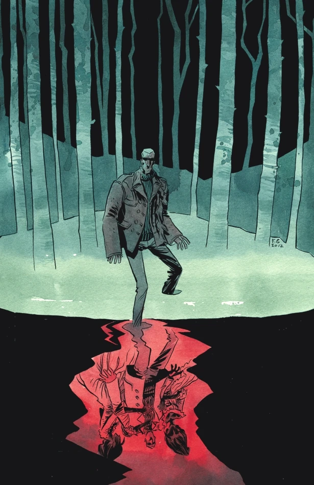
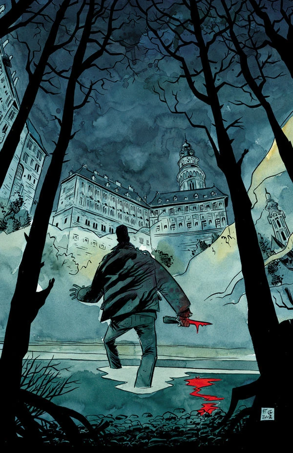
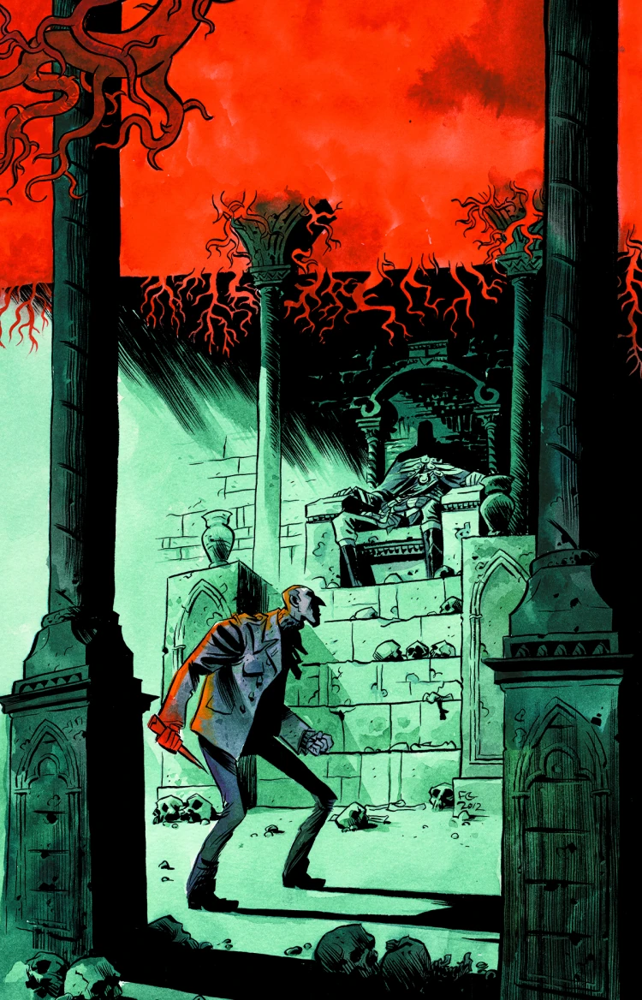
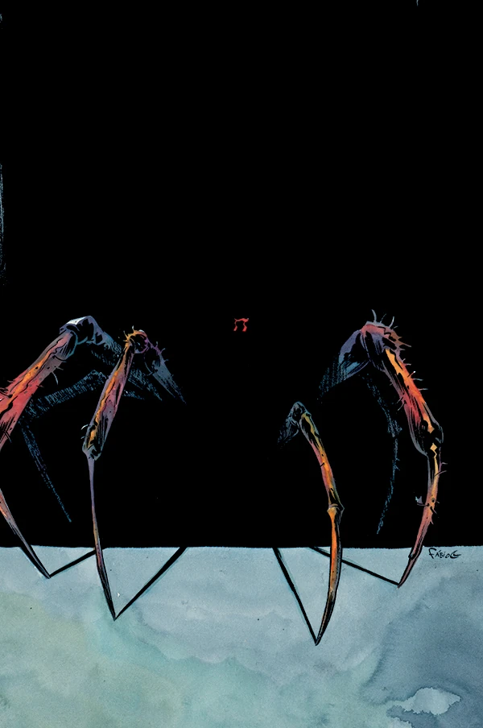
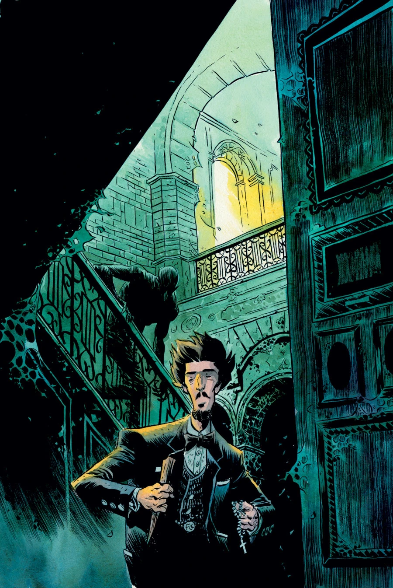

**Fábio Moon** 是巴西漫画编剧兼画师。他于 2009 年 7 月凭借[《B.P.R.D.：1947》（B.P.R.D.: 1947）](/entry/1947)首次登上《地狱男爵》宇宙。他是 [Gabriel Bá](/entry/Gabriel_B%C3%A1) 的孪生兄弟。

## 编剧

Fábio Moon 与 Gabriel Bá、Mike Mignola 共同编写了[《B.P.R.D.：吸血鬼》故事周期（B.P.R.D.: Vampire story cycle）](/entry/Vampire_%28story_cycle%29)。

- *[《B.P.R.D.：吸血鬼》（B.P.R.D.: Vampire）](/entry/Vampire_%28story%29)*（与 Mike Mignola 和 Gabriel Bá 合著）
- *[《B.P.R.D.：迷失者》（B.P.R.D.: Lost Ones）](/entry/Lost_Ones)*（与 Gabriel Bá 合著）

## 内页作画

- [《B.P.R.D.：1947》（B.P.R.D.: 1947）](/entry/1947)（与 Gabriel Bá 合作）
- [《B.P.R.D.：吸血鬼》（B.P.R.D.: Vampire）](/entry/Vampire_%28story%29)（与 Gabriel Bá 合作）
- *[《地狱男爵：棺材人》（Hellboy: The Coffin Man）](/entry/The_Coffin_Man)*
- *[《B.P.R.D.：迷失者》（B.P.R.D.: Lost Ones）](/entry/Lost_Ones)*（与 Gabriel Bá 合作）

## 封面作画

|《B.P.R.D.：吸血鬼》（B.P.R.D.: Vampire）第 1 期

|《B.P.R.D.：吸血鬼》（B.P.R.D.: Vampire）第 2 期

|《B.P.R.D.：吸血鬼》（B.P.R.D.: Vampire）第 3 期

|《B.P.R.D.：吸血鬼》（B.P.R.D.: Vampire）第 4 期

|《B.P.R.D.：吸血鬼》（B.P.R.D.: Vampire）\#

## 外部链接

- [**Wikipedia：** Fábio Moon](http://en.wikipedia.org/wiki/F%C3%A1bio_Moon)
- [**Comic Book DB：** Fábio Moon](http://www.comicbookdb.com/creator.php?ID=2930)
- [Fábio Moon 与 Gabriel Bá 的博客](http://www.fabioandgabriel.blogspot.com.au/)
