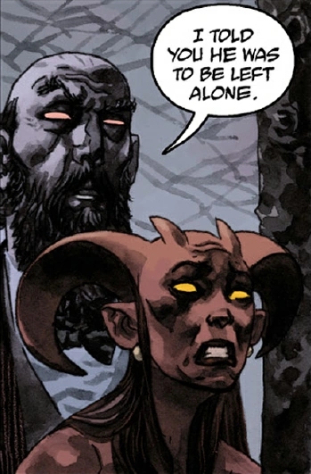

**加莫利（Gamori）**是[地狱男爵](/entry/Hellboy)睚眦必报的姐姐。1948年，她密谋杀害自己的弟弟，声称他最终会给她和她的舅父[阿斯塔罗斯](/entry/Astaroth)都带来毁灭。然而，谋害年幼地狱男爵的行动失败后，阿斯塔罗斯禁止加莫利在自己有生之年再碰地狱男爵或谋害他。

当地狱男爵最终死去、被送入[地狱](/entry/Hell)后，一连串事件导致阿斯塔罗斯以及加莫利的兄弟[卢斯克](/entry/Lusk)和[加蒙](/entry/Gamon)之死。加莫利把亲人之死归咎于地狱男爵，派[厄里倪厄斯](/entry/Erinyes)去惩罚他。然而厄里倪厄斯裁定地狱男爵无罪，反而因加莫利对她们撒谎而审判了她。加莫利被带走后，厄里倪厄斯向地狱男爵透露：等加莫利服刑期满获释，她将被引着沿一条血河前往[万魔殿](/entry/Pandemonium)。在那里，她会发现血河的源头，是[撒旦](/entry/Satan)被割开的喉咙。看到地狱之主已死，加莫利发了疯，她的尖叫使万魔殿崩塌成废墟，地狱的心脏就此永远毁灭。[1]

在《[不死的柯歇伊](/entry/Koshchei_the_Deathless_%28story%29)》中，柯歇伊向地狱男爵讲述的一段回忆里再次出现了她的身影。她面色苍白、骨瘦如柴，穿越地狱的沙漠寻找那条血河。（这印证了厄里倪厄斯在《[普鲁托之犬](/entry/The_Hounds_of_Pluto)》中对地狱男爵的预言。）

在 [*《柯歇伊在地狱》第1期*](/entry/Koshchei_in_Hell)的结尾，柯歇伊沉入陷落的万魔殿时再次遇见加莫利，她看起来依然病弱，却怀着一个信念斗志昂扬：地狱将以她为后重获新生。

## 画廊

|Gamori caught in the act of trying to kill Hellboy by Astaroth
## 资料来源

<references />

[1] *[地狱男爵在地狱：普鲁托之犬](/entry/The_Hounds_of_Pluto)*
