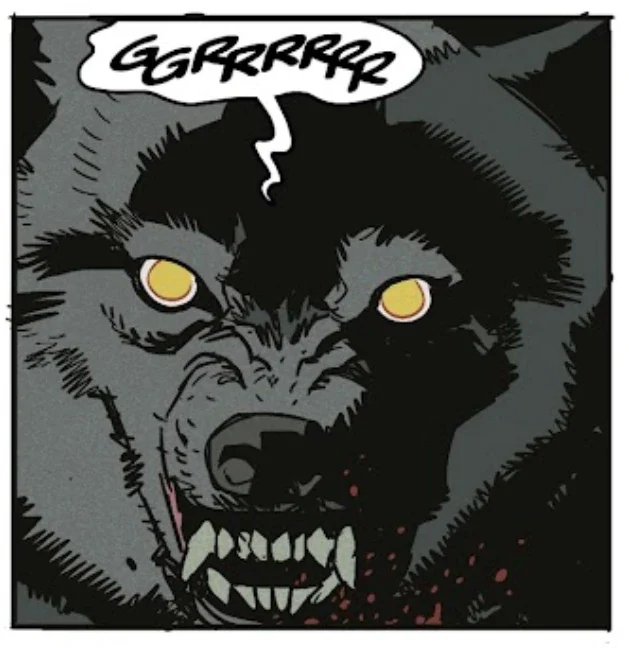

**加姆**（Garm），格尼帕海利尔之犬，是北欧神话中的一头怪物。

## 历史

在[索列姆](/entry/Thrym)——霜[巨人](/entry/Giant)之王——复活期间，它在人间（即米德加尔特，Midgard）重现并侍奉索列姆。值得一提的是，加姆当时看守着被巨人们杀害的村民的尸体，[地狱男爵](/entry/Hellboy_(character))、[亚伯·塞皮恩](/entry/Abe_Sapien)、[佩妮拉·艾克曼](/entry/Pernilla_Aickman)（Pernilla Aickman）和几名[矮人](/entry/Dwarf)在一座废弃的谷仓中发现了这头巨犬。这头怪物随即与闯入者们展开搏斗，加姆成功杀死了矮人中的一位——伊特理（Eitri）。

尽管它力量惊人，矮人们与手持[索尔](/entry/Thor)之锤[妙尔尼尔](/entry/Mjollnir)（Mjollnir）的地狱男爵最终还是合力将它杀死。

## 登场

- [《巨人之骨》](/entry/The_Bones_of_Giants_(comic_miniseries))
