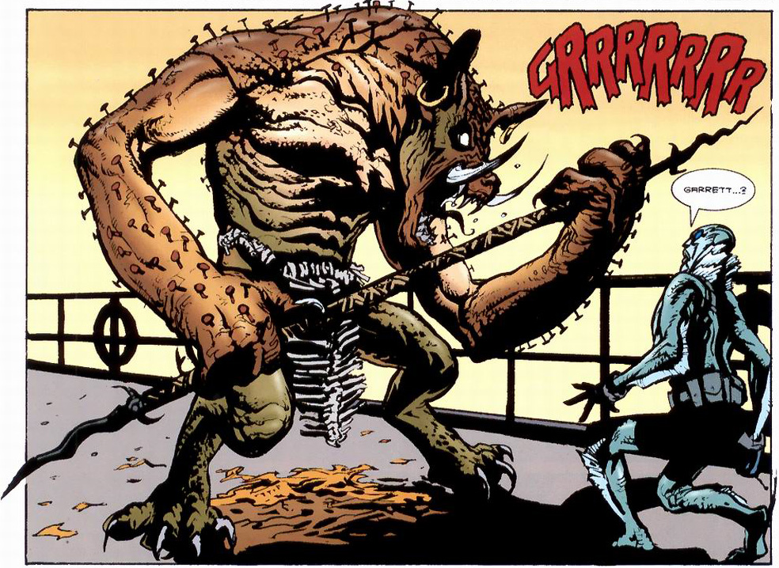

**加勒特·奥马塔（Garrett Omatta）**是受雇于[B.P.R.D.](/entry/B.P.R.D.)的一名灵媒。他首次登场于[亚伯·塞皮恩](/entry/Abe_Sapien)的单篇故事*[亡灵之鼓](/entry/Drums_of_the_Dead)*。

## 历史

加勒特·奥马塔本是一名神学院学生，遭遇了一场不明事故，陷入昏迷长达两年多。一天他奇迹般醒来，声称自己去过天堂，而天堂把他送回来，是为了引导迷途的亡灵回家。他还声称自己能看见死者的鬼魂在走廊里游荡。医生起初以为他遭受了某种精神创伤，直到加勒特平静地向其中一位医师转述了其亡父的口信，口信中包含除那位父亲外绝无可能有人知道的事情。医院联系了[B.P.R.D.](/entry/B.P.R.D.)，后者把加勒特列入他们的"强化天赋"名单。

 加勒特最早的任务之一，也可能是他的第一个任务，是与[亚伯·塞皮恩](/entry/Abe_Sapien)搭档。两人奉命调查一系列海上超自然入侵事件，这些事件一直困扰着一家非洲航运公司。加勒特与亚伯登上该公司的"北极星号"同行后，几乎立刻就开始产生奇怪的惴惴不安与恐惧，最后狂吐了亚伯一身，并变成一头怪物般的生物：形似野猪、手持长矛，手臂和背上长出钉子。短暂交手之后，亚伯提醒加勒特，天堂送他回人间是为了什么，他注定不该成为杀人凶手。这些话把加勒特的意识从压制它的力量中震醒，使他变回了正常的自己，只是这番折腾让他体力耗尽。

卧床恢复期间，加勒特向亚伯讲述了变形时的经历。他解释说，附在他身上的灵魂实际上是各种守护神灵的集合体，这些守护神灵与一直骚扰"北极星号"及其他横渡大西洋船只的众多鬼魂关系密切。他还提到，自己反复看到一个三角形的幻象。

利用这些线索，亚伯推断出袭击各艘船只的鬼魂是被俘奴隶的鬼魂——他们在运输途中死去，尸体被抛入海中，具体而言是殖民时代航运三角的"中段航程"中死去的人。附在加勒特身上的神灵是众多非洲文化所崇奉的守护神灵的合体，正对应着被掳走的众多奴隶。

完全康复后，加勒特目送亚伯潜入鬼魂活动的水下"热点"。亚伯在那里找到了死去非洲人的骸骨，把它们带上岸妥善安葬，终结了这场超自然威胁。

## 能力与本领

加勒特·奥马塔是一位天赋异禀的灵媒，能看见死者并与之交谈。他的能力要么是在事故中觉醒，要么是天堂所赐，但无论哪种情况，显然都是天堂选中他做了自己的代理人。

加勒特的能力有点像一把双刃剑，因为它们也会让他容易被强大的灵体入侵。
