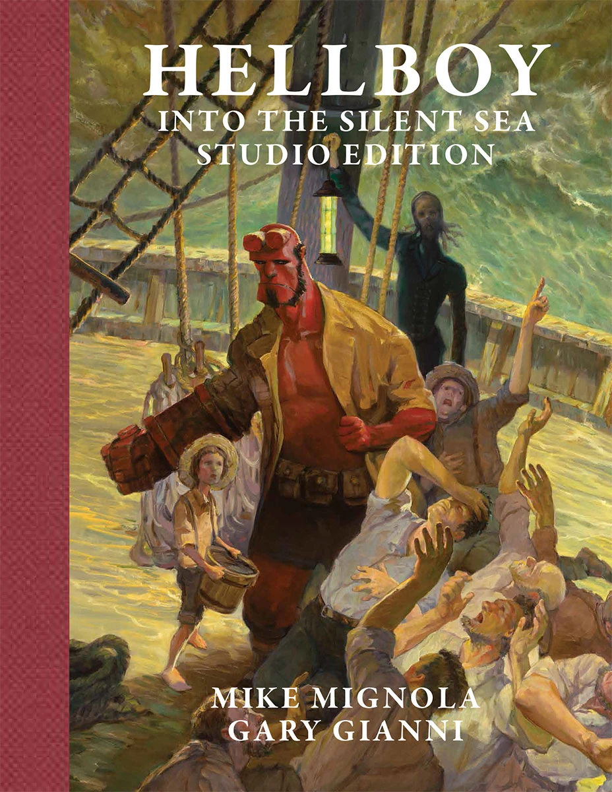

**Gary Gianni** 是一位编剧兼漫画画师。2017 年 4 月，他以原创图像小说[《地狱男爵：驶入寂静之海》（Hellboy: Into the Silent Sea）](/entry/Into_the_Silent_Sea)首次登场地狱男爵宇宙；不过他与*[《地狱男爵》（Hellboy）](/entry/Hellboy_%28series%29)*早有渊源——他的自有系列《怪物人》（The MonsterMen）常以后备故事的形式刊登在《地狱男爵》各期中。凭借在[《驶入寂静之海》（Into the Silent Sea）](/entry/Into_the_Silent_Sea)中的作画，他获得 2018 年 [Eisner 奖](https://www.comic-con.org/awards/eisner-awards-current-info)最佳铅笔稿/墨线画师或铅笔稿/墨线画师团队提名。

## 内页作画

- [《地狱男爵：驶入寂静之海》（Hellboy: Into the Silent Sea）](/entry/Into_the_Silent_Sea)

## 封面作画

工作室版（Studio Edition）](/entry/Into_the_Silent_Sea)

## 编剧

- [《地狱男爵：驶入寂静之海》（Hellboy: Into the Silent Sea）](/entry/Into_the_Silent_Sea)

## 《怪物人》（The MonsterMen）

虽然《怪物人》（The MonsterMen，亦称 *Corpus Monstrum*）漫画系列的故事并不发生在地狱男爵宇宙中，但其出版一直与《地狱男爵》故事关系密切。其中数篇曾以后备故事形式刊登在《地狱男爵》各期中：

- 《如坟墓般寂静》（Silent as the Grave）（收录于[《地狱男爵：唤醒恶魔》第 1–5 期（Hellboy: Wake the Devil #1–5）](/entry/Wake_the_Devil)）
- 《降 B 调尸检》（Autopsy in B-Flat）（收录于[《地狱男爵：近乎巨像》第 1–2 期（Hellboy: Almost Colossus #1–2）](/entry/Almost_Colossus)）
- 《给恶人的礼物》（A Gift for the Wicked）（收录于[《地狱男爵圣诞特刊》（Hellboy Christmas Special）](/entry/Hellboy_Christmas_Special)）
- 《怪物人：骷髅与雪人》（The MonsterMen: The Skull and the Snowman）（与 [Mike Mignola](/entry/Mike_Mignola) 的[《再见，Tod 先生》（Goodbye Mister Tod）](/entry/Goodbye_Mister_Tod)一同刊载）
- 《哦，我们脚下的罪人！》（O Sinner Beneath Us!）（收录于[《地狱男爵：狂猎》第 5–6 期（Hellboy: The Wild Hunt #5–6）](/entry/The_Wild_Hunt)）

## 外部链接

- [**Comic Book DB：** Gary Gianni](http://www.comicbookdb.com/creator.php?ID=681)
