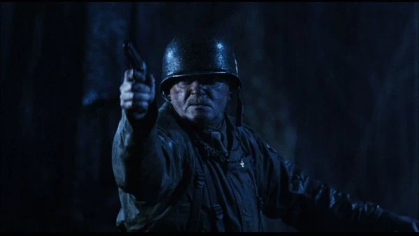

**乔治·惠特曼（George Whitman）**中士是第二次世界大战期间的一名美国军官。

## 历史

1944 年，乔治·惠特曼策划召集了三位超自然专家：[特雷佛·布鲁姆](/entry/Trevor_Bruttenholm)、[马尔科姆·弗罗斯特](/entry/Malcolm_Frost)和灵媒[辛西娅·伊登-琼斯夫人](/entry/Lady_Cynthia_Eden-Jones)。惠特曼与这些专家一起亲历了被称为"[地狱男爵事件](/entry/Seed_of_Destruction)"的事件。在场的还有抗击纳粹的超级英雄[自由火炬](/entry/The_Torch_of_Liberty)；让惠特曼意外的是，这位英雄不像公开露面时那样，只是和他的手下们悠然喝着咖啡。

## 其他媒体

 Agnus Maclnnes 饰演乔治·惠特曼

- 乔治·惠特曼登场于*[《地狱男爵》](/entry/Hellboy_%28film%29)*，由 Agnus Maclnnes 饰演；他是一名陆军中士，率领军方突袭特隆汉姆修道院废墟。他的任务是破坏拉斯普廷的仪式、击败纳粹部队。
- 在地狱男爵动画系列中，惠特曼登场于*[《地狱男爵：风暴之剑》](/entry/Hellboy__Sword_of_Storms)*。

[pt-br:George Whitman](/entry/pt-br%3AGeorge_Whitman)
