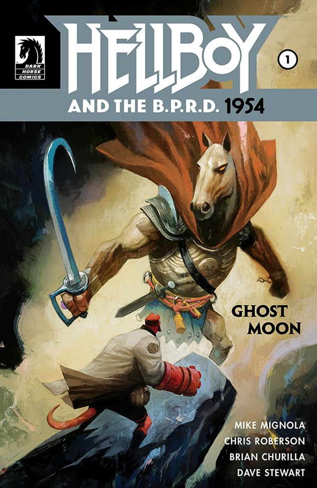
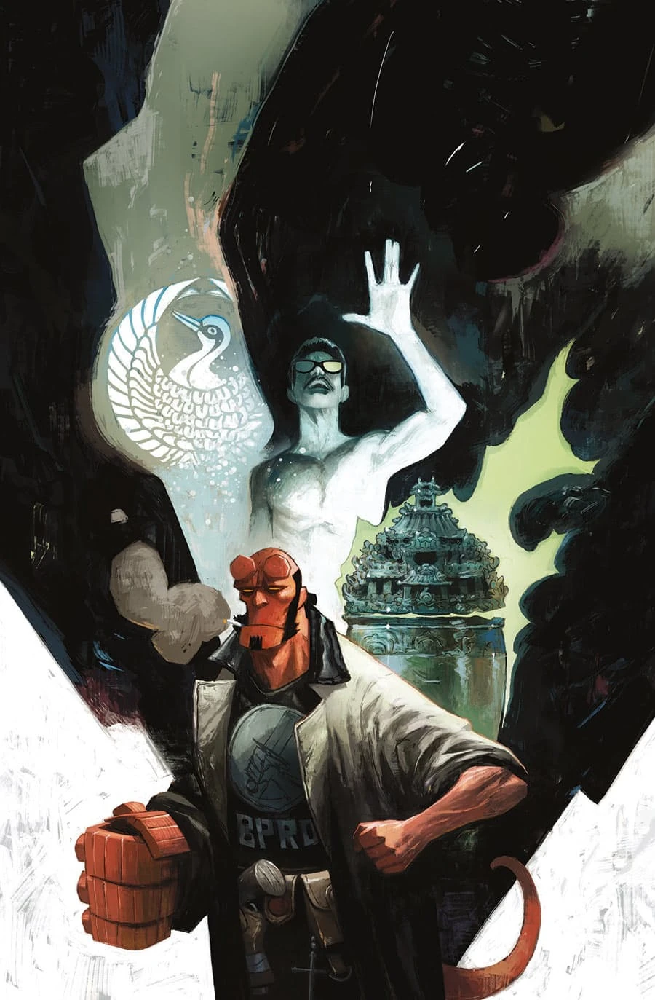

《**鬼月**》（Ghost Moon）是《[Hellboy and the B.P.R.D.](/entry/Hellboy_and_the_B.P.R.D.)：1954》的一个篇章，由 Mike Mignola 与 Chris Roberson 编剧、Brian Churilla 作画。

## 剧情简介

### 第一部

布鲁滕霍尔姆的一位老友上门请托，地狱男爵于是在香港九龙城寨追猎古老的中国妖魔。

### 第二部

地狱男爵与一对中国妖魔正面交锋；与此同时，苏珊凭借通灵能力追查这场香港超自然骚乱的源头。

## 《辛西娅夫人究竟是谁？》

这篇两页后备短篇由 [Matt Strackbein](/entry/Matt_Strackbein) 自编自画，刊载于 *Hellboy and the B.P.R.D.: 1954—Ghost Moon* \#2。它回顾了[辛西娅·伊登-琼斯夫人](/entry/Cynthia_Eden-Jones)（Lady Cynthia Eden-Jones）的来历，未收录于任何合订本。

## 画廊

封面由 [Mike Huddleston](/entry/Mike_Huddleston) 绘制。

|《1954: Ghost Moon》\#1

|《1954: Ghost Moon》\#2
