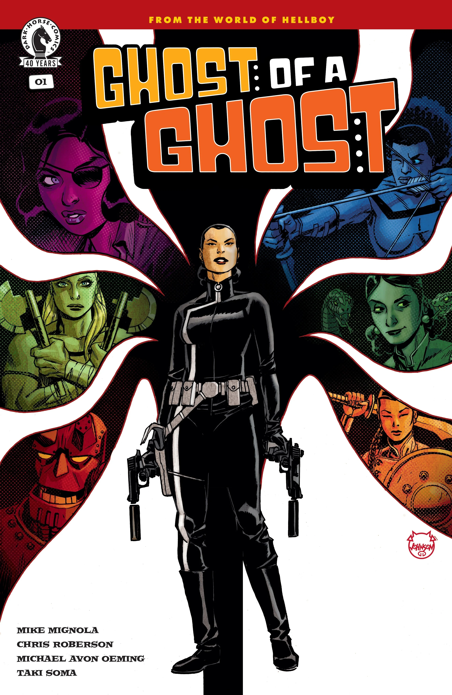

*本条目为小作品，你可以帮助扩充地狱男爵维基。*

***《幽灵之幽灵》（Ghost of a Ghost）***是由 Mike Mignola 与 Chris Roberson 编剧、Michael Avon Oeming 作画的一部四期限定迷你系列。它接续 *[《巨型机器人地狱男爵》](/entry/Giant_Robot_Hellboy_(story))* 与 *[《巨型机器人地狱男爵归来》](/entry/Giant_Robot_Hellboy_Returns)* 的事件，聚焦于简探员（Agent Jian）。

## 出版历史

据 Roberson 所说：

> 我参与过的许多地狱男爵宇宙故事，都始于一次交谈——要么是我有了点子的萌芽，要么是 Mignola 有个想深入探索的、尚未成形的想法。有些情况下，最初的灵感主要来自我，另一些时候则主要来自 Mignola；但这一部从一开始就是个完全成形的 Mike Mignola 式构想。几年前在一次漫展上，他和我、Mike Oeming 以及 Taki Soma 坐在一起，向我们讲述了他对这个在 *《巨型机器人地狱男爵》* 中引入的角色的设想，随后我们便着手把它实现出来。而从最一开始，我们对 Jian 这个角色及其故事的构想就与 Mignola 的设想完全合拍：一个发生在时髦摇摆的六十年代、穿梭世界各地的谍战科幻惊险故事，但其处理方式是我们此前在地狱男爵宇宙的故事中从未真正见过的。

## 剧情简介

### 第一部分

在《巨型机器人地狱男爵》中接触到恩克拉迪石（enkeladite）之后，超级间谍简探员将她新获得的能力用于一个神秘间谍组织，该组织受托调查恩克拉迪石的储存情况、防止这种强大物质落入坏人之手——但究竟谁的手才算“坏人”，比她原以为的更难判断。

## 画廊

主封面作者：Michael Avon Oeming

第 \#1 期

|Issue #1 by Dave Johnson
### 变体封面

第 \#1 期  
作者：Dave Johnson
