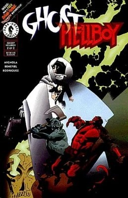
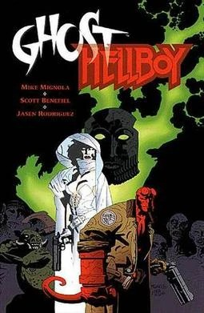

***《幽灵／地狱男爵》（Ghost/Hellboy）*** 是一部非正史的两期迷你连载，编剧 Mike Mignola，铅笔稿 Scott Benefiel，墨线 Jason Rodriguez，由[黑马漫画](/entry/Dark_Horse_Comics)出版。故事讲述地狱男爵与幽灵的跨界联动，二者均为黑马漫画旗下角色。

## 剧情简介

### 第一部分

[地狱男爵](/entry/Hellboy_(character))前往阿卡迪亚追捕幽灵，但局势发生逆转：幽灵收到一个自称"和平者（Peace）"之人的幻象，对方告诉她地狱男爵是她的敌人，而将她从苦难中解脱的关键就是[毁灭之右手](/entry/Right_Hand_of_Doom)。

### 第二部分

故事中，幽灵在一个神秘位面把地狱男爵交给了自称和平者的存在，但当他显露真身——一直对她撒谎的毁灭者阿拉尔（Alal the Destroyer）——时，这位复仇的亡灵与世上最伟大的超自然调查员必须联手，阻止迫在眉睫的末日。

## 合订本

除被收入 [《面具与怪物》](/entry/Masks_and_Monsters) 平装合订本之外，还推出了一本 *《幽灵／地狱男爵特刊》*，收录了两期连载并附有一小段速写本内容。

## 封面画廊

第 \#1 期

第 \#2 期

特刊

|第 #2 期

|Special
## 外部链接

- DarkHorse.com 上的《幽灵／地狱男爵》第1期产品页
- DarkHorse.com 上的《幽灵／地狱男爵》第2期产品页
- DarkHorse.com 上的《幽灵／地狱男爵特刊》产品页
