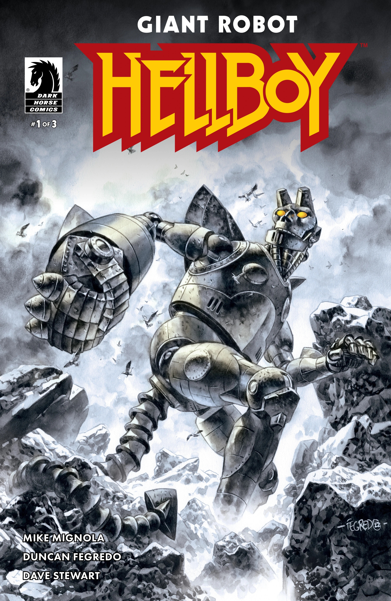
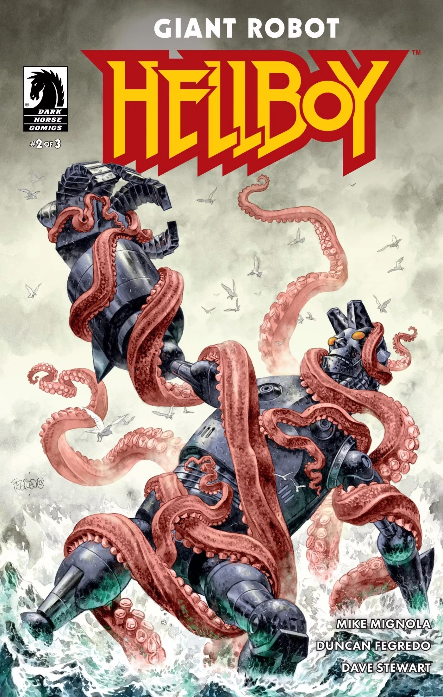
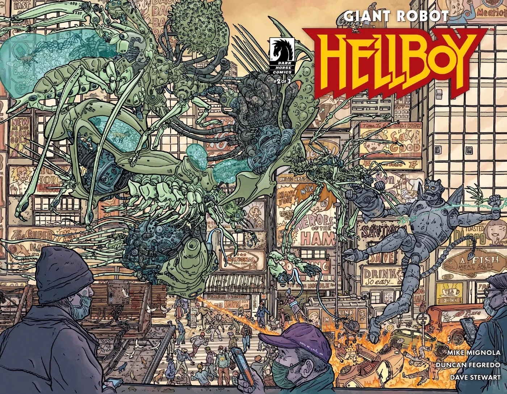
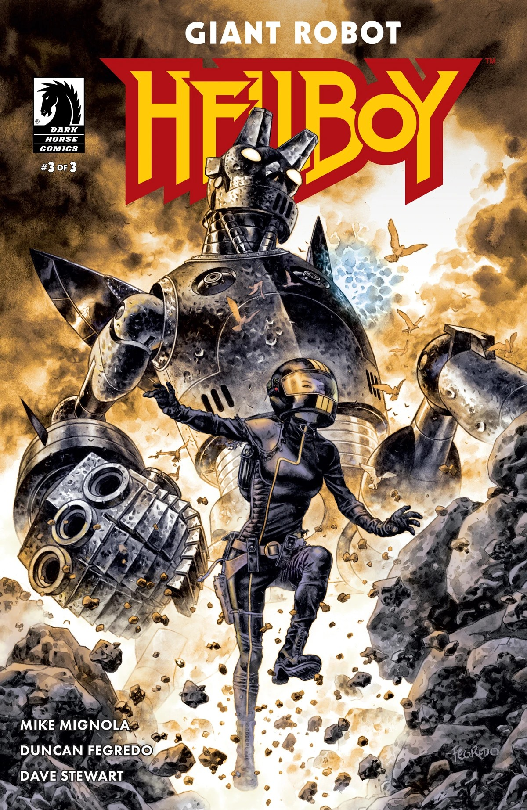
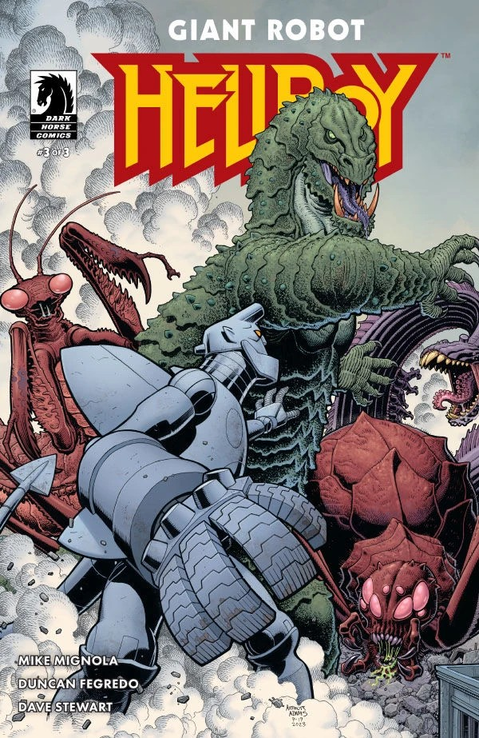

*本条目为小作品，你可以帮助扩充地狱男爵维基。*

***《巨型机器人地狱男爵》（Giant Robot Hellboy，故事）***是由 Mike Mignola 编剧、Duncan Fegredo 作画的一部三期限定迷你系列。

## 出版历史

创作 *《巨型机器人地狱男爵》* 的构想，Mike Mignola 已酝酿许久，但他一直认为它“傻得没法真的做出来”。后来，在新冠疫情的第一年，Mignola 开始为慈善活动绘制以巨型机器人地狱男爵为主角的速写，结果他非常喜欢这些速写，这个点子便开始“显得像是真能做成的东西”。

该项目的灵感来自听画师 Geof Darrow 和 Art Adams 聊怪兽电影（Kaiju）。Mignola 起初希望由他们中的一位来绘制这部漫画，但二人都忙于其他项目，于是 Mignola 转而找到 Duncan Fegredo。Mignola 心想，如果 Fegredo 也觉得这个项目太傻，那这事就算了。

续作 *[《巨型机器人地狱男爵归来》](/entry/Giant_Robot_Hellboy_Returns)* 于 2026 年出版。

## 剧情简介

### 第一部分

地狱男爵遭到绑架，被连接到一台巨大的机甲地狱男爵上，派往一座神秘遥远的岛屿执行任务，但这座岛屿恐怕会还以颜色、奋起抵抗。

### 第二部分

当地狱男爵的机器人分身正在遥远岛屿上与巨型怪物搏斗时，主持任务的科学家们却因实验室里的事态彻底失控而手忙脚乱。

### 第三部分

巨型机器人地狱男爵暴走反叛，令岛屿与实验室双双陷入爆炸般的混乱！

## 画廊

第 \#1 期  
封面：Duncan Fegredo

第 \#1 期  
变体封面：Mike Mignola  
上色：Dave Stewart

第 \#2 期  
封面：Duncan Fegredo

第 \#2 期  
变体封面：Geof Darrow  
上色：Dave Stewart

第 \#3 期  
封面：Duncan Fegredo

第 \#3 期  
变体封面：Art Adams  
上色：Dave Stewart

|Issue #1 cover by Duncan Fegredo

|Issue #2 cover by Duncan Fegredo

|Issue #2 variant cover by Geof Darrow colors by Dave Stewart

|Issue #3 cover by Duncan Fegredo

|Issue #3 variant cover by Art Adams colors by Dave Stewart
