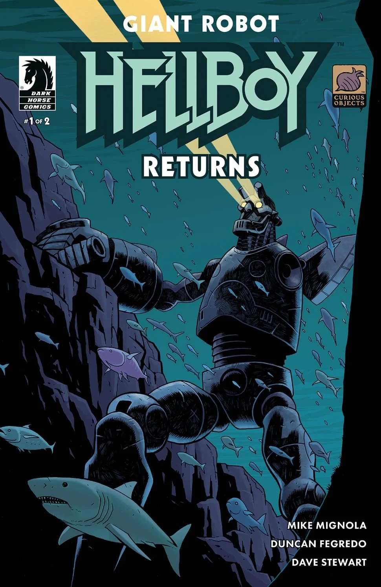
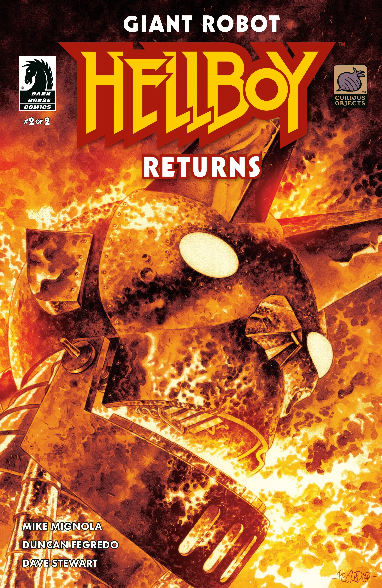
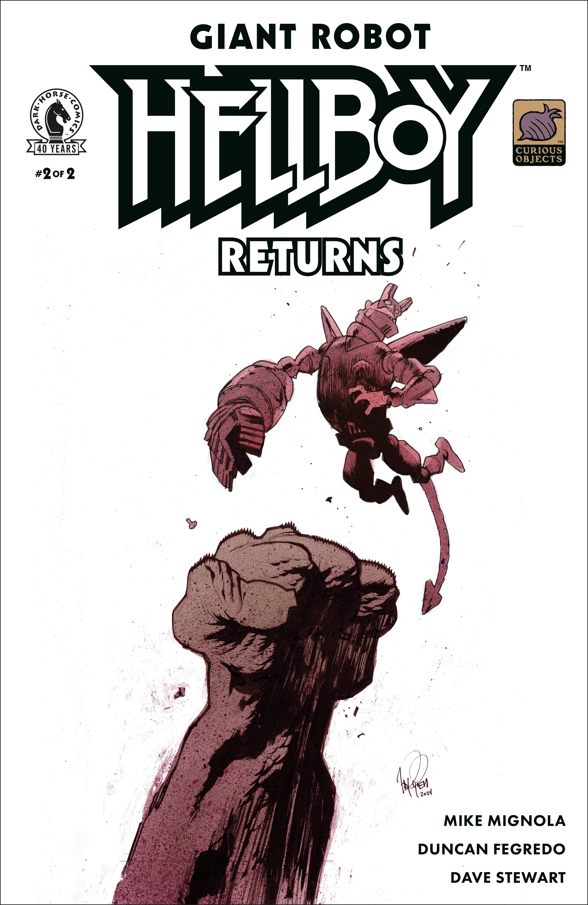

*本条目为小作品，你可以帮助扩充地狱男爵维基。*

***《巨型机器人地狱男爵归来》（Giant Robot Hellboy Returns）***是由 Mike Mignola 编剧、Duncan Fegredo 作画的一部双期限定迷你系列，是 2023 年 *[《巨型机器人地狱男爵》](/entry/Giant_Robot_Hellboy_(story))* 的续作。

## 剧情简介

### 第一部分

地狱男爵的机器人分身回来了——而且他并非孤身一人！巨型机器人地狱男爵失踪后，科学家们在深海中四处搜寻他的踪迹，却发现了超出预期的东西：一道跨维度传送门眼看就要把他们吸进去——或是把来历不明的怪物放出来。

### 第二部分

潜艇仍在搜寻巨型机器人地狱男爵，当这片未经勘测的水域将他们引向一个全然未知而恐怖的所在时，潜艇与水上实验室之间失去了联系。

## 画廊

第 \#1 期  
封面：Duncan Fegredo

第 \#1 期  
变体封面：Ben Stenbeck

第 \#2 期  
封面：Duncan Fegredo

第 \#2 期  
变体封面：James Harren  
上色：Dave Stewart

|Issue #1 variant cover by Ben Stenbeck

|Issue #2 cover by Duncan Fegredo

|Issue #2 variant cover by James Harren colors by Dave Stewart
