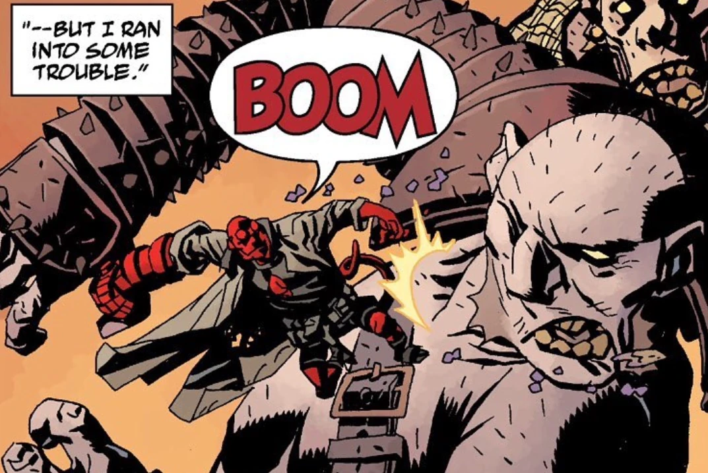

**巨人（Giants）**是一个曾行走于地球上的大型人形种族。

## 背景

据[奥西里斯俱乐部](/entry/Osiris_Club)所述，英格兰曾是巨人的领地，但他们的故土上遍布着同类的坟墓。英格兰最后一位在世的巨人是黑尔（Hale），他被韦尔登（Weldon）所杀。奇怪的是，巨人死后有时会从坟墓中复生。单个的不死巨人几乎不会引起秘术组织的关注，然而当一群巨人同时复活时，人们便会组织狂猎（Wild Hunt）来对付他们。

曾有一个巨大的人形生物看守着[妮缪](/entry/Nimue)的牢狱，并侍奉众女巫。妮缪获释后，他因惧怕即将到来的时代而爬进了深坑。他究竟是不是巨人尚不清楚，但奥西里斯俱乐部的说法也未必总是正确。
