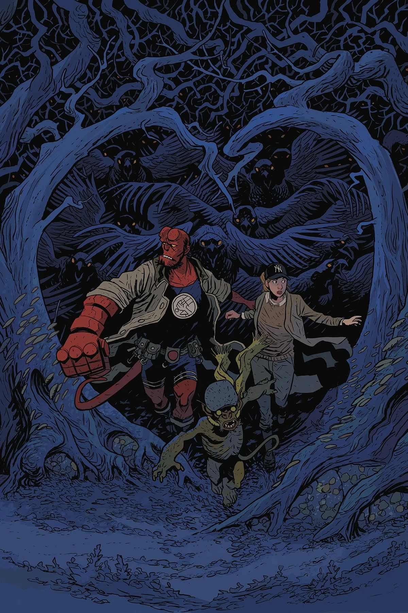

***《哥布林之夜》***是 *[《恋爱中的地狱男爵》](/entry/Hellboy_in_Love)* 的一个两期故事弧，由 [迈克·米格诺拉](/entry/Mike_Mignola) 与 [Christopher Golden](/entry/Christopher_Golden) 编剧，[Matt Smith](/entry/Matt_Smith) 绘制。这是 [阿纳斯塔西娅·布兰斯菲尔德](/entry/Anastasia_Bransfield) 在漫画中的首次登场。

## 剧情简介

### 第一部分

[地狱男爵](/entry/Hellboy_(character))被派去巡逻一条火车线路，[哥布林](/entry/Goblin)一直在那里偷窃乘客的财物。它们最近的受害者[阿纳斯塔西娅](/entry/Anastasia_Bransfield)是一名研究者兼考古学家，正将一批珍贵文物运往博物馆，她可不打算不做任何抵抗就放手！她没有留在后方，而是与地狱男爵组队，穿过英国乡间追逐这些手脚不干净的妖精，一路追进了……一场本地朋克演出？

### 第二部分

在这场横跨英国乡间的欢乐追逐中，地狱男爵和阿纳斯塔西娅从朋克演出一路追到一场神秘学拍卖会，为寻回阿纳斯塔西娅被盗的文物而紧追哥布林不放。

## 画廊

全部封面由 Matt Smith 绘制。

*《恋爱中的地狱男爵》* \#1  
*《哥布林之夜》*（第一部分）

*《恋爱中的地狱男爵》* \#2  
*《哥布林之夜》*（第二部分）

|Hellboy in Love #2 Goblin Night (Part 2)
