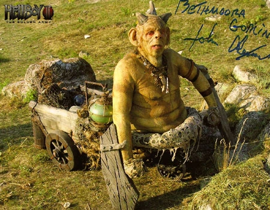

*关于贝斯莫兰的哥布林铁匠，见[哥布林（贝斯莫兰）](/entry/Goblin_Master_Blacksmith_(Bethmoran))。*

**哥布林（Goblins）**是一个传说中的种族，生有绿色皮肤和角。

## 概述

曾有一只[无名哥布林](/entry/Goblin_Master_Blacksmith_(Bethmoran))缔造了[黄金军团](/entry/The_Golden_Army)，受[巴罗尔](/entry/Balor)王之命而造，目的是保护魔法生物免受[人类](/entry/Human)侵害。

到了 21 世纪，还是这只哥布林同意带上[地狱男爵](/entry/Hellboy_(character))、丽兹·舍曼、[亚伯·塞皮恩](/entry/Abraham_Sapien)和[约翰·克劳斯](/entry/Johann_Kraus)，先是去面见[死亡天使](/entry/Angel_of_Death)，之后再前往黄金军团本身。

## 知名哥布林

- [贝斯莫兰哥布林](/entry/Goblin_Master_Blacksmith_(Bethmoran))
- [铁鞋](/entry/Iron_Shoes_(character))

## 登场

- [*《地狱男爵 2：黄金军团》*](/entry/Hellboy_II__The_Golden_Army)
- [*《铁鞋》*](/entry/The_Iron_Shoes)
