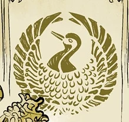

 **金鹤会（Golden Crane Society）**是一个扎根于中国的秘密秘术社团。

## 历史

### [鬼月](/entry/Ghost_Moon)

自中古王国时代起，金鹤会便世代守护着中国，抵御来自另一个世界的威胁。然而 1954 年，该组织遭到共产党的迫害——当时许多秘密社团和秘术团体都为其所不容。中国的主席一直在将各种力量之物收集到成都的一处秘密设施中。金鹤会派出自己的一名成员[鲍志（Bao Zhi）](/entry/Bao_Zhi)，让他把[魂瓶](/entry/Hunping)带出共产党的势力范围、送往九龙城寨；但在运送途中，他遭到 S.D.I. 叛变探员[托马斯·莱姆斯（Thomas Rhymes）](/entry/Thomas_Rhymes)的袭击，神器被偷走。后来揭示，[苏珊·项](/entry/Susan_Xiang)的家族世代都是金鹤会成员。鲍志临终前把几句话传给了她，使她重新审视自己的过去，并促使她着手解决一些家族事务。

## 成员

- *鲍志（已故）*
