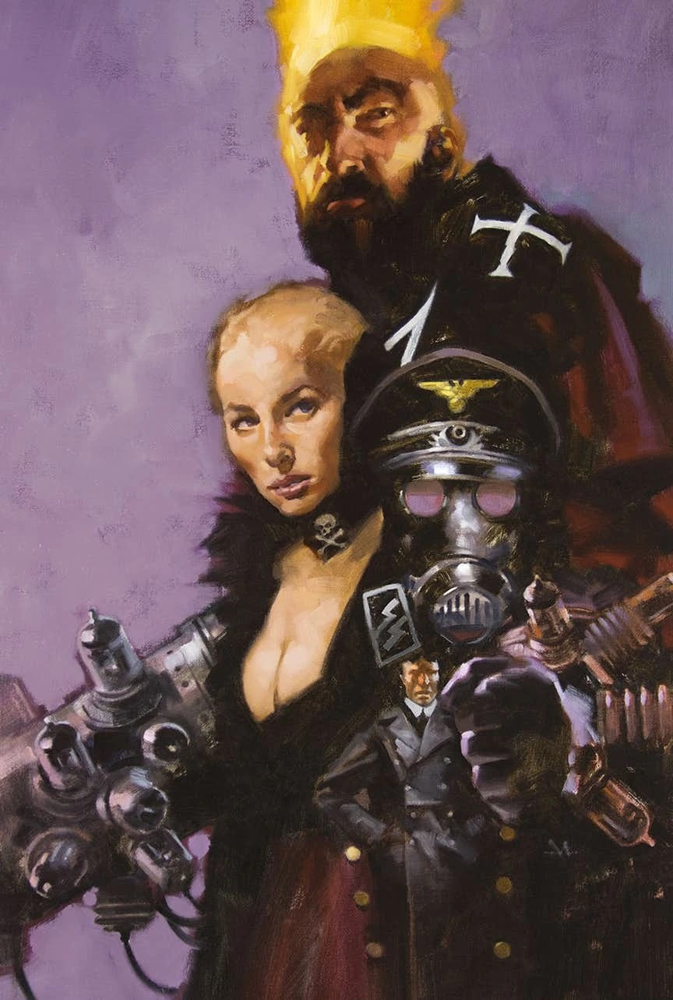

*本条目是小作品。你可以帮助扩充地狱男爵维基。*

**Gregory Manchess** 是一位美国插画家与艺术家，以其油画作品最为知名。

## 封面画作

[《大螯虾强生：撒旦工厂》](/entry/Lobster_Johnson__The_Satan_Factory)

[《拉斯普廷：龙之音》](/entry/Rasputin__The_Voice_of_the_Dragon) 第 2 期变体封面

## 外部链接

- **维基百科：** Gregory Manchess
- www.manchess.com

## 画廊

|Rasputin: The Voice of the Dragon #2 Variant
