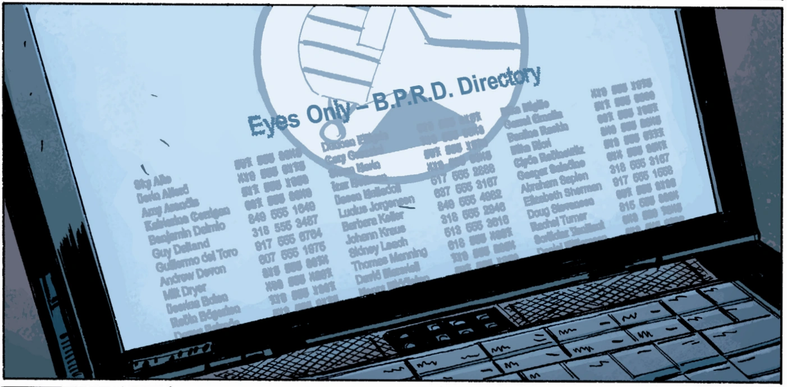

**Guillermo del Toro Gómez** 是墨西哥电影人、作家、演员兼化妆师。

他是真人版《[Hellboy](/entry/Hellboy_%282004_film%29)》（2004）电影及其续集《[Hellboy II: The Golden Army](/entry/Hellboy_II__The_Golden_Army)》（2008）的编剧兼导演。他还担任 [Hellboy Animated](/entry/Hellboy_Animated) 动画电影 [Sword of Storms](/entry/Hellboy__Sword_of_Storms)（2006）与 [Blood and Iron](/entry/Hellboy__Blood_and_Iron)（2007）的创意制片人，并为电子游戏 [The Science of Evil](/entry/Hellboy__The_Science_of_Evil)（2008）担任编剧兼配音导演。

他为《[Conqueror Worm](/entry/Conqueror_Worm_%28story%29)》平装本合集撰写了序言，还与 Matthew Robbins 合写了短篇小说「Tasty Teeth」，收录于 [Odder Jobs](/entry/Hellboy__Odder_Jobs) 散文选集。

他在漫画系列中也被提及过。根据漫画的说法，曾有传言称他有意重拍「[Lobster Johnson](/entry/The_Lobster) and the Ring of Death」，那是一部 1957 年的低成本[*Lucha libre* 电影](/entry/wikipedia%3A_Luchador_films)，由 [Adolfo Flores](/entry/Adolfo_Flores) 主演。

## 轶事

Guillermo del Toro 在 B.P.R.D. 漫画 [Killing Ground](/entry/Killing_Ground) 的 B.P.R.D. 名录里客串了一把：

Bprd_directory.png

（最左边一列，从上往下第 7 个名字）。

## 链接

Wikipedia 上的 [Guillermo del Toro](/entry/wikipedia%3AGuillermo_del_Toro)
