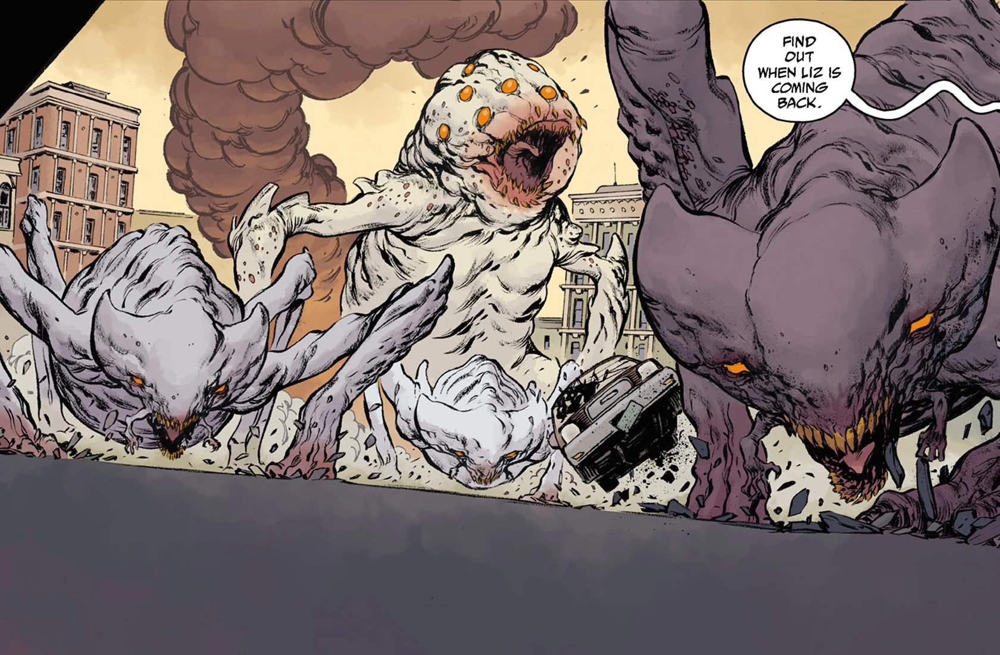

**锤头兽**(Hammerheads)是末日降临之后崛起的最主要物种之一。它们首次出现于休斯敦附近的一次火山喷发之后，那很可能是一只未具名的奥格德鲁·赫姆苏醒所致。

## 生理特征

锤头兽是体型庞大的伪六足动物（它们的后腿在膝盖以上分叉成两条独立的肢体），面部还伸出一对小得多的、类似手臂的附肢。它们宽阔的面孔上长着一双锐利的橙色眼睛（不过有些个体长有四只甚至更多的眼睛），还有一对鼻孔。它们的全身都覆有骨白色的外骨骼，足以无视大多数轻武器火力，但对爆炸物和大口径穿甲弹则较为脆弱。尽管装甲厚重，它们的口腔内侧却有一个可资利用的弱点：朝那里开枪几乎可以当场将其击杀，但要做到这一点，射手必须冒险极度接近这头怪物。该物种还表现出惊人的耐受力，无论是在俄罗斯苔原还是亚利桑那州的沙漠，它们都能同样自在地生存。

除了顽强的生命力之外，锤头兽还表现出惊人的力量，一爪就能把大多数汽车拍得翻滚甚至飞出。它们也有足够的速度与耐力，一旦被激怒，可以追着机动车连续奔跑数英里。这些特性在不同个体间存在一定差异，因为它们的体型跨度极大：有些个体大致只有现代犀牛大小，另一些则大到能在掌心碾碎汽车。较小的个体究竟只是大型个体的幼年形态，还是属于不同的品种，目前尚不清楚。

虽然谈不上拥有完整的智慧，锤头兽仍是相当聪明的生物，能够进行高度协作的群体围猎，还曾被目击以活人作饵，为毫无防备的猎物设下陷阱。尽管如此，它们终究受本能驱使——一旦有新的食物出现（比如一只死去的锤头兽），它们就可能中断追逐。

## 分布

凭借异常迅速的繁殖速度以及连混凝土都能掘穿的挖掘能力，自末日爆发以来，锤头兽已在北美迅速蔓延，远在班加罗尔、巴黎和多约涅克(Doyonek)等地也有少量分布并造成破坏。日本还存在一个独特的亚种，它们没有西方品种那种面部附肢，但全身长有许多鳍状突起。

除了肆虐现代地球的虫灾之外，有迹象表明锤头兽也已蔓延到其他星球，是[奥格德鲁·赫姆](/entry/Ogdru_Hem)之灾所催生的常见生物。在[《人间地狱》(故事篇章)](/entry/Hell_on_Earth_(story_cycle))的事件之后，一架无人机观察到一只锤头兽从一具干枯的奥格德鲁·赫姆尸体内的大巢穴中衔走一枚卵，这为上述观点提供了一定依据。

## 画廊​​​​​​​

一只锤头兽展示其惊人的力量。

锤头兽们分食一只倒下的同类。

特工霍华德与一只四眼品种交战。

调查局特工与日本锤头兽交战。

访客回忆自己星球的陷落。

《B.P.R.D.：人间地狱——恶魔引擎》第 \#2 期封面上的一只锤头兽

《B.P.R.D.：人间地狱——恶魔引擎》第 \#3 期封面上的一只锤头兽
