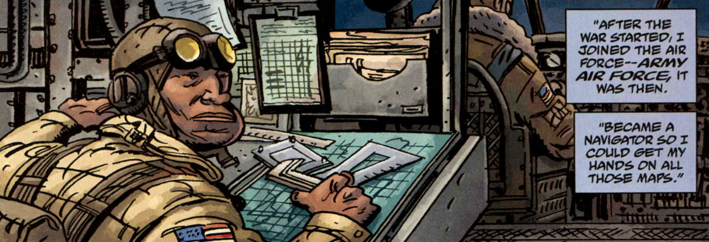
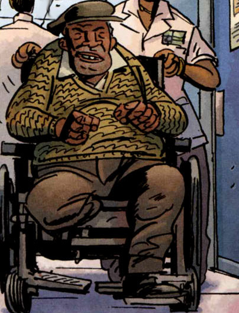

**哈罗德·“哈里”·麦克泰尔（Harold "Harry" McTell）**是[大螯虾](/entry/The_Lobster)团队的成员，担任机械师，也是一位天才制图师。

## 历史

### 早年

哈里·麦克泰尔究竟是如何与大螯虾扯上关系的，具体经过尚不得而知，但他在20世纪30年代初被招募进大螯虾那支义警打击犯罪团队。他至少有过一些接触超自然事物的经验：他的祖父是一名翁根（houngan，伏都教祭司），教过他伏都教的知识。

按时间顺序，他先是在[辛西雅·泰南](/entry/Cindy_Tynan)向当地人打听大螯虾的情报却一无所获时，给了她一番善意的忠告；不久后便揭示他其实是大螯虾团队的一员，一身惊人的蛮力和高超的机械技能派上了大用场。大螯虾藏身处见到的那些车辆很可能就是他造的，而且他不止一次靠打倒敌人救了老板的命。

当大螯虾试图解开[姆姆南·萨](/entry/Memnan_Saa)之谜时，他的下场只比朋友们稍微好一点。萨始终抢先团队一步，而团队成员大多离奇死去。当只剩下他和大螯虾两人时，大螯虾放弃了搜寻，两人分道扬镳。

### 军旅生涯

 哈里·麦克泰尔很快加入了中华民国空军，帮助中国抗击日本。第二次世界大战结束后，麦克泰尔辗转进入美国空军，成为一名领航员，执行侦察任务，后来又在朝鲜战争期间在中国执行过一些秘密行动。尽管这是那些年里他的主要工作，他却始终没有放弃寻找姆姆南·萨，也没有放弃再听到大螯虾的消息——自从[亨特城堡](/entry/Hunte_Castle)事件之后，尽管亲眼见证过大螯虾战胜过的一切，他还是接受了自己认识的那个人已死的事实。这份执着让他付出了右膝以下一条腿的代价，但后来的事实表明，他的努力没有白费。

### 晚年

 上了年纪之后，哈里住在一家养老院里，一位满脸怀疑的护士（从表情看已不是第一次）又在听他讲述当年与大螯虾一起冒险的老故事。然而，[B.P.R.D.](/entry/B.P.R.D.)探员[凯特·考瑞根](/entry/Kate_Corrigan)因大螯虾和姆姆南·萨的事来找他，于是她的机构一行人移驾到他的公寓。为 B.P.R.D. 补上知识中的空白，似乎让他终于有机会面对一群愿意倾听、不把他的絮叨当胡话的听众。作为答谢，他送给凯特一张地图，上面标出了姆姆南·萨秘密基地的大致位置。

## 能力与本领

哈里·麦克泰尔壮年时膂力过人，待人接物相当有一套，还略有搞阴谋诡计的天赋，为他搞到了不少情报。他还担任大螯虾团队的首席机械师，在此期间积累了大量超自然方面的知识。他也是团队的第二号司机。他首选的武器是自己的拳头——可以说就近在手边；不过他也会开枪。

### 车辆

哈里·麦克泰尔驾驶、制造、修理并拥有过各式各样的车辆：

- 一辆拖车
- 大螯虾的双翼飞机
- [马西莫](/entry/Massimo)的出租车
- 一辆黑帮年代的汽车
- 停泊在大螯虾藏身处海港入口的船只
- 他的轮椅
- 几架美军飞机

## 趣闻

- 与大螯虾分道扬镳之后，哈里再也没有见过或听到过他的消息，尽管大螯虾死后的灵魂仍十分活跃。
- 哈里敬重地把大螯虾称为“老板”。
- 哈里与[马西莫](/entry/Massimo)是朋友，当[黑焰](/entry/The_Black_Flame_%28character%29)杀死马西莫并瞬移离开时，他相当难以接受。
- 据说，团队用来对付黑焰的一门老式大炮，翻修工作哈里也有一份功劳。

## 登场

- *[钢铁普罗米修斯](/entry/The_Iron_Prometheus)*
- *[黑色女神](/entry/The_Black_Goddess)*
- *[烈焰之掌](/entry/The_Burning_Hand)*
- *[一缕莲香](/entry/A_Scent_of_Lotus)*
- *[搞掂鳌虾！](/entry/%E6%90%9E%E6%8E%82%E9%B3%8C%E8%99%BE))*
- *[被遗忘者](/entry/The_Forgotten_Man)*
- *[中城金属怪物](/entry/Metal_Monsters_of_Midtown)*
- *[白骨花园](/entry/Garden_of_Bones)*
- *[海盗之魂](/entry/The_Pirate%27s_Ghost)*
