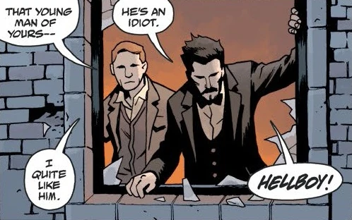
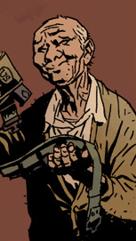

**哈里·H·米德尔顿（Harry H. Middleton）**[1]是一名私家神秘学调查员。他是[特雷佛·布鲁姆](/entry/Trevor_Bruttenholm)的大学同窗，20世纪50年代与布鲁姆的养子[地狱男爵](/entry/Hellboy)结为好友。这段友谊并未因米德尔顿之死而终结——他的鬼魂继续陪伴、帮助着地狱男爵。

## 历史

哈里·米德尔顿是布鲁姆的朋友，[2]两人于20世纪30年代在伊顿公学相识。他们都是学校“幽灵俱乐部”的成员，还是学生时，两人就在苏格兰一座修道院附近第一次遭遇了鬼魂。[3]

1953年，布鲁姆带米德尔顿一起去圣奥尔本斯调查时，把他介绍给了地狱男爵；他很快就喜欢上了地狱男爵，很大程度上是因为这小伙子面对超自然存在时那股热忱劲儿。[4]整个50年代，米德尔顿继续与这对搭档合作，办了不少案子，[5]其中包括“布劳恩顿伯勒斯猎犬”一案。[6]

### 去世

哈里·米德尔顿于1984年去世。[7][8]布鲁姆和地狱男爵都前往英格兰参加他的葬礼，朋友的死让他们深受打击。[9]

### 探望

地狱男爵在海上漂泊之后（见《[岛屿](/entry/The_Island)》），曾在哈里·米德尔顿那里住了一个月，[10]随后被带去参加一场女巫集会（见《[黑暗召唤](/entry/Darkness_Calls)》）。在《[黑暗召唤](/entry/Darkness_Calls)》事件发生两周前，哈里与艾伯特·林赛爵士、西莉亚·拉德福德夫人的鬼魂一起陪地狱男爵打牌。[11]哈里注意到地狱男爵弄丢了[他的枪](/entry/Hellboy%27s_gun)，便送给他一把装在左手枪套里的1941年款美军点45手枪作为临别礼物。[12]

## 趣闻

- [迈克·米格诺拉](/entry/Mike_Mignola)最初创作《黑暗召唤》时，本想把米德尔顿设定成活人。构思“[鼹鼠](/entry/The_Mole)”时，他转念觉得，让地狱男爵和一群鬼魂打牌会“更酷”；因此在《黑暗召唤》的尾声中交代了：故事发生时米德尔顿早已过世。[13]

## 画廊

（左）1953年与布鲁姆在一起[14]

 送给地狱男爵一把 M1911 手枪。[15]

## 注释

<references/>

[1] 他名字的中间首字母见于“[鼹鼠](/entry/The_Mole)”和“[幻影之手](/entry/The_Phantom_Hand)”。

[2] *[黑暗召唤](/entry/Darkness_Calls)* 尾声1

[3] *[地狱男爵与 B.P.R.D.](/entry/Hellboy_and_the_B.P.R.D.)：1953*——“[水马凯尔皮](/entry/The_Kelpie)”

[4] *[地狱男爵与 B.P.R.D.](/entry/Hellboy_and_the_B.P.R.D.)：1953*——“[幻影之手](/entry/The_Phantom_Hand)”

[5]

[6] *[黑暗召唤](/entry/Darkness_Calls)* 第1期

[7]

[8] “[鼹鼠](/entry/The_Mole)”

[9]

[10] 《[荒野狩猎](/entry/The_Wild_Hunt)》第1期也提到了此事

[11]

[12]

[13] [*《地狱男爵》第10卷：扭曲人和其他故事*](/entry/Trade_Collections)

[14]

[15]
