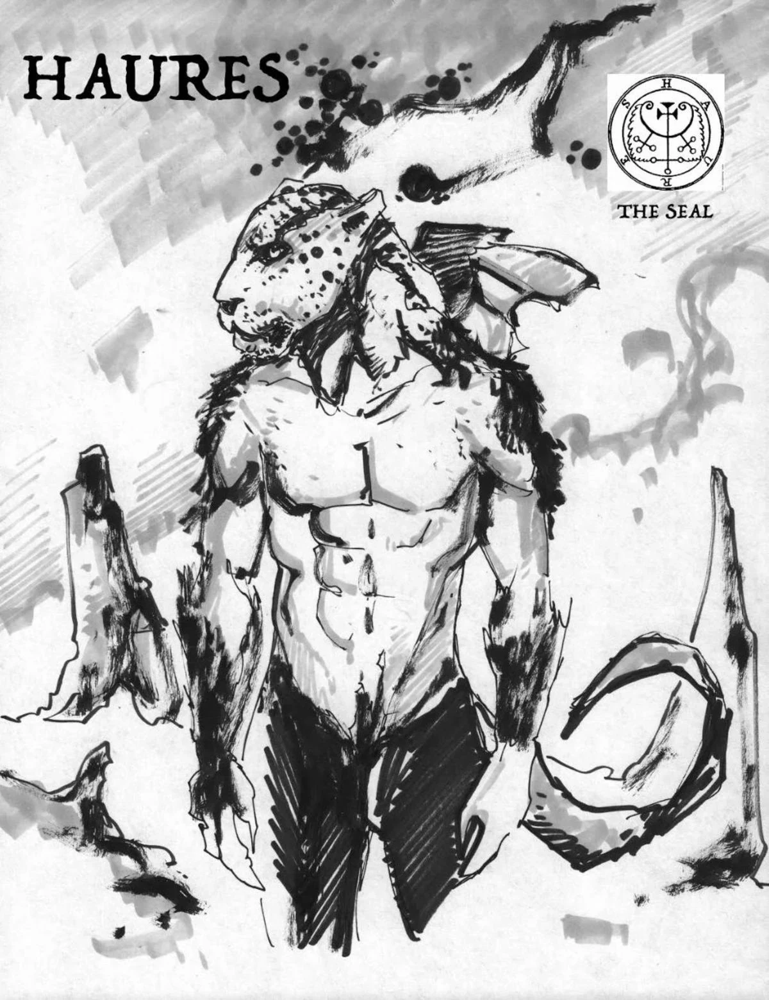
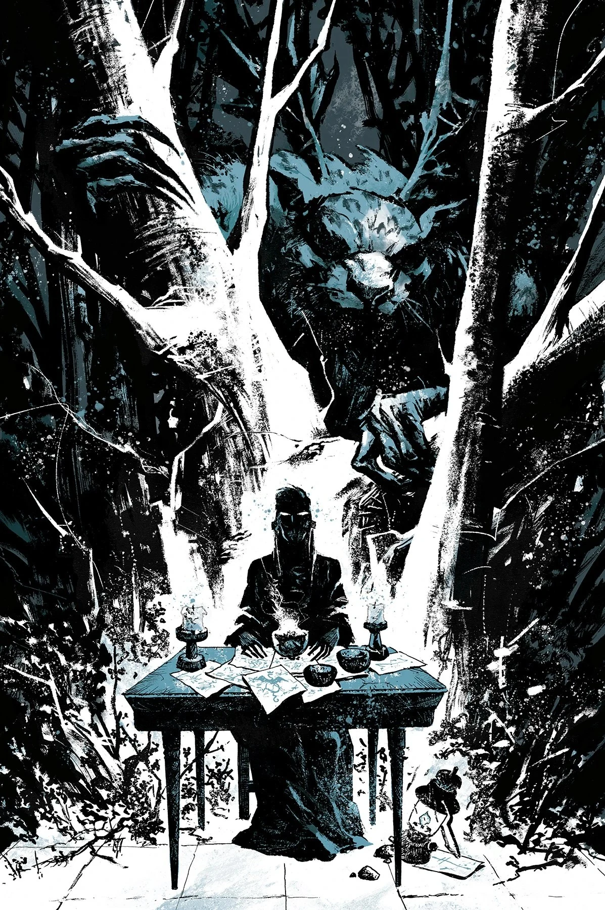

**浩瑞士（Haures）** 本是一个恶魔，原计划（大概以反派身份）登场于已被取消的故事 *[《圣哈根最后的骑士》](/entry/The_Last_Knight_of_St._Hagan)*。

## 画廊

|

|
## 趣闻

浩瑞士，又名弗劳罗斯（Flauros），是一位神秘学中的恶魔，官阶为公爵，以豹子的形象现身。他能如实回答关于现在、过去与未来一切事物的问题，讲述世界的创造与神性，并消灭召唤者的敌人。但如果不把他封入黑色三角形中，他便会试图撒谎、欺骗自己的召唤者。
