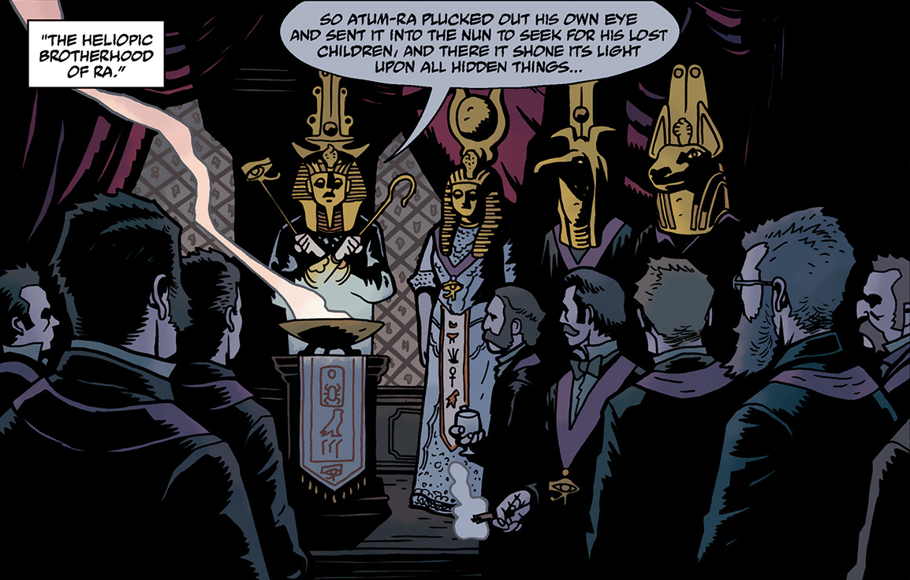
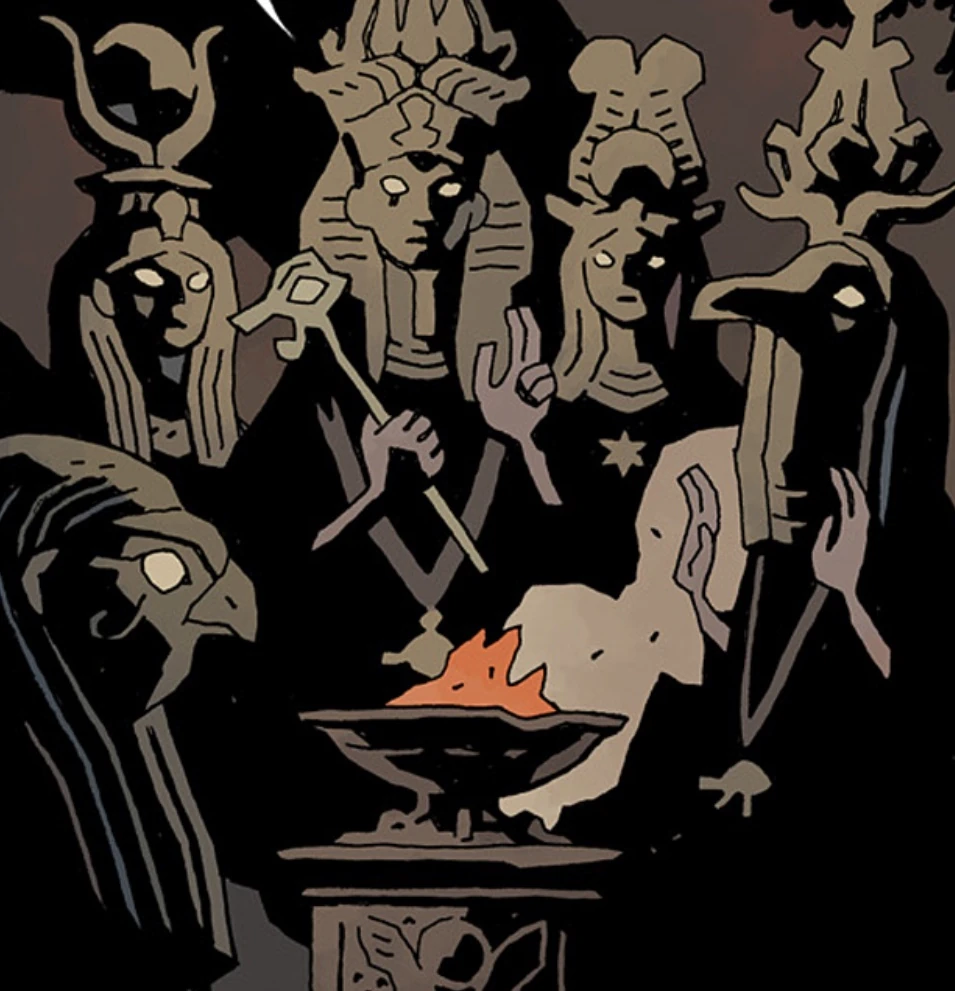

 **拉神赫利奥皮斯兄弟会（Heliopic Brotherhood of Ra）**是一个致力于保存古老秘密知识的秘密社团。

## 历史

1728 年，一个没什么天分的法国纺织品商人尤金·雷米声称自己到访过埃及大金字塔下的密室。在那里，一个名叫 [Larzod](/entry/Larzod) 的神秘存在接见了他，他也由此习得了亚特兰蒂斯、姆大陆和雷姆利亚的秘密知识。雷米这些离经叛道的说法吸引了几个好奇的人。1729 年，雷米的富有赞助人出资修建了赫利奥波利斯神殿。这座神殿成为拉神赫利奥皮斯兄弟会的大本营；兄弟会由雷米创立，旨在保存 Larzod 的秘密教义，并把这些隐秘智慧传给有资格接受的人。

1738 年，兄弟会成员围绕 Larzod 教义的核心——埃及神祇[阿图姆](/entry/Atum)——爆发了一场激烈争论：他究竟是自我创生的（多数派观点），还是「从原初之海中诞生」的（少数派观点）。最终，支持后一种说法的人退出兄弟会，另组[奥安尼斯学会](/entry/Oannes_Society)，在此后一个多世纪里一直与兄弟会分庭抗礼。尽管损失了部分成员，尽管 1745 年后法国局势动荡、尤金·雷米也被一辆马车的车轮碾轧身亡，兄弟会仍在不断壮大。在法国大革命爆发前的岁月里，H.B.R. 支持了拿破仑·波拿巴；作为友好的表示，拿破仑把他 1798 年远征埃及时所得的埃及文物捐赠给了该组织。

从 19 世纪中叶起，H.B.R. 的会员遍布世界各地，并在伦敦和纽约设立了机构。1866 年，兄弟会的六名成员在查尔斯·伯利勋爵家中拜访了神秘的 E.T. 哈特恩小姐，并举行了一场降神会。灵体 Larzod 再次向这群人显现，嘱托他们要活着看到人类的终结，并留意一位君王的降临。这群人从 H.B.R. 分裂出去，成立了[奥西里斯俱乐部](/entry/Osiris_Club)。

19 世纪后期，H.B.R. 在公开场合日渐衰落，这在很大程度上要归因于[爱德华·格雷爵士](/entry/Edward_Grey)的努力。到 1890 年，巴黎最初的赫利奥皮斯兄弟会神殿被关闭。纽约市的**赫利奥皮斯兄弟会黄金分会**也在 1890 年前关闭。伦敦的**拉神赫利奥皮斯兄弟会普世神殿**则在 1893 年一群愤怒暴民的袭击之后关停。在此之后的许多年里，兄弟会仍作为一个秘密社团活动。人们认为 1906 年的旧金山大地震和 1908 年西伯利亚通古斯森林大爆炸都与他们有关。俄罗斯[特殊科学局](/entry/Special_Sciences_Service)后来发现，通古斯玻璃与[恩克拉戴石](/entry/Enkeladite)极为相似——后者是在一处风水宝地进行核试验后产生的一种物质。

## 画廊

## 成员

- 尤金·雷米（创始人）
- [泰芙努特·特里奥努斯](/entry/Tefnut_Trionus)（「尤金·雷米的第二化身」，大女主事）
- [卡普医生](/entry/Dr._Carp%27s_Experiment)（黄金分会的大师）
- [亚当·格拉伦勋爵](/entry/Lord_Glaren)
- [奥古斯特·斯温](/entry/August_Swain)
- [阿尔伯特·梅休](/entry/Albert_Mayhew)
- [丹尼斯·彼得斯](/entry/Dennis_Peters)
- [雷金纳德·谢尔德雷克](/entry/Reginald_Sheldrake)
- [威廉·布莱特](/entry/William_Bright)

## 特许分会与分裂团体

- 银星骑士团
  - 1916 年，该分会在其芝加哥据点试图完全召唤恶魔安杜西亚斯，被爱德华·格雷爵士挫败。
- 阿拜多斯骑士团
- [奥安尼斯学会](/entry/Oannes_Society)（1738 年从 H.B.R. 分裂出去）
- [奥西里斯俱乐部](/entry/Osiris_Club)（1866 年从 H.B.R. 分裂出去）

[pt-br:Irmandade Heliópica de Rá](/entry/pt-br%3AIrmandade_Heli%C3%B3pica_de_R%C3%A1)
