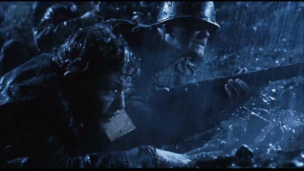
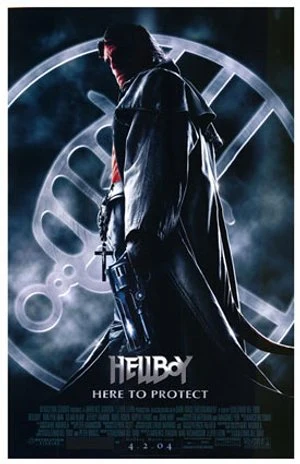
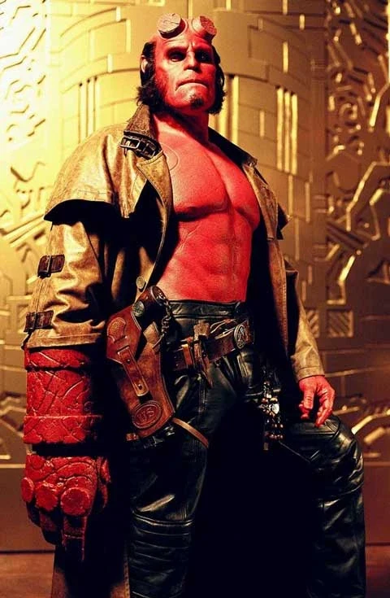
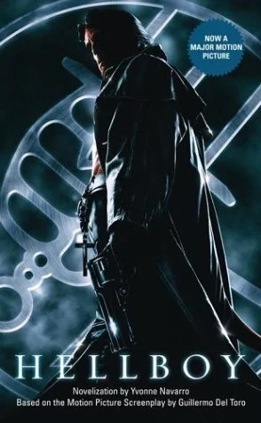

***《地狱男爵（Hellboy）》***是一部 2004 年的美国动作恐怖电影，由 [Guillermo del Toro](/entry/Guillermo_del_Toro) 执导并参与编剧，[Ron Perlman](/entry/Ron_Perlman)、[John Hurt](/entry/John_Hurt) 和 [Selma Blair](/entry/Selma_Blair) 主演。影片大致改编自 Dark Horse 漫画系列 *[《地狱男爵》](/entry/Hellboy_%28series%29)*（作者 [Mike Mignola](/entry/Mike_Mignola)），尤其是最初的四期限定迷你系列 *[《毁灭之芽》](/entry/Seed_of_Destruction)*。

影片中，半恶魔[地狱男爵](/entry/Hellboy_%282004%E2%80%932008_film_character%29)在二战期间被纳粹召唤到人间，又被盟军救出；此后他藏身于一个[绝密政府组织](/entry/Bureau_for_Paranormal_Research_and_Defense)之中，暗中保护现代世界免遭超自然威胁。

续集 *[《地狱男爵2：黄金军团》](/entry/Hellboy_II__The_Golden_Army)* 同样由 del Toro 执导、Perlman 主演，于 2008 年上映。系列[重启之作](/entry/Hellboy_(2019_film))于 2019 年上映[1]，[第二次重启](/entry/Hellboy__The_Crooked_Man_%28film%29)则于 2024 年上映[2]。

## 剧情

1944 年，在[格里高利·拉斯普京](/entry/Grigori_Rasputin)的帮助下，纳粹在苏格兰海岸外建造了一扇次元传送门，企图释放被囚禁在深空之中的怪物神祇[奥格德鲁·贾哈德](/entry/Ogdru_Jahad)，借其力量击败盟军。一支盟军小队在年轻的[特雷弗·布鲁滕霍尔姆](/entry/Trevor_Bruttenholm)带领下奉命摧毁传送门。纳粹被消灭，传送门被毁，拉斯普京也随之消失，而他的仆从[伊尔莎·豪普斯坦](/entry/Ilsa_Haupstein)和[卡尔·鲁普雷希特·克勒南](/entry/Karl_Ruprect_Kroenen)逃脱。盟军小队发现一只右手为石质的恶魔婴儿穿过了传送门；他们给他取名"[地狱男爵](/entry/Hellboy_%282004%E2%80%932008_film_character%29)"，布鲁滕霍尔姆收养了他。

六十年后，FBI 探员约翰·迈尔斯应布鲁滕霍尔姆的要求被调往[超自然调查防御署](/entry/Bureau_for_Paranormal_Research_and_Defense)（BPRD），在那里见到了成年的地狱男爵和两栖类人形生物[亚伯·塞皮恩](/entry/Abe_Sapien)。他得知 BPRD 的第三名成员[丽兹·舍曼](/entry/Liz_Sherman)不久前住进了一家精神病院，以免自己失控的控火能力伤及他人。尽管地狱男爵时常探望、好言相劝，她仍决意不再回去。克勒南和豪普斯坦在摩尔多瓦的群山中复活了拉斯普京，三人放出了地狱猎犬[萨麦尔](/entry/Sammael)。拉斯普京赐予萨麦尔轮回重生的力量：它每死一次，就有两枚卵孵化。拉斯普京还趁丽兹熟睡时来访，激活了她的能力，险些毁掉整家医院。迈尔斯说服她回到了防御署。

萨麦尔不断增殖，成了大患；众人断定它的卵就在下水道里，地狱男爵、亚伯和几名 BPRD 探员下去毁卵。亚伯在搜寻卵时受伤，克勒南则杀掉了大部分探员。克勒南的不死之躯由发条机械驱动，他自行关机装死，躯体被带回防御署总部。BPRD 主管[汤姆·曼宁](/entry/Tom_Manning)正为地狱男爵的鲁莽大动肝火，迈尔斯则带丽兹出去喝咖啡。地狱男爵醋意大发，暗中跟踪他们，令总部无人看守。克勒南随即复活自己，拉斯普京也再度现身于防御署，与布鲁滕霍尔姆教授对峙并最终杀死了他。

曼宁接管 BPRD，在莫斯科郊外一座旧公墓中找到了拉斯普京的陵墓。曼宁和地狱男爵率队进入陵墓，却很快失散。地狱男爵和曼宁摸到克勒南的巢穴，将他击败。地狱男爵在萨麦尔的新巢穴与丽兹、迈尔斯会合，但怪物们蜂拥而上将他们淹没。丽兹动用控火能力，把萨麦尔群和它们的卵一并焚毁。地狱男爵、丽兹和迈尔斯失去意识，被拉斯普京和豪普斯坦俘虏。拉斯普京一边从丽兹体内抽走她的灵魂，一边要求地狱男爵释放[奥格德鲁·贾哈德](/entry/Ogdru_Jahad)，以换回她的灵魂。地狱男爵唤醒了自己作为启示录之兽阿努·恩·罗摩的真正力量，把自己的石质右手——毁灭之右手——伸入拉斯普京寻获的一块巨型独石，开始释放奥格德鲁·贾哈德。迈尔斯挣脱束缚、制服豪普斯坦，并提醒地狱男爵他可以反抗自己的命运。地狱男爵记起了真正的自己，掰断重新长出的双角，重新封印奥格德鲁·贾哈德，并用一截断角刺中拉斯普京。

一头触手巨兽比希摩斯从拉斯普京垂死的躯体中破膛而出，膨胀到惊人的尺寸，把拉斯普京和豪普斯坦碾死。地狱男爵任自己被巨兽吞下，引爆一腰带到[手榴弹](/entry/Vulcan_Grenades)，从内部摧毁了怪物。他回到丽兹身边，在她耳边低语几句，将灵魂还给了她。影片结尾，丽兹与地狱男爵在她温柔的火焰环绕中相吻。

## 配音/演员阵容

- [Ron Perlman](/entry/Ron_Perlman) 饰 [地狱男爵](/entry/Hellboy_%282004%E2%80%932008_film_character%29)
- [John Hurt](/entry/John_Hurt) 饰 [特雷弗·布鲁滕霍尔姆](/entry/Trevor_Bruttenholm)
  - Kevin Trainor 饰 年轻的布鲁姆
- [Selma Blair](/entry/Selma_Blair) 饰 [丽兹·舍曼](/entry/Liz_Sherman)
- [Rupert Evans](/entry/Rupert_Evans) 饰 [约翰·迈尔斯](/entry/John_Myers)
- Karel Roden 饰 [格里高利·拉斯普京](/entry/Grigori_Rasputin)
- [Jeffrey Tambor](/entry/Jeffrey_Tambor) 饰 [汤姆·曼宁](/entry/Tom_Manning)
- [Doug Jones](/entry/Doug_Jones) 饰 [亚伯·塞皮恩](/entry/Abe_Sapien)
  - [David Hyde Pierce](/entry/David_Hyde_Pierce)（未署名）为亚伯·塞皮恩配音
- Brian Steele 饰 [萨麦尔](/entry/Sammael)
- Ladislav Beranas 饰 [卡尔·鲁普雷希特·克勒南](/entry/Karl_Ruprecht_Kroenen)
- Biddy Hodson（署名 Bridget Hodson）饰 [伊尔莎·豪普斯坦](/entry/Ilsa_Haupstein)
- Corey Johnson 饰 [克莱探员](/entry/Agent_Clay)
- Brian Caspe 饰 Lime 探员
- James Babson 饰 Moss 探员
- Stephen Fisher 饰 Quarry 探员
- Garth Cooper 饰 Stone 探员

## 制作

[Del Toro](/entry/Guillermo_del_Toro) 与 *[《地狱男爵》](/entry/Hellboy_%28series%29)* 的创作者 [Mike Mignola](/entry/Mike_Mignola) 设想把这部影片拍成一部 Ray Harryhausen 式的电影。影片多年间被各家制片厂兜售又拒之门外，原因是片厂不喜欢这个片名、不喜欢剧本，也不喜欢由 [Perlman](/entry/Ron_Perlman) 出演[地狱男爵](/entry/Hellboy_%28character%29)。Del Toro 曾邀请 Harryhausen 向影片的动画师传授他特效技法的独到之处，但 Harryhausen 婉拒了，他觉得现代电影过于暴力。

### 编剧

影片大致改编自出道漫画 *[《地狱男爵：毁灭之芽》](/entry/Seed_of_Destruction)*。撰写剧本期间，Del Toro 研究了纳粹神秘学哲学，以此作为影片开场戏的参考。在剧本的一个早期版本中，陀螺仪式传送门由铁轨构成，拼出五芒星、六芒星和倒转星的形状，以呈现影片的魔法与神秘学元素。Del Toro 选择改动漫画中的起源设定，让主要角色们的来历彼此交织。

迷宫成了影片的母题，用以象征地狱男爵"选择正确道路"的内心冲突，这一点体现在影片的开场字幕中。Del Toro 认为迷宫代表了影片关于"抉择、走上不同的岔路、选择不同命运"的主题，他说："据说，迷宫不是一个让人迷失的地方，而是一个让人找到自我的地方。"Del Toro 还为 BPRD 的徽标补充了背景设定，把影片中的版本植根于天主教神话，在布鲁姆的办公室里加入了大天使形象。早在选定演员之前，Del Toro 写地狱男爵的台词时心中想的就是 Perlman。Del Toro 提到，他在动作场面中试图模仿 Jack Kirby 和 Harryhausen 的动作风格。

片中为地狱男爵设计了一把特制手枪"[撒玛利亚人](/entry/The_Samaritan)"，以体现 BPRD 的技术魔法。Del Toro 用一种反转的"美女与野兽"思路来处理爱情故事，他说："我想让美女在最后变成野兽，全然接纳她凡俗的天赋……而当她接受自己本来的样子——一个怪物——时，她才能去爱那个怪物[地狱男爵]。"地狱男爵偷看丽兹和迈尔斯的点子，最初是为另一个名为《肉市，一个爱情故事》（Meat Market, A Love Story）的剧本写的。布鲁姆之死在漫画中发生得很早，Del Toro 却希望把它延后，让观众对这个角色产生感情，"让失去这个角色变得令人心痛"。

### 前期制作

除了此前与 Perlman 有过合作，Del Toro 选他出演主角还因为他觉得 Perlman 即使戴着特效化妆也能演绎出细腻入微的表演。影片在 Universal Pictures 筹划阶段，Vin Diesel 曾与该角色传出关联；Jeremy Renner 曾受邀出演"主角"，但他因对原作毫无感情而拒绝。Del Toro 安排现实中的好友 Santiago Segura 扮演袭击地狱男爵的火车司机。[David Hyde Pierce](/entry/David_Hyde_Pierce) 受雇为亚伯·塞皮恩配音，因为 Pierce"名气更大"、声音"更有辨识度"。出于对 [Doug Jones](/entry/Doug_Jones) 的尊重，Pierce 拒绝署名、拒绝参加宣传巡演，也拒绝出席首映礼。

### 拍摄

影片于 2003 年拍摄，每周拍 6 天、共 130 天，周一至周六不间断，没有第二摄制组。周日留作剪辑用。Del Toro 提到，影片其实 1998 年就可以开拍，但它迟迟找不到一家愿意投入的制片厂，因为当时好莱坞对超级英雄和漫画改编电影心存偏见。动作场面参照 Harryhausen 的影片来设计，多用广角镜头，摄影机几乎不移动。公墓段落拍摄于布拉格一座真实的公墓。

## 花絮

盟军士兵使用的 [M1 加兰德步枪](/entry/%3AFile%3AM1_garand.jpg)

- 影片开场段落中，Whitman 中士和其他几名士兵使用的是 M1 加兰德步枪。
- 早在拍摄这部电影之前很久，地狱男爵就是 Guillermo del Toro 最喜爱的超级英雄。[3]

## 奖项

### 获奖

- **Image Award，2004**
  - 最佳导演——长片电影。
- **Saturn Award，2005**
  - 最佳化妆

### 提名

- **Teen Choice Award，2004**
  - 精选电影——剧情/动作冒险类。
- **VES Award，2005**
  - 真人电影中动画角色杰出表演奖。
- **IHG Award，2005**
  - 最佳电影
- **Bram Stoker Award，2005**
  - 剧本奖
- **Saturn Award，2005**
  - 最佳奇幻电影
  - 最佳特别版 DVD 发行
  - 最佳服装

## 画廊

### 预告片

- [<http://www.sonypictures.com/cthe/hellboy/helltrailer_high.asx>? 第一支预告片]
- [第二支预告片](http://www.sonypictures.com/movies/hellboy/video/trailer2/trailer2_high.asx?affiliateId=)

## 链接

- Internet Movie Database 上的 [*《地狱男爵》*](http://www.imdb.com/title/tt0167190/)
- [*《地狱男爵》*](/entry/wikipedia%3AHellboy_%282004_film%29) Wikipedia 词条
- allmovie.com 上的 [*《地狱男爵》*](http://www.allmovie.com/cg/avg.dll?p=avg&sql=1:287448)
- rottentomatoes.com 上的 [《地狱男爵》](http://www.rottentomatoes.com/m/hellboy/)
- superhero hype! 上的 [Hellboy Hype!](http://www.superherohype.com/hellboy/)
- [*《地狱男爵》*电影官网](http://www.sonypictures.com/movies/hellboy/)
- [*《地狱男爵》*官方网站](http://www.hellboy.com/)
- [The Doug Jones Experience 的 *《地狱男爵》*电影页面](http://www.thedougjonesexperience.com/Hellboy.htm) \*FLAREgamer 上的[《地狱男爵》](http://flaregamer.com/b2article.php?p=89&more=1)
- [剧本——制作稿](http://sfy.ru/sfy.html?script=hellboy)
- FanHistory 上的 [Hellboy](http://www.fanhistory.com/wiki/Hellboy)
- [院线版（PG-13）与导演剪辑版的详细对比](http://www.movie-censorship.com/report.php?ID=1905&In=WikE)

## 参考资料

[1] 'Hellboy' Release Date Pushed Back 3 Months to April 2019 (hollywoodreporter.com)

[2] ‘Hellboy: The Crooked Man’ Plot And Production Details Revealed (deadline.com)

[3] 12 Burning Facts About Hellboy | Mental Floss
