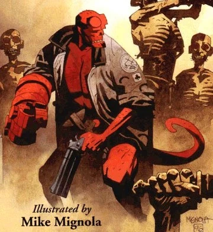
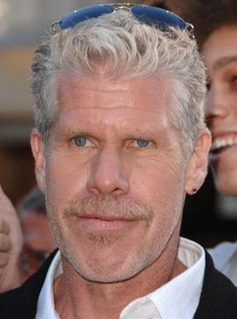

**地狱男爵**是电影*[《地狱男爵》](/entry/Hellboy_(2004_film))*（2004）及其续集*[《地狱男爵 2：黄金军团》](/entry/Hellboy_II__The_Golden_Army)*（2008）的标题角色与主角。他改编自[同名角色](/entry/Hellboy_(character)——后者出自[漫画系列《地狱男爵》](/entry/Hellboy_(series))，电影角色的大部分背景故事与漫画迷你系列*[《毁灭之芽》](/entry/Seed_of_Destruction)*中所呈现的相似。

地狱男爵是半恶魔，由一个人类女子和一个恶魔父亲所生，于 1944 年 10 月 9 日通过一道次元门户被召唤到人间。他被[特雷佛·布鲁姆](/entry/Trevor_Bruttenholm)教授收养，其存在对外界严格保密。此后六十年间，他以[超自然现象研究与防御局](/entry/Bureau_for_Paranormal_Research_and_Defense)探员的身份行动，只在少数情况下、在监督之下被带出总部去与怪物作战。2000 年代，地狱男爵在与复活的[拉斯普廷](/entry/Grigori_Rasputin)的冲突中进一步得知了自己的真实本性：他就是阿努·恩·罗摩，启示录之兽。几年后，在一系列事件中，地狱男爵向世界暴露了自己的存在，这些事件最终以他从调查局辞职收场。地狱男爵还与控火者[丽兹·舍曼](/entry/Elizabeth_Sherman)展开了一段恋情。

电影中，地狱男爵由[朗·普尔曼（Ron Perlman）](/entry/Ron_Perlman)饰演。普尔曼是漫画创作者[迈克·米格诺拉](/entry/Mike_Mignola)和电影编剧兼导演[吉尔莫·德尔·托罗（Guillermo del Toro）](/entry/Guillermo_del_Toro)出演该角色的首选，他还在其他多个项目中继续为该角色配音。

## 历史

*另见：[《地狱男爵》（2004 电影）#剧情](/entry/Hellboy_(2004_film)#Plot)与[《地狱男爵 2：黄金军团》#剧情](/entry/Hellboy_II__The_Golden_Army)*

由[吉尔莫·德尔·托罗](/entry/Guillermo_del_Toro)撰写的人物小传曾收录在公映前的宣传材料中。尽管其中一些元素在成片中显而易见，但这段文字有多少被视为最终电影的正典，尚不清楚。

*德尔·托罗的电影人物小传：地狱男爵*

**地狱男爵**  
**阿努·恩·罗摩**  
1944 年 10 月 9 日  
身高 6 英尺 9 英寸，体重 350 磅。黑发、红皮肤、金色眼睛、石头右手。

喜好：莉兹在黄昏金色光线中的样子。莉兹在清晨的样子。从远处看莉兹的样子。莉兹在近处的样子。她的声音、她的气味、她的衣服、她的肌肤……她靠在他肩上睡着，嗯，你懂的。他敬仰布鲁姆教授，却觉得自己像《伊甸园之东》里的詹姆斯·迪恩。他酷爱啤酒、披萨、辣豆酱、墨西哥玉米片、举铁、好雪茄、糟雪茄、旅行、猫、糖果——尤其是 Baby Ruth 花生巧克力棒——老 UPA 卡通、老弗莱舍卡通、宝丽来照片（这是莉兹教他的）、Zippo 打火机（他收藏这个）、叮当蛋糕和奶油夹馅蛋糕、饼干配牛奶、油腻的汉堡和热狗、磨他的角。他很容易被放屁逗乐——认为《阿呆与阿瓜》是杰作——还爱看黑白电影痛哭一场，尤其是卓别林的《城市之光》和《相见恨晚》。把怪物揍个稀巴烂。把他的大衣修补妥当。他那把又大又凶的枪“撒玛利亚人”，以及它的子弹。布鲁斯·威利斯。汤姆·威茨、尼克·凯夫、皮克斯电影——他觉得《怪兽电力公司》这个名字更适合超自然调查防御署（亚伯对此很介意）——和莉兹一起看《玩具总动员》1 和 2 就是一个完美的下午。他热爱三个臭皮匠、马克斯兄弟、哈罗德·劳埃德、巴斯特·基顿。

厌恶：蔬菜——尤其是甜菜——牡蛎、哈拉佩尼奥辣椒、沙拉、雅尼、夏洛蒂·澈奇、《人物》杂志、《国家询问报》、摄影师、亚伯打嗝（那些该死的蛋真恶心）或是摆出道貌岸然的样子。想到自己的出身、去了解它。人们盯着他的额头看。被关起来四个月以上没有一次“外出”。被人叫做恶魔。

**吉尔莫·德尔·托罗撰写的传记：**

要理解地狱男爵，就得多少了解一点他的家族。这里说的是他真正的家族。

他的母亲生于 1681 年。她名叫凯瑟琳·坦纳-特里梅因（Catherine Tanner-Tremaine），出生在英格兰的东布罗姆维奇。作为一位烟草富商的女继承人，她学习羽管键琴和歌唱，精通大多数闺秀技艺。19 岁时父母双亡，此后很长一段时间，她独自住在豪宅里读书、作画。她沉浸于德国文学，梦想着灵体与魔法。她谨慎地通过伦敦书商购得典籍与魔法书，最终拥有了一批重要的魔法器物与知识收藏——其中包括约翰·迪伊博士传说中的魔法盒——并把它们陈列在私人藏书室／书房中。她召唤出一位高阶恶魔，并自愿与他交合。这既是她生命中最崇高、也是最恐怖的一刻。

她从此变了一个人：她的灵魂探入过黑暗，那刺鼻的余味使她余生都走在忏悔之路上。但罪自有其留存之道；尽管她乐善好施，虔诚地嫁给一位牧师，还修建资助了许多教堂与礼拜堂，她仍在失宠的状态中死去。她脚边躺着她的两个人类孩子：一个修女和一个牧师。她坦白了自己的过犯，痛哭流涕，恳求他们拯救她的灵魂，因为那灵魂将被她黑暗的情人索走。可就在她呼出最后一口气时，她的情人索回了她的身体，以迅雷不及掩耳之势杀死了她尘世的两个孩子——一阵阴风震颤了特里梅因庄园所有的窗户。他们的灵魂结合在一起，他向她求爱并许诺：在他眼中她将永远年轻，而她体内仍怀着她那尚未出世的灵性之子，等待着降生成人、坠落人间。于是她像琥珀中的昆虫一般沉睡，直到 1944 年那个宿命般的秋夜，她的孩子被格里高利·叶菲莫维奇·拉斯普廷召唤出世。

地狱男爵降生的细节已妥善存入超自然调查防御署的档案，特雷佛·布鲁姆教授最终把他转移到新墨西哥一座陆军基地一事也同样有案可查。正是布鲁姆发现了这个孩子，促使他永久留在美国，并接受罗斯福总统的任命，出任超自然调查防御署的行动主管。

地狱男爵成长得很快，而且好奇心旺盛得惊人。他有一双极活泼的眼睛，对大多数机械物件都很感兴趣——还常用石头右手把它们砸个粉碎。在诺顿·赖克将军的监督下，基地每天安排测试，还频繁做活检以获取组织样本。地狱男爵对疼痛表现出惊人的耐受力，却每次都痛哭失声。要取得他拳套上石头的样本，需动用高压金刚石钻头，结果只采到不到一平方毫米的材料，钻头便炸成一片火花与碎屑。

布鲁姆教授教地狱男爵语言。起初他们用手势交流，然后是几个发音，最终用上了词句。这孩子还与动物极有亲和力，有一阵子他能和基地的狗吉祥物“说话”（这项能力多年后消失了），并认为狗是比人类更高级的物种。也许正因如此，地狱男爵直到童年后期才学会“如厕”。在一次私下会面中，总统要求布鲁姆向全世界隐瞒地狱男爵的存在，并拨款修建一座更大的超自然调查防御署大楼。

尽管严加保密，地狱男爵偶尔还是会被引荐给许多名人。爱因斯坦飞到新墨西哥，与这生物共度了一个下午，觉得他讨人喜欢又聪明。地狱男爵比较了布鲁姆和爱因斯坦的发型，表示更喜欢后者。1946 年，他朝贝比·鲁斯的脑袋扔了块石头，还极其无礼地一直把克拉克·盖博叫做“下水道嘴”。有人把地狱男爵描绘成美国秘密武器的照片拿给约瑟夫·斯大林看。斯大林喜欢他的肤色，却认为他是个骗局。1949 年，地狱男爵见到了这位苏联独裁者，后者不停地捏他的脸颊、摩挲他的角。此后不久，地狱男爵便开始磨角。1951 年，他被交由布鲁姆教授全职监护，搬进了当时位于马萨诸塞州波士顿的超自然调查防御署总部。

50 年代初，调查局格外忙碌：阿道夫·希特勒在南美对美国发动他的秘密战争。地狱男爵证明了自己作为外勤探员的过人才华，用机械希特勒自己的机械腿痛殴这个半机械希特勒，或许算得上他最辉煌的胜利之一。那十年末，超自然调查防御署搬进了新总部。如今安置调查局的这栋建筑建于 20 世纪 40 年代，联邦政府原本打算把它作为冷战时期的战略地堡掩体，在危急时刻容纳政府各部门。

地狱男爵的房间原是这栋楼的保险库，嵌在悬崖岩石与钢筋混凝土的围护结构之中。

直到 1959 年布鲁姆首次与癌症搏斗、父子俩进行了一次“交心谈话”之前，布鲁姆始终让地狱男爵对自己的出身含糊不清。地狱男爵难过至极，决定再也不追问这个话题。他的梦境不时不可避免地遭到末日景象的侵扰，这在他肩头留下了一块心结：每当他痛殴一只异形生物，都是在驱除自己身上的“异类感”。除莉兹之外，他对“被人盯着看”或“被拍照”极为敏感。

多年来，地狱男爵一直是超自然调查防御署唯一的非人类成员，直到 1978 年亚伯·塞皮恩加入组织。地狱男爵与亚伯的友谊开局不顺。亚伯拥有地狱男爵所没有的一切：内省、寡言、酷爱读书（地狱男爵向来偏爱旧的《大众机械》杂志，以及《舒格与斯派克》《小露露》等十来本白银时代漫画），而且极其注重隐私。地狱男爵嫉妒布鲁姆对亚伯的关注，也恼火于每次他给这个鱼人起个新绰号，对方都要生气。

1988 年，丽兹·舍曼加入超自然调查防御署，地狱男爵对她一见钟情。从那一刻起，刀枪不入的地狱男爵尝到了痛苦的滋味。

## 人物塑造

### 外貌

地狱男爵的衰老方式与人类不同：2004 年时他虽年约六十，身体与心智的成熟度却大致相当于二十到三十岁。

他的头发从头顶向后梳，在头顶挽成一个武士式的发髻。面部的毛发修剪成连鬓胡与山羊胡。

作为恶魔血统的证明，地狱男爵长着红色皮肤、黄色眼睛、一条尾巴、偶蹄般的双足，以及一对角。他偏好用带式砂磨机把角磨平，并时常对盯着他额头看的人流露反感。角任其生长时可超过一英尺长，向上弯成弧形。

他的右臂是一只巨大的石头手与前臂，即[毁灭之右手](/entry/Right_Hand_of_Doom)。手上刻着玄奥的螺旋纹路，一直向上延伸到地狱男爵的躯干。

### 能力

地狱男爵防火。

地狱男爵偏爱的随身武器是[撒玛利亚人](/entry/The_Samaritan)，一把定制的巨型左轮手枪。它可装填四发子弹，他频繁使用手工特制、改装过的子弹来对抗超自然生物。地狱男爵还挥舞着[大宝贝（Big Baby）](/entry/Big_Baby)——一件可装六发、形似霰弹枪的武器，他曾用它杀死一位[森林之神](/entry/The_Last_Elemental)。

他还配备一条红棕色皮革多功能腰带，是 1968 年由代理局长[诺伯特·里克（Norbert Ricker）](/entry/Norton_Ricker)下令制作的。腰带上有小袋和挂环，用来携带或悬挂各种护身符与物品。他在多功能腰带里携带着各式各样的物件，如圣物、马蹄铁和草药，还有各种[手雷](/entry/Vulcan_Grenades)与其他爆破器材；这些在与超自然野兽战斗时常派上用场。

他还食量惊人，一天吃六顿饭。

### 与漫画角色的差异

> 
>
> 我们开始拍第二部时，最初的想法是回到漫画里挑一个故事改编成电影。但第一部电影偏离漫画根源太远，根本没法回头照搬漫画。所以我们不得不做的，是构思一部电影的续集，而不是又一次漫画改编。[……]德尔·托罗和我一起想出了这个原创故事。  
> 第二部电影里的地狱男爵角色与我笔下的地狱男爵相去甚远，因为里面有整套恋爱戏码，后来还演变成结婚头一年那种吵吵闹闹的样子，这对我的角色而言完全陌生。[……]事实上，有一刻我说：“嗯，地狱男爵不会那么干。”德尔·托罗则说：“你的地狱男爵不会，我的会。”
>
> 
>
> ——[迈克·米格诺拉](/entry/Mike_Mignola)，《极客银河指南》播客访谈，2012 年

  

尽管第一部电影是对《毁灭之芽》的松散改编，改编时做出的改动既保持了故事的精神，又让它作为电影叙事更具吸引力。这些差异不断累积，在续集中（它很大程度上是一个情节与人物都自成一体的原创故事）变得更加显著，以至于地狱男爵的若干显著元素与[他在原版漫画中的描绘](/entry/Hellboy_(character))截然不同。最值得注意的差异包括：

- 地狱男爵的存在对外界严格保密。这种保密也延伸到整个超自然调查防御署的存在，[托马斯·曼宁](/entry/Thomas_Manning)局长的职责之一就是“辟谣”有关地狱男爵的目击事件。直到 2000 年代，地狱男爵仍一直处在超自然调查防御署“管理员”的持续监督之下。第二部电影的大部分戏剧冲突，正来自地狱男爵未经授权便决定公开现身——他在是否要保卫一个并不理解他（甚至恐惧、憎恨他）的世界之间挣扎。
  - 相比之下，漫画角色的存在广为人知，且很少引发任何反应：他于 1947 年向世界现身，1952 年被授予荣誉人类身份，多年来还数次登上《生活》杂志封面。
- 电影中的地狱男爵表现出类似青少年的情感成熟度，这或许是他与世隔绝的成长经历所致；同样，地狱男爵对待工作带有某种程度的不情愿，常常更愿意在房间里放松，或是干脆逃避冲突。
  - 漫画中，地狱男爵到 1960 年代已经成熟；他的闲暇时光与私人生活很少被展现。
- 丽兹·舍曼是地狱男爵的恋人。地狱男爵对她一见钟情，苦恋多年；两人在第一部电影结尾成为情侣，到第二部时已开始组建家庭。
  - 漫画中，尽管地狱男爵防火的体质让他和丽兹建立起亲密的“姐弟般情谊”，却从未发展为爱情；虽然地狱男爵对其他女性表现过恋爱方面的兴趣（例如*[《恋爱中的地狱男爵》](/entry/Hellboy_in_Love)*），这些都没有发展成长久关系，也没有导致组建家庭。

> 
>
> 当我看到一部改编作品对原书忠实到把电影阉割掉的地步，那是非常乏味的。你看《指环王》，它并非逐字照搬，却是你能从那本书拍出的最好的电影。它抓住了精神。但有时你需要意译，有时需要类比，有时需要推演延伸，这部电影就是如此。
>
> 
>
> ——[吉尔莫·德尔·托罗](/entry/Guillermo_del_Toro)，《Wizard》杂志访谈，2004 年

其他相对次要的差异包括较小的人物属性或视觉差异。

- 地狱男爵于 1944 年被召唤到地球，但具体日期不一：电影中是 10 月 9 日，漫画中是 12 月 23 日。
- 两个版本的地狱男爵衰老方式都与人类不同，但具体情形有别。
  - 电影角色被解释为衰老缓慢（以“反向狗龄”计算），六十多岁仍显年轻，不过十一岁时与同龄普通人类孩童相仿。
  - 漫画角色同样在六十多岁时仍处于身体巅峰，但他八岁时便已完全长大成人。
- 电影中的毁灭之右手刻着巨大的螺旋纹路。手指更显方块状，在关节处弯折，而不是沿长度平滑弯曲。
- 地狱男爵的服装略有不同：
  - 他的风衣是一件更厚重的防尘式长大衣，肩部带有“披风”；右袖用大扣袢固定，为毁灭之右手留出空间。
  - 他的皮带扣上有超自然调查防御署的标志，而漫画中是空白的红色圆牌。一个超自然调查防御署追踪器挂在他的皮带上，是一个独立的小装置，而不像漫画中那样集成在圆形牌里。
  - 他通常穿长款皮裤和皮靴，而不是短裤和露出双蹄的鞋，这大概是为了省去腿部义肢，兼顾演员舒适与拍摄效率。
- 这个版本的地狱男爵似乎比漫画版更擅长、也更愿意使用枪械；尽管如此，他仍说自己的枪法还需练练。他心爱的手枪“撒玛利亚人”在漫画中并[没有直接对应的原型](/entry/Hellboy's_gun)。
- 地狱男爵喜欢抽雪茄。
  - 漫画中，该角色通常更喜欢抽香烟。
  - 对雪茄的这种偏爱也为地狱男爵的饰演者朗·普尔曼所共有。
- 地狱男爵极爱猫，在房间里养了许多只。
  - 漫画角色不养宠物，但童年时曾与[一只友善的狗](/entry/Mac)相伴。

## 幕后花絮

地狱男爵由[朗·普尔曼](/entry/Ron_Perlman)饰演。

*《地狱男爵 2：黄金军团》*有一段序幕，登场的是十一岁的地狱男爵。幼年地狱男爵由化妆师蒙特塞·里韦（Montse Ribé）饰演，她与事业搭档兼同行艺人戴维·马蒂（David Martí）共同创造了该角色的造型。

## 画廊

2004 年电影海报上的地狱男爵

《黄金军团》小说封面上地狱男爵的面部特写

地狱男爵在《黄金军团》中挥舞着“[大宝贝](/entry/Big_Baby)”

地狱男爵与他在《黄金军团》中的超自然调查防御署战友们

地狱男爵攻击[黄金军团](/entry/The_Golden_Army)。

## 趣闻

- 普尔曼还在[地狱男爵动画版](/entry/Hellboy_Animated)系列中为地狱男爵配音。
