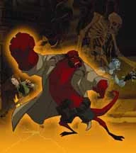

 ***地狱男爵动画版（Hellboy Animated）*** 是两部原创的直接发行 DVD 的动画电影以及一系列配套漫画。《[风暴之剑（Sword of Storms）](/entry/Hellboy_Animated%3A_Sword_of_Storms)》和《[血与铁（Blood & Iron）](/entry/Hellboy_Animated%3A_Blood_%26_Iron)》是在[迈克·米格诺拉](/entry/Mike_Mignola)和[吉尔莫·德尔·托罗](/entry/Guillermo_del_Toro)的认可下制作的。曾计划制作第三部电影，但后来已被放弃。

## 配音阵容

[朗·普尔曼（Ron Perlman）](/entry/Ron_Perlman)、[塞尔玛·布莱尔（Selma Blair）](/entry/Selma_Blair)和[约翰·赫特（John Hurt）](/entry/John_Hurt)在《地狱男爵动画版》中再次演绎[地狱男爵](/entry/Hellboy_%28character%29)、[莉兹·谢尔曼](/entry/Elizabeth_Sherman)和[特雷弗·布鲁滕霍尔姆教授](/entry/Trevor_Bruttenholm)这三个角色——他们曾在 [2004 年](/entry/Hellboy_%28film%29)和 [2008 年](/entry/Hellboy_II__The_Golden_Army)的真人电影中饰演这些角色。[亚伯·塞皮恩](/entry/Abraham_Sapien)由[道格·琼斯（Doug Jones）](/entry/Doug_Jones)配音，他在真人电影中饰演亚伯。这些电影是他首次为亚伯配音。（[大卫·海德·皮尔斯（David Hyde Pierce）](/entry/David_Hyde_Pierce)在第一部真人电影中为亚伯配音。）

- 朗·普尔曼 饰 地狱男爵
- 塞尔玛·布莱尔 饰 莉兹·谢尔曼
- 道格·琼斯 饰 亚伯·塞皮恩
- 约翰·赫特 饰 特雷弗·布鲁滕霍尔姆教授
- [佩里·吉尔平（Peri Gilpin）](/entry/Peri_Gilpin) 饰 凯特·科里根

## 电影

### 《[风暴之剑](/entry/Hellboy_Animated%3A_Sword_of_Storms)》

在《风暴之剑》中，地狱男爵和[凯特·科里根](/entry/Kate_Corrigan)被派往[日本](/entry/Japan)，调查一位被日本恶魔"雷"和"电"附身的教授之谜。这两个恶魔想把一把强大的邪灵之剑弄到手，这把剑将解救他们，并使他们能够放出自己的[兄弟们](/entry/Ogdru_Jahad)、毁灭世界。当地狱男爵被送入一个异次元空间、一路对抗妖怪（Youkai）时，他的 [B.P.R.D.](/entry/Bureau_for_Paranormal_Research_and_Defense) 队友亚伯·塞皮恩和莉兹·谢尔曼试图阻止即将到来的混乱第一波中的一条龙。

### 《[血与铁](/entry/Hellboy_Animated%3A_Blood_%26_Iron)》

《血与铁》讲述特雷弗·布鲁滕霍尔姆教授在 1934 年与一名女吸血鬼（血腥女伯爵）的经历以及当下发生的故事。地狱男爵还与赫卡忒（Hecate）正面对决。

### 《[铁鞋（Iron Shoes）](/entry/Iron_Shoes_%28film%29)》（短片）

《Hellboy Animated: Blood & Iron》DVD 中还收录了一部附赠短片，改编自短篇漫画《[铁鞋（The Iron Shoes）](/entry/The_Iron_Shoes)》。

### 《幻影之爪（The Phantom Claw）》

被放弃的第三部电影。它本将是[龙虾人约翰逊](/entry/The_Lobster)在该系列中的首次亮相，不过影片主要角色原本将是地狱男爵和凯特。

2008 年 3 月 19 日，制片人塔德·斯通斯（Tad Stones）在《地狱男爵动画版》网站上发布消息称，目前没有在进行这部电影的任何工作。不过，斯通斯也写道，可能会制作一些规模较小的动画项目在网络上发布，并暗示《[地狱男爵 2：黄金军团](/entry/Hellboy_II__The_Golden_Army)》的上映可能会影响动画电影系列的未来。

此后，《幻影之爪》的所有工作已被无限期搁置。

### 《[深渊之下（The Dark Below）](/entry/The_Dark_Below)》（短片）

《深渊之下》是一部 2010 年发行的五分钟短片，目前可通过流媒体服务观看。短片讲述地狱男爵坠入一处古老的地下遗迹，在那里与一只湖怪对抗。

## 漫画

[Dark Horse Comics](https://en.wikipedia.org/wiki/Dark_Horse_Comics) 以《地狱男爵动画版》的名义发行了若干卷漫画。这些漫画延续了动画角色的冒险。

- 《地狱男爵动画版——第 1 卷：黑色婚礼（Hellboy Animated – Volume 1: The Black Wedding）》（80 页，2006 年 10 月，[ISBN 978-1-59307-700-6](/entry/Special%3ABookSources/978-1-59307-700-6)）收录：
  - 《[黑色婚礼（The Black Wedding）](/entry/The_Black_Wedding)》（[Jim Pascoe](/entry/Jim_Pascoe) 编剧，[Rick Lacy](/entry/Rick_Lacy) 绘画）
  - 《[死亡金字塔（Pyramid of Death）](/entry/Pyramid_of_Death)》（[Tad Stones](/entry/Tad_Stones) 编剧，[Fabio Laguna](/entry/Fabio_Laguna) 绘画）
- 《[地狱男爵动画版：幻影肢体（Hellboy Animated: Phantom Limbs）](/entry/Phantom_Limbs)》（25 页，2007 年 2 月，随《[地狱男爵动画版：风暴之剑（Hellboy Animated: Sword of Storms）](/entry/Hellboy_Animated%3A_Sword_of_Storms)》DVD 附赠，Jim Pascoe 编剧，Rick Lacy 绘画）
- 《[地狱男爵动画版：思念（Hellboy Animated: The Yearning）](/entry/The_Yearning)》（2007 年 5 月，随《[地狱男爵动画版：血与铁（Hellboy Animated: Blood & Iron）](/entry/Hellboy_Animated%3A_Blood_%26_Iron)》DVD 附赠，Jim Pascoe 编剧，[Ben Stenbeck](/entry/Ben_Stenbeck) 绘画）
- 《地狱男爵动画版——第 2 卷：审判之钟（Hellboy Animated – Volume 2: Judgment Bell）》（80 页，2007 年 6 月，[ISBN 978-1-59307-799-0](/entry/Special%3ABookSources/978-1-59307-799-0)）收录：
  - 《[审判之钟（The Judgment Bell）](/entry/The_Judgment_Bell)》（Jim Pascoe 编剧，Rick Lacy 绘画）
  - 《[机械怪物的威胁（The Menace of the Mechanical Monster）](/entry/The_Menace_of_the_Mechanical_Monster)》（Tad Stones 编剧兼绘画）
- 《地狱男爵动画版——第 3 卷：珍奇异兽园（Hellboy Animated – Volume 3: The Menagerie）》（80 页，2007 年 12 月，[ISBN 978-1-59307-861-4](/entry/Special%3ABookSources/978-1-59307-861-4)）收录：
  - 《[珍奇异兽园（The Menagerie）](/entry/The_Menagerie)》（[Jason Hall](/entry/Jason_Hall_%28writer%29) 编剧，Rick Lacy 绘画）
  - 《[小小胜利（Small Victories）](/entry/Small_Victories)》（[Nate Piekos](/entry/Nate_Piekos) 编剧，Fabio Laguna 绘画）

## 周边商品

以雕像闻名的 [Gentle Giant](/entry/Gentle_Giant) 获得了《地狱男爵动画版》可动人偶的授权。一款与《Blood & Iron》DVD 塑封在一起的抢先看版地狱男爵人偶作为 [Best Buy](/entry/wikipedia%3ABest_Buy) 限定品发行。

## 外部链接

- [《地狱男爵动画版》官方制作博客](http://hellboyanimated.typepad.com/)
- [《地狱男爵动画版》](/entry/wikipedia%3AHellboy_Animated)
