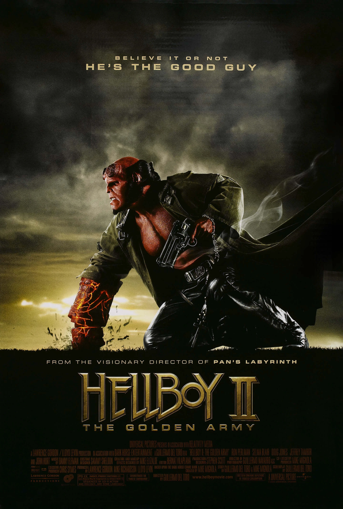

**地狱男爵2：黄金军团（Hellboy II: The Golden Army）**是一部 2008 年的美国奇幻动作恐怖电影，由 [Guillermo del Toro](/entry/Guillermo_del_Toro)执导，[Ron Perlman](/entry/Ron_Perlman)、[Selma Blair](/entry/Selma_Blair)和 [Doug Jones](/entry/Doug_Jones)主演，大致改编自黑马漫画系列《[地狱男爵](/entry/Hellboy_%28series%29)》，原作者为 [Mike Mignola](/entry/Mike_Mignola)。本片是 2004 年《[地狱男爵](/entry/Hellboy_%282004_film%29)》的续集，前作同样由 del Toro 执导、Perlman 主演。

影片中，[地狱男爵](/entry/Hellboy_%282004%E2%80%932008_film_character%29)和 [B.P.R.D.](/entry/Bureau_for_Paranormal_Research_and_Defense)必须阻止一位反叛的精灵王子唤醒一支势不可挡的发条军团——这支军团足以灭绝人类，让世界重归魔法生物之手。

del Toro 曾计划拍摄第三部，但最终没有再推出任何续作。

## 剧情

1955 年圣诞节，年幼的[地狱男爵](/entry/Hellboy_%282004%E2%80%932008_film_character%29)听养父 [Trevor Bruttenholm](/entry/Trevor_Bruttenholm)讲睡前故事：那是人类与魔法生物之间一场古老的战争。魔法生物被人类击退后，哥布林铁匠向精灵之王巴洛尔提出，可以为他打造一支坚不可摧的机械军团。在儿子弩阿达王子的鼓动下，巴洛尔接受了提议；黄金军团随即重创人类。事后巴洛尔悔恨不已，与人类缔结休战协定：人类居于城市，魔法生物居于森林。能够号令黄金军团、唯有王室血脉方可佩戴的王冠被分成三瓣。弩阿达不认同休战，自我流亡离去。

时间来到现在，弩阿达归来，开始收集王冠碎片。他在一场拍卖会上夺得第一瓣碎片，放出[牙仙](/entry/Tooth_fairy)杀光了现场所有人，又为夺取第二瓣碎片杀死了自己的父亲。他的孪生妹妹弩阿拉公主带着最后一瓣碎片逃走。与此同时，在 [B.P.R.D.](/entry/Bureau_for_Paranormal_Research_and_Defense)，地狱男爵正与女友 [丽兹](/entry/Liz_Sherman)闹矛盾，也反感自己所在的组织必须秘密行事。调查拍卖会屠杀案时，地狱男爵故意让自己暴露在世人面前。混乱中，[亚伯·塞皮恩](/entry/Abraham_Sapien)发现丽兹怀孕了；丽兹要他发誓保密。署里的高层对地狱男爵的行为大为光火，派来灵质灵媒[约翰·克劳斯](/entry/Johann_Kraus)管束他。克劳斯接管行动后，小队循牙仙追踪到布鲁克林大桥下的秘密集市。亚伯找到了弩阿拉——她手上有一张通往黄金军团所在地的地图——并对她一见钟情。地狱男爵迎战并杀死了弩阿达的同伙温克，又杀死了弩阿达召唤来对付他的森林元素之神。战斗中弩阿达质问他：人类把魔法生物逼得无处容身，而他自己也是魔法生物之一，为何还要为人类而战。弩阿拉被 B.P.R.D. 置于保护之下。

弩阿达凭借他与妹妹之间的魔法纽带追踪到 B.P.R.D. 总部——这种纽带让二人共享伤痛、能读取彼此的心思。弩阿拉在被找到之前藏起了最后一瓣王冠碎片，弩阿达则与地狱男爵展开搏斗。弩阿达用长矛重创地狱男爵，掳走弩阿拉，承诺以她交换王冠碎片。丽兹、亚伯和克劳斯无法取出伤口中的矛尖，只好带地狱男爵前往北爱尔兰巨人堤道的黄金军团所在地。他们见到了贝斯莫拉的哥布林铁匠大师，后者带他们来到死亡天使面前取出矛尖。尽管天使警告说，地狱男爵若活下来将给人类带来毁灭，而承受最多痛苦的人会是丽兹，丽兹仍苦苦哀求饶地狱男爵一命。天使从地狱男爵胸中取出矛尖，让丽兹给他一个活下去的理由。丽兹告诉地狱男爵他就要当父亲了，地狱男爵随即痊愈。

哥布林带领小队来到黄金军团的沉睡之地，弩阿达已在那里等候。亚伯把最后一瓣王冠碎片交给他，弩阿达唤醒黄金军团，命令他们杀死小队。地狱男爵向弩阿达挑战，争夺军团的指挥权；由于地狱男爵属于地狱王室，弩阿达必须接受挑战。地狱男爵击败弩阿达并饶他一命，弩阿达却试图趁机行刺。弩阿拉为阻止哥哥自杀；濒死的弩阿达告诉地狱男爵，他终将必须选择：是让人类灭亡，还是让魔法生物灭亡。亚伯在弩阿拉死去前以心灵感应向她倾诉了情意。丽兹熔碎王冠，黄金军团随之停止运作。地狱男爵、丽兹、亚伯和约翰从 B.P.R.D. 辞职，地狱男爵憧憬着与丽兹和他们的孩子共度未来。丽兹纠正道是"孩子们"，透露自己怀的是双胞胎。

## 演员

- [Ron Perlman](/entry/Ron_Perlman) 饰 [地狱男爵](/entry/Hellboy_%282004%E2%80%932008_film_character%29)
- [Selma Blair](/entry/Selma_Blair) 饰 [丽兹·舍曼](/entry/Liz_Sherman)
- [Doug Jones](/entry/Doug_Jones) 饰 [亚伯·塞皮恩](/entry/Abraham_Sapien)、[死亡天使](/entry/Angel_of_Death)和内侍大臣
- John Alexander 与 James Dodd 饰 [约翰·克劳斯](/entry/Johann_Kraus)
  - Alexander 还饰演了无腿的贝斯莫拉哥布林
  - [Seth MacFarlane](/entry/Seth_MacFarlane) 为约翰·克劳斯配音
- [Luke Goss](/entry/Luke_Goss) 饰 [弩阿达王子](/entry/Prince_Nuada)
- [Anna Walton](/entry/Anna_Walton) 饰 [弩阿拉公主](/entry/Princess_Nuala)
- [Jeffrey Tambor](/entry/Jeffrey_Tambor) 饰 [汤姆·曼宁](/entry/Tom_Manning)
- [John Hurt](/entry/John_Hurt) 饰 [Trevor Bruttenholm](/entry/Trevor_Bruttenholm)
- Brian Steele 饰 [温克先生](/entry/Mr._Wink)、[Fragglewump](/entry/Fragglewump)、[Cronie Troll](/entry/Cronie_Troll)和教堂头
- Andrew Hefler 饰 Flint 特工
- Ivan Kamaras 饰 Steel 特工
- Mike Kelley 饰 Marble 特工
- Jeremy Zimmermann 饰拍卖师

## 制作

电影《[地狱男爵](/entry/Hellboy_%282004_film%29)》于 2004 年 4 月 2 日院线上映。此后不久，即 2004 年 5 月，续集在革命工作室进入开发，前作的编剧兼导演 [Guillermo del Toro](/entry/Guillermo_del_Toro)回归，制片人 Lawrence Gordon、Mike Richardson 和 Lloyd Levin 亦回归。[Mike Mignola](/entry/Mike_Mignola)是该漫画[角色](/entry/Hellboy_%28character%29)与[系列](/entry/Hellboy_%28series%29)的创作者，他受邀与 del Toro 一起为续集构思故事，演员 [Ron Perlman](/entry/Ron_Perlman)则继续出演片名主角。[1] 同年 9 月，del Toro 表示有兴趣与 Mignola 把《地狱男爵》做成三部曲，第一部续集计划于 2006 年上映。[2]

2006 年 8 月，当时已停业的革命工作室放弃了《地狱男爵2》，环球影业接手该项目，安排在 2008 年暑期档上映。影片计划于 2007 年 4 月在布达佩斯和伦敦开拍。[3] 当时 del Toro 正在洽谈执导《光环》，但他出于"艺术和个人原因"选择留在《地狱男爵2》。[4] 2006 年 10 月，del Toro 分享了他的计划：在片中重塑经典版本的弗兰肯斯坦、德古拉和狼人作为反派。[5] 导演还重申了拍摄第三部《地狱男爵》、构成三部曲的计划。[6]

凭借 del Toro《潘神的迷宫》的成功，导演得以加快《地狱男爵》续集的制作进程。[7] 《地狱男爵2》于 2007 年 6 月在布达佩斯开拍，同年 12 月杀青。[8] 《地狱男爵2》的正式预告片于 12 月 20 日星期四放出。

2007 年 2 月，Mignola 形容他与 del Toro 构思的故事更侧重民间传说和童话，而非第一部中更偏低俗小说的元素。

## 配套漫画

2008 年 1 月，推出了一部 12 页的宣传漫画《[黄金军团](/entry/The_Golden_Army_%28promo%29)》。

## 画廊

## 花絮

- 传闻 Doug Jones 在本片中所有特技动作均亲自完成，这得益于他的体操运动能力。
- Neil Gaiman 在片场待了几天，向 [Guillermo del Toro](/entry/Guillermo_del_Toro)请教导演经验，以备自己即将到来的导演处女作《Death and Me》之用。[9]

## 参考资料

<references />

## 链接

- [官方网站与预告片](http://www.hellboymovie.com/)
- 互联网电影数据库上的 [*Hellboy II: The Golden Army*](http://www.imdb.com/title/tt0411477/)

[1] ['Hellboy II'' Confirmed!](http://movies.ign.com/articles/515/515970p1.html) Stax, ign.com, 2004-05-14

[2] [Guillermo, Blair Talk *Hellboy* Sequel](http://movies.ign.com/articles/544/544125p1.html) Brian Linder, ign.com, 2004-09-02

[3] ['Hellboy' in U turn](http://www.variety.com/article/VR1117947953.html?categoryid=1350&cs=1) Michael Fleming, *Variety*, 2006-08-03

[4] [Tyro helmer wears 'Halo'](http://www.variety.com/article/VR1117948239.html?categoryid=1236&cs=1) Gabriel Snyder, *Variety*, 2006-08-09

[5] [Exclusive: Hellboy vs. the Universal Monsters?](http://movies.ign.com/articles/739/739203p1.html) Scott Collura, ign.com, 2006-10-16

[6] [Exclusive: *Hellboy 2* Leads to *Hellboy 3*](http://movies.ign.com/articles/739/739228p1.html) Scott Collura, ign.com, 2006-10-16

[7] [*Pan's Labyrinth* Duo Use Oscar Clout To Make *Hellboy II* Their Way](http://www.vh1.com/movies/news/articles/1552289/20070212/story.jhtml) Larry Carroll, vh1, 2007-02-13（已存档）

[8] [‘HELLBOY 2’ UPDATE](http://www.wizarduniverse.com/magazine/wizard/005779781.cfm) Andy Serwin, Wizard Entertainment, 2007-08-28

[9] [Del Toro Wants Gaiman On *Death*](http://www.scifi.com/scifiwire/index.php?category=0&id=45051)
