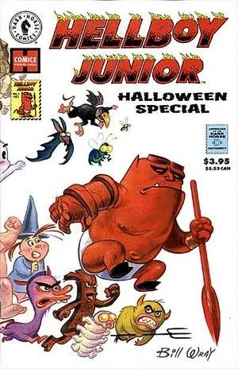
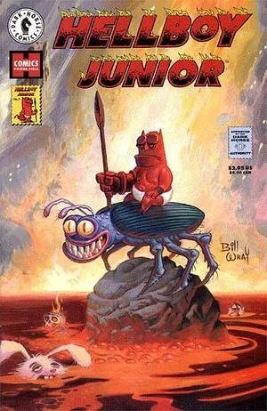
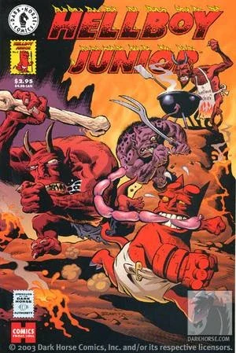
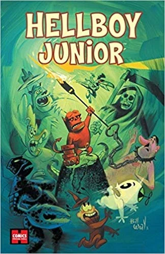

***《少年地狱男爵》***（Hellboy Junior）是由[黑马漫画](/entry/Dark_Horse_Comics)出版的一部非正史成人幽默漫画系列，由 [Bill Wray](/entry/Bill_Wray) 与[迈克·米格诺拉](/entry/Mike_Mignola)编剧，除二人外还有多位画师参与作画。

*《少年地狱男爵》*中的大部分故事主角是成长阶段的少年[地狱男爵](/entry/Hellboy_(character))，他当时生活在[地狱](/entry/Hell)之中。这些故事发生在他作为[拉格纳·洛克计划](/entry/Project_Ragna_Rok)的一部分被召唤到人间之前——在召唤过程中他失去了记忆。因此，他的性格、脾性与道德观都与后来由[特雷佛·布鲁姆](/entry/Trevor_Bruttenholm)抚养长大时截然不同。《少年地狱男爵》在一定程度上是对 Harvey Comics 角色 Hot Stuff 的戏仿，另有若干后备故事改编自 Harvey 旗下的其他角色。

## 各期

*《少年地狱男爵》*最初以一期单行刊出版，两年后又推出了一部两期限定系列。三期刊物各自都由若干故事组成，有些故事相互关联，另一些则独立成篇。

期号
出版日期
封面
故事
编剧
画师
附加内容

&#10;
万圣节特别刊
1997 年 10 月 15 日

BILL WRAY
《蛆啊蛆，到处都是蛆》
Bill Wray
插画作者 Kevin Nowlan

《生病的小女巫惠琪》
Bill Wray
Stephen DeStefano

《姜味牛肉男孩》
Bill Wray
Hilary Barta

《小地狱男爵的诞生》
Bill Wray &amp; Mike Mignola

《沉睡巨人索姆南博》
Bill Wray
Dave Cooper

《魔鬼不抽烟》
Bill Wray &amp; Mike Mignola
Mike Mignola

1
1999 年 10 月 20 日

BILL WRAY
《神奇蘑菇之旅》
Bill Wray
Dave Cooper
插画作者 Glenn Barr &amp; Stephen DeStefano

《沃尔弗顿一家》
Bill Wray
Pat McEown

《人之乌贼》
Bill Wray
Mike Mignola

2
1999 年 11 月 17 日

HILARY BARTA
《糖果之痛之屋》
Bill Wray
Hilary Barta
插画作者 Stephen DeStefano

《火花熊》
Bill Wray

Baby Huey 戏仿作品
Bill Wray
Stephen DeStefano

《小地狱男爵买车记》
Mike Mignola

## 平装合订本

*《少年地狱男爵 \#2》*发行三年后，出版了一本平装合订本。该合订本收录了各期的全部故事与插画。此外，书中还收录了一则新故事——*[《小地狱男爵大战希特勒》](/entry/Hellboy_Jr._vs_Hitler)*，由 [Bill Wray](/entry/Bill_Wray) 自编自绘。

书名
出版日期
封面
收录内容
附加内容

&#10;
《少年地狱男爵》
2004 年 1 月 21 日

BILL WRAY

<li>《少年地狱男爵万圣节特别刊》</li>
<li>《少年地狱男爵》#1-2</li>
<li>《小地狱男爵大战希特勒》</li>

<li>Steve Niles 作序</li>
<li>六页速写簿</li>

## 外部链接

- DarkHorse.com 上的《少年地狱男爵万圣节特别刊》产品页
- DarkHorse.com 上的《少年地狱男爵》#1 产品页
- DarkHorse.com 上的《少年地狱男爵》#2 产品页
- DarkHorse.com 上的《少年地狱男爵》合集产品页
