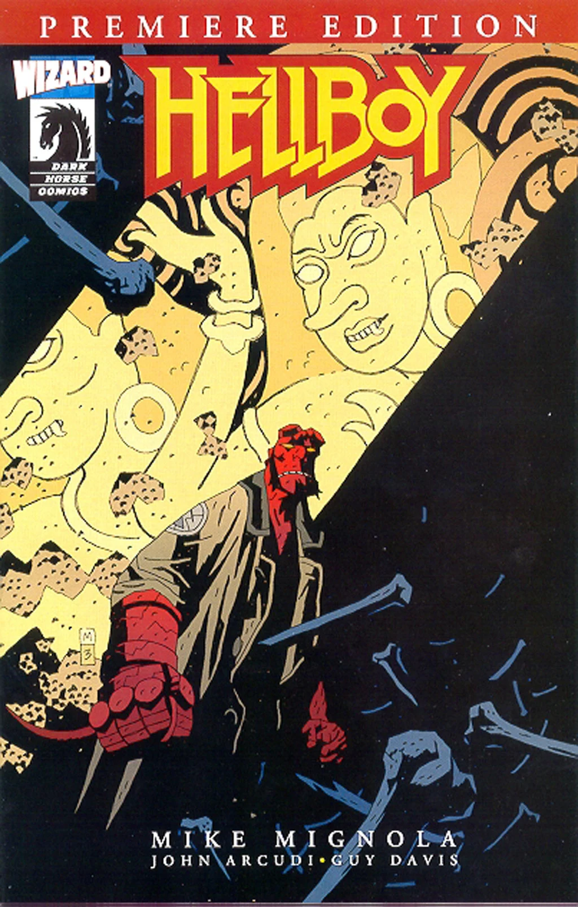
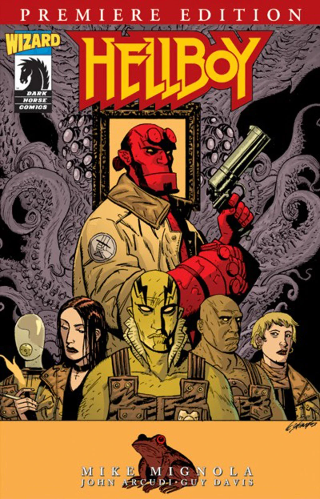
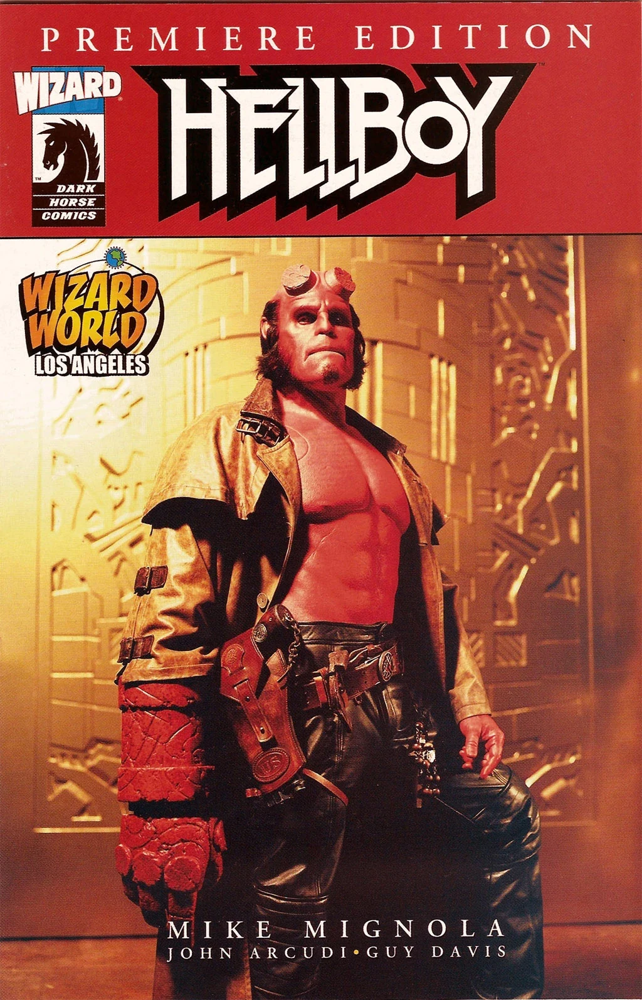

***《地狱男爵首映版》***（Hellboy Premiere Edition）是通过《Wizard》杂志第 148 期出版的独家漫画。它收录了两个全新的地狱男爵宇宙故事：《[地狱男爵](/entry/Hellboy_%28series%29)》故事《[飞头鬼](/entry/The_Penanggalan)》（The Penanggalan）和《[B.P.R.D.](/entry/B.P.R.D._%28series%29)》故事《[重生](/entry/Born_Again)》（Born Again）。该期共出版了三种封面：一种由[迈克·米格诺拉](/entry/Mike_Mignola)绘制，画面出自《飞头鬼》；一种由[盖伊·戴维斯](/entry/Guy_Davis)绘制，画的是 [B.P.R.D.](/entry/B.P.R.D.) 成员与地狱男爵；还有一种是洛杉矶 Wizard World 漫展独家封面，画面是[朗·普尔曼](/entry/Ron_Perlman)饰演的[地狱男爵](/entry/Hellboy_%28character%29)。

## 图集

 米格诺拉封面

 戴维斯封面

 Angeles Wizard World 独家封面
