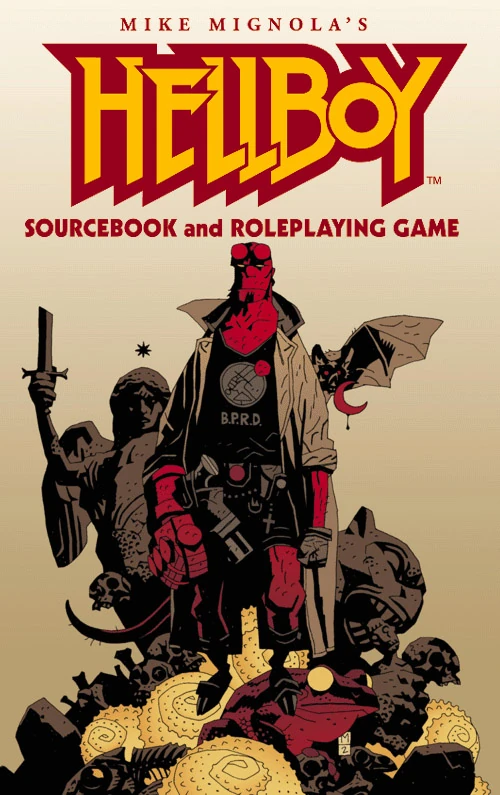

***《地狱男爵资料设定集与桌上角色扮演游戏》（Hellboy Sourcebook and Roleplaying Game）***由 Phil Masters 和 Jonathan Woodward 撰写，Steve Jackson Games 出版。这是一款基于泛用无界角色扮演系统（GURPS）第三版、以 Lite 精简规则为核心的桌上角色扮演游戏。

游戏中收录了两则全新故事：

- *《达基尼》（Dakini）*，由 [Christopher Golden](/entry/Christopher_Golden) 创作的散文故事
- *[《卡班达》](/entry/The_Kabandha)*，由 Jai Nitz、Philip Reed 和 [Zach Howard](/entry/Zach_Howard) 创作、[Mike Mignola](/entry/Mike_Mignola) 协助完成的漫画

此外，还制作了一份漫画形式的宣传单以推广该资料设定集：

- *[《星磁》](/entry/The_Astromagnet)*，由 Jai Nitz、Philip Reed 和 [Peter Bergting](/entry/Peter_Bergting) 创作的漫画
