除了[漫画](/entry/Hellboy_%28series%29)之外，地狱男爵宇宙（Hellboy Universe）还通过一系列散文体小说和若干短篇小说得到拓展。

## 小说

迄今为止，"地狱男爵宇宙"已出版十一部原创小说，其中十部隶属于 *[地狱男爵（Hellboy）](/entry/Hellboy_%28series%29)* 出版线，一部隶属于 *[龙虾约翰逊（Lobster Johnson）](/entry/Lobster_Johnson_%28series%29)* 出版线。此外，头两部《地狱男爵》电影——*[《地狱男爵》（Hellboy）](/entry/Hellboy_%282004_film%29)* 和 *[《地狱男爵2：黄金军团》（Hellboy II: The Golden Army）](/entry/Hellboy_II__The_Golden_Army)*——各有一部小说改编版。

### 原创小说

书名
出版日期
作者
封面

<tbody>

*[《地狱男爵：迷失军团》（Hellboy: The Lost Army）](/entry/Hellboy__The_Lost_Army)*
June 1, 1997 
February 4, 2020（有声书）<a href="#fn1" class="footnote-ref" id="fnref1" role="doc-noteref">1</a>
Christopher Golden 
<em>插图作者</em> 
Mike Mignola
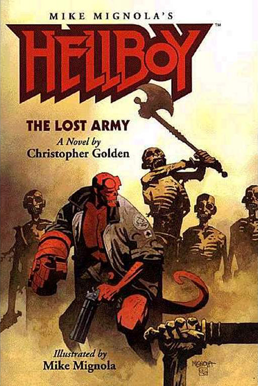MIKE MIGNOLA

*[《地狱男爵：巨人之骨》（Hellboy: The Bones of Giants）](/entry/Hellboy__The_Bones_of_Giants_%28prose_novel%29)*
December 5, 2001 
February 25, 2020（有声书）<a href="#fn2" class="footnote-ref" id="fnref2" role="doc-noteref">2</a>
Christopher Golden 
<em>插图作者</em> 
Mike Mignola
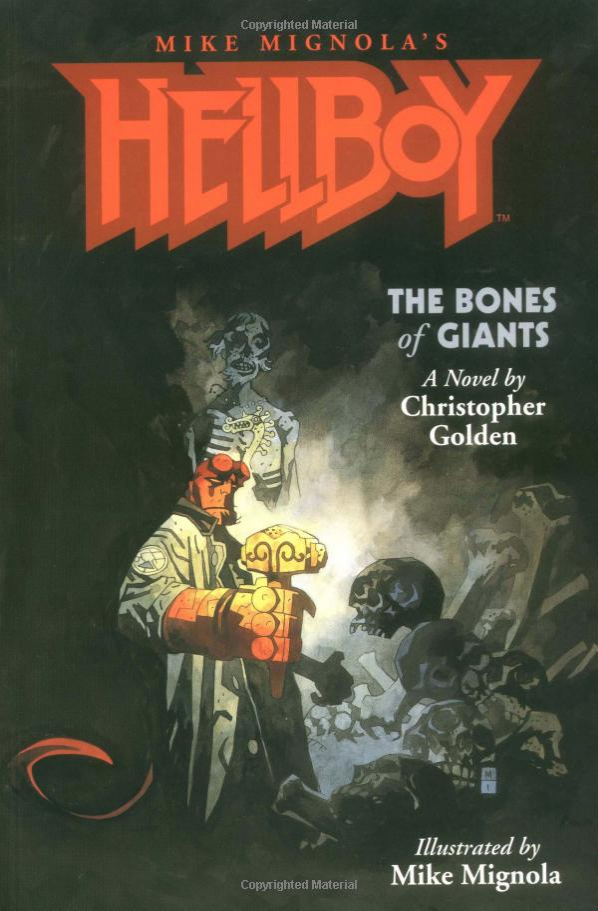MIKE MIGNOLA

*[《地狱男爵：人间如狱》（Hellboy: On Earth as it is in Hell）](/entry/Hellboy__On_Earth_as_it_is_in_Hell)*
September, 2005
Brian Hodge
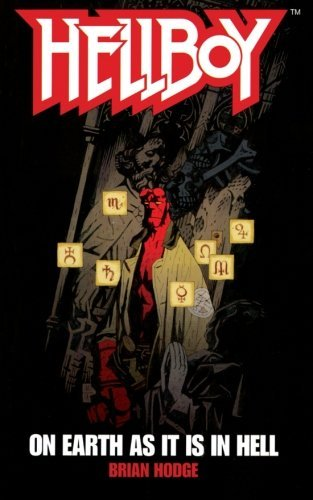MIKE MIGNOLA

*[《地狱男爵：非自然选择》（Hellboy: Unnatural Selection）](/entry/Hellboy__Unnatural_Selection)*
March, 2006
Tim Lebbon
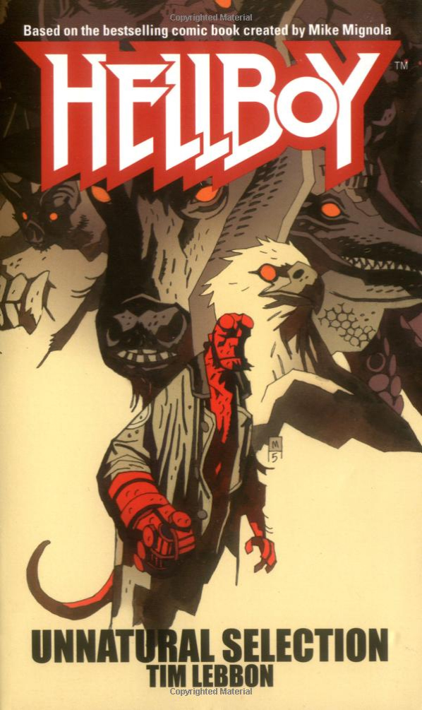MIKE MIGNOLA

*[《地狱男爵：神之机器》（Hellboy: The God Machine）](/entry/Hellboy__The_God_Machine)*
July, 2006
Thomas E. Sniegoski
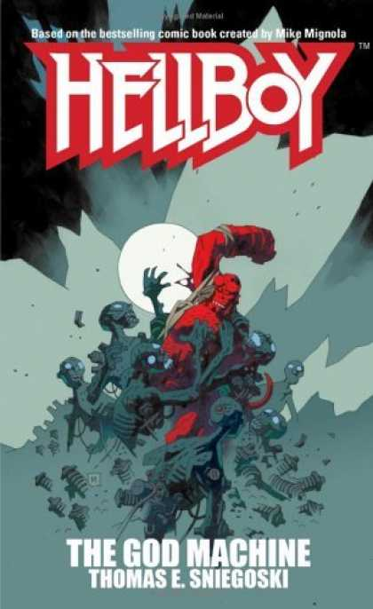MIKE MIGNOLA

*[《地狱男爵：龙潭》（Hellboy: The Dragon Pool）](/entry/Hellboy__The_Dragon_Pool)*
March, 2007
Christopher Golden
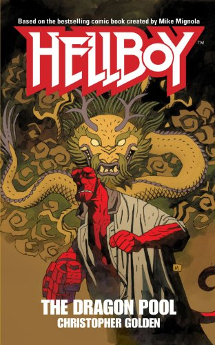MIKE MIGNOLA

*[《地狱男爵：翡翠地狱》（Hellboy: Emerald Hell）](/entry/Hellboy__Emerald_Hell)*
February 13, 2008 
March 17, 2020（有声书）<a href="#fn3" class="footnote-ref" id="fnref3" role="doc-noteref">3</a>
Tom Piccirilli
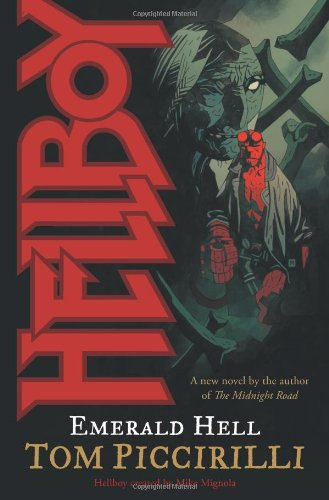MIKE MIGNOLA

*[《地狱男爵：全视之眼》（Hellboy: The All-Seeing Eye）](/entry/Hellboy__The_All-Seeing_Eye)*
October 22, 2008 
April 7, 2020（有声书）<a href="#fn4" class="footnote-ref" id="fnref4" role="doc-noteref">4</a>
Mark Morris
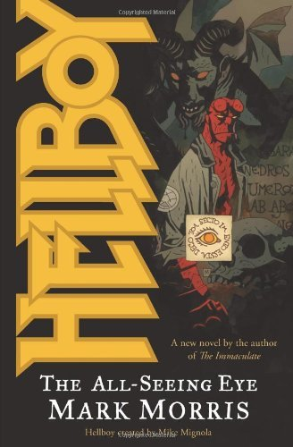MIKE MIGNOLA

*[《地狱男爵：火狼》（Hellboy: The Fire Wolves）](/entry/Hellboy__The_Fire_Wolves)*
April 1, 2009 
April 14, 2020（有声书）<a href="#fn5" class="footnote-ref" id="fnref5" role="doc-noteref">5</a>
Tim Lebbon
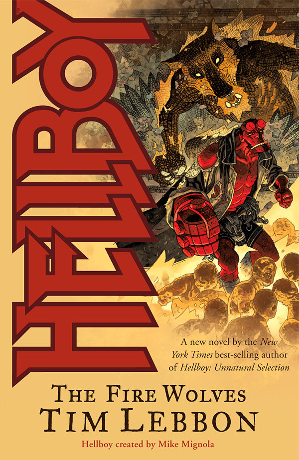DUNCAN FEGREDO

*[《龙虾约翰逊：撒旦工厂》（Lobster Johnson: The Satan Factory）](/entry/Lobster_Johnson__The_Satan_Factory)*
July 22, 2009
Thomas E. Sniegoski
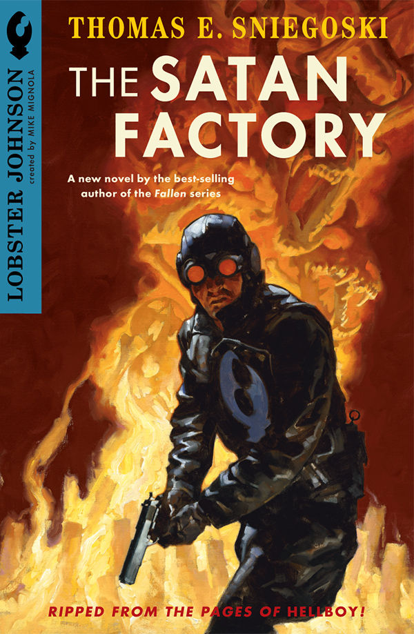GREGORY MANCHESS

*[《地狱男爵：冰狼》（Hellboy: The Ice Wolves）](/entry/Hellboy__The_Ice_Wolves)*
September 30, 2009 
April 21, 2020（有声书）<a href="#fn6" class="footnote-ref" id="fnref6" role="doc-noteref">6</a>
Mark Chadbourn
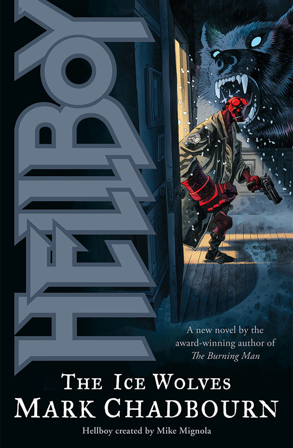DUNCAN FEGREDO

</tbody>

<aside id="footnotes" class="footnotes footnotes-end-of-document" role="doc-endnotes">

<ol>
<li id="fn1"><a href="https://www.audible.com/pd/Hellboy-The-Lost-Army-Audiobook/1690563753"><em>《地狱男爵：迷失军团》</em>有声书</a><a href="#fnref1" class="footnote-back" role="doc-backlink">↩︎</a></li>
<li id="fn2"><a href="https://www.audible.com/pd/Hellboy-The-Bones-of-Giants-Audiobook/1690565551"><em>《地狱男爵：巨人之骨》</em>有声书（Audible）</a><a href="#fnref2" class="footnote-back" role="doc-backlink">↩︎</a></li>
<li id="fn3"><a href="https://www.audible.com/pd/Hellboy-Emerald-Hell-Audiobook/1690590394"><em>《地狱男爵：翡翠地狱》</em>有声书（Audible）</a><a href="#fnref3" class="footnote-back" role="doc-backlink">↩︎</a></li>
<li id="fn4"><a href="https://www.audible.com/pd/Hellboy-The-All-Seeing-Eye-Audiobook/1690592141"><em>《地狱男爵：全视之眼》</em>有声书</a><a href="#fnref4" class="footnote-back" role="doc-backlink">↩︎</a></li>
<li id="fn5"><a href="https://www.audible.com/pd/Hellboy-The-Fire-Wolves-Audiobook/1690592087"><em>《地狱男爵：火狼》</em>有声书</a><a href="#fnref5" class="footnote-back" role="doc-backlink">↩︎</a></li>
<li id="fn6"><a href="https://www.audible.com/pd/Hellboy-The-Ice-Wolves-Audiobook/1690592028"><em>《地狱男爵：冰狼》</em>有声书</a><a href="#fnref6" class="footnote-back" role="doc-backlink">↩︎</a></li>
</ol>
</aside>

### 电影小说改编版

书名
电影
作者
出版日期
封面

<tbody>

*《地狱男爵》（Hellboy）*
*[《地狱男爵》（Hellboy）](/entry/Hellboy_%282004_film%29)*
Yvonne Navarro
March 2004

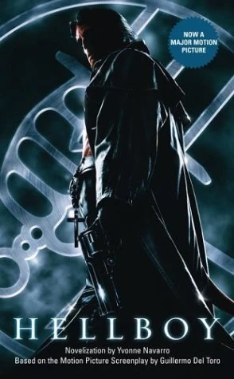

*《地狱男爵2：黄金军团》（Hellboy II: The Golden Army）*
*[《地狱男爵2：黄金军团》（Hellboy II: The Golden Army）](/entry/Hellboy_II__The_Golden_Army)*
Robert Greenberger
June 18, 2008

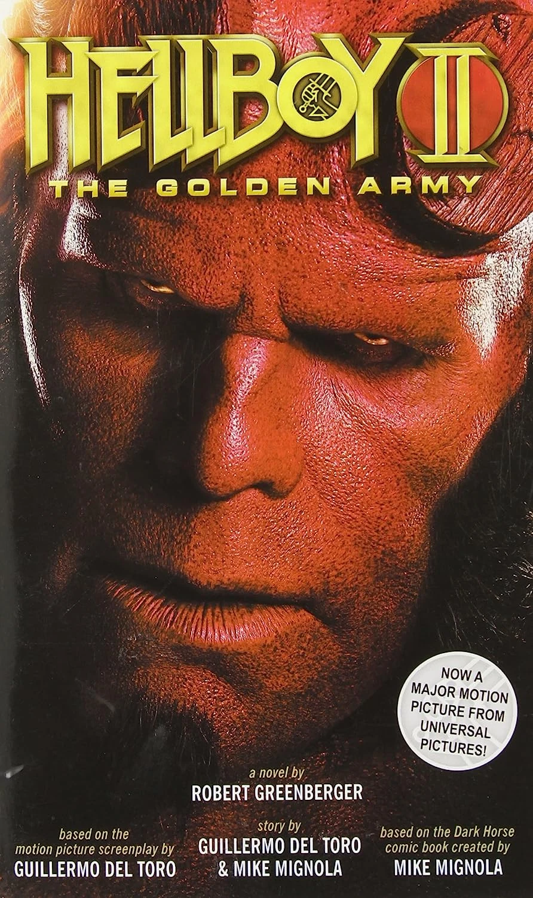

</tbody>

## 短篇小说

地狱男爵宇宙的短篇小说大部分收录在一系列选集中。不过，另有两篇短篇小说被收录在其他出版物中。

### 短篇选集

这些短篇选集均由 Christopher Golden 主编。

书名
封面
出版日期
故事
作者

<tbody>

*[《地狱男爵：杂务》（Hellboy: Odd Jobs）](/entry/Hellboy__Odd_Jobs)*
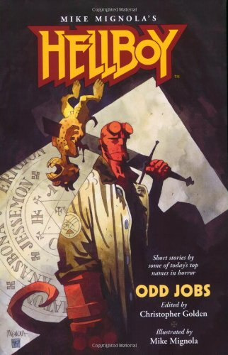MIKE MIGNOLA
December 15, 1999 
February 11, 2020（有声书）<a href="#fn1" class="footnote-ref" id="fnref1" role="doc-noteref">1</a>
*《美杜莎的复仇》（Medusa's Revenge）*
Yvonne Navarro

*《拼图》（Jigsaw）*
Stephen Bissette

*《母亲在午夜哭泣》（A Mother Cries at Midnight）*
Philip Nutman

*《送达》（Delivered）*
Greg Rucka

*《二人成疯》（Folie á Deux）*
Nancy Holder

*《恶魔政治》（Demon Politics）*
Craig Shaw Gardner

*《残酷童话》（A Grim Fairy Tale）*
Nancy A. Collins

*《受惊的乌鸦》（Scared Crows）*
Rick Hautala 
<em>与</em> Jim Connolly

*《他们的火焰不熄之处》（Where Their Fire Is Not Quenched）*
Chet Williamson

*《我怀了大脚怪的孩子！》（I Had Bigfoot's Baby!）*
Max Allan Collins

*《纳克拉维》（The Nuckelavee）*
Christopher Golden 
<em>与</em> Mike Mignola

*《海滩一夜》（A Night at the Beach）*
Matthew J. Costello

*《燃烧吧，宝贝，燃烧》（Burn, Baby, Burn）*
Poppy Z. Brite

*《他的夸口远飞》（Far Flew the Boast of Him）*
Brian Hodge

*[《地狱男爵：更多杂务》（Hellboy: Odder Jobs）](/entry/Hellboy__Odder_Jobs)*
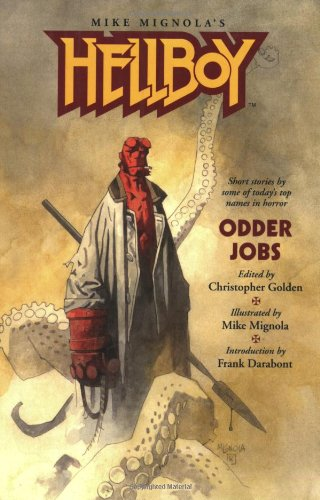MIKE MIGNOLA
October 6, 2004 
March 10, 2020（有声书）<a href="#fn2" class="footnote-ref" id="fnref2" role="doc-noteref">2</a>
*《枪之兄弟会》（The Brotherhood of the Gun）*
Frank Darabont

*《逃离巫师》（From an Enchanter Fleeing）*
Peter Crowther

*《洪水深处》（Down in the Flood）*
Scott Allie

*《纽福德捉鬼小队》（Newford Spook Squad）*
Charles de Lint

*《水之乐》（Water Music）*
David J. Schow

*《吸血鬼简报》（The Vampire Brief）*
James L. Cambias

*《未尽之事》（Unfinished Business）*
Ed Gorman 
<em>&amp;</em> Richard Dean Starr

*《圣徒地狱男爵》（Saint Hellboy）*
Tom Piccirilli

*《曼哈顿无眠》（Sleepless in Manhattan）*
Nancy Kilpatrick

*《祈愿猎犬》（The Wish Hounds）*
Sharyn McCrumb

*《仁慈之举》（Act of Mercy）*
Thomas E. Sniegoski

*《三名之丘》（The Thrice-Named Hill）*
Graham Joyce

*《血与泥》（Of Blood, of Clay）*
James A. Moore

*《充实而满足的一生》（A Full and Satisfying Life）*
Ray Garton

*《玻璃之路》（The Glass Road）*
Tim Lebbon

*《美味牙齿》（Tasty Teeth）*
Guillermo del Toro 
<em>&amp;</em> Matthew Robbins

*[《地狱男爵：最怪杂务》（Hellboy: Oddest Jobs）](/entry/Hellboy__Oddest_Jobs)*
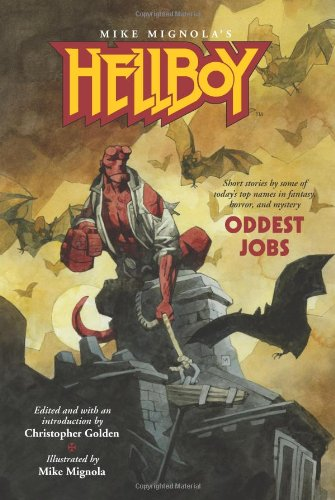MIKE MIGNOLA
July 9, 2008 
March 24, 2020（有声书）<a href="#fn3" class="footnote-ref" id="fnref3" role="doc-noteref">3</a>
*《与影子、巨龙和黑色长列车共舞》（Jiving with Shadows and Dragons and Long, Black Trains）*
Joe R. Lansdale

*《一口闷，不掺水》（Straight, No Chaser）*
Mark Chadbourn

*《二度蜜月》（Second Honeymoon）*
John Skipp 
<em>&amp;</em> Cody Goodfellow

*《丹尼男孩》（Danny Boy）*
Ken Bruen

*《西部高地怪钓》（Strange Fishing in the Western Highlands）*
Garth Nix

*《火蜥蜴蓝调》（Salamander Blues）*
Brian Keene

*《星期四来客》（The Thursday Men）*
Tad Williams

*《收成》（Produce）*
Amber Benson

*《收回》（Repossession）*
Barbara Hambly

*《橱柜与书架之间》（In Cupboards and Bookshelves）*
Gary A. Braunbeck

*《斯喀戎之足》（Feet of Sciron）*
Rhys Hughes

*《怪物男孩》（Monster Boy）*
Stephen Volk

*《进化与地狱穴峡谷》（Evolution and Hellhole Canyon）*
Don Winslow

*《一间自己的房间》（A Room of One's Own）*
China Miéville

*[《地狱男爵：恐怖集锦》（Hellboy: An Assortment of Horrors）](/entry/Hellboy__An_Assortment_of_Horrors)*
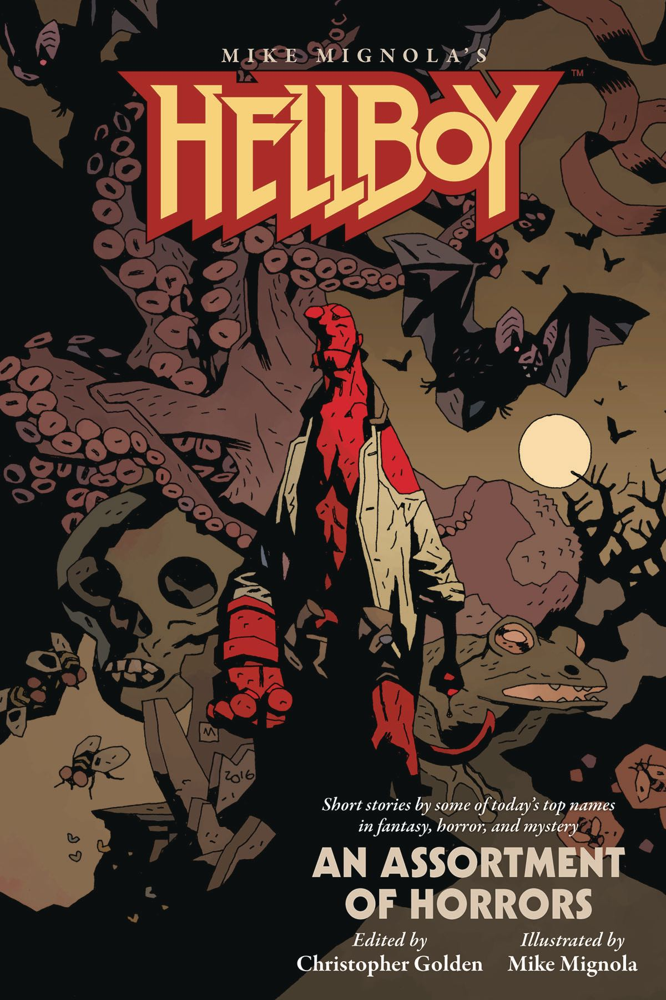MIKE MIGNOLA
August 16, 2017 
January 28, 2020（有声书）<a href="#fn4" class="footnote-ref" id="fnref4" role="doc-noteref">4</a>
*《许诺的微笑》（The Promised Smile）*
Rio Youers

*《当鸽子哭泣》（When Doves Cry）*
Delilah S. Dawson

*《夏天的另一面》（The Other Side of Summer）*
Chris Roberson

*《地狱男爵的"地狱男爵性"》（The Hellboyness of Hellboy）*
Chris Priestley

*《再来一只激进石狐》（One More Radical Stone Fox）*
Chelsea Cain

*《决斗者》（The Duelist）*
Jonathan Maberry

*《图书馆宁静一夜》（A Quiet Night in the Library）*
E. Lily Yu

*《火是魔鬼唯一的朋友》（Fire Is the Devil's Only Friend）*
Michael Rowe

*《一只该死的巨型吸血鬼》（A Huge Damn Vampire）*
Richard Kadrey

*《另一伙政府人员》（The Other Government Guys）*
Weston Ochse

*《她的毁灭右手》（Her Red Right Hand）*
Paul Tremblay

*《给猫系铃》（To Bell the Cat）*
Angela Slatter

*《藏匿》（Versteckdt）*
Kealan Patrick Burke

*《男孩与双头狗》（Of Boys and Two-headed Dogs）*
Laird Barron

*《燃烧的女孩》（Burning Girls）*
Seanan Mcguire

*《蠕虫之主的故事》（Tales of the Worm Lord）*
Nathan Ballingrud

</tbody>

<aside id="footnotes" class="footnotes footnotes-end-of-document" role="doc-endnotes">

<ol>
<li id="fn1"><a href="https://www.audible.com/pd/Hellboy-Odd-Jobs-Audiobook/1690565616"><em>《地狱男爵：杂务》</em>有声书</a><a href="#fnref1" class="footnote-back" role="doc-backlink">↩︎</a></li>
<li id="fn2"><a href="https://www.audible.com/pd/Hellboy-Odder-Jobs-Audiobook/1690590335"><em>《地狱男爵：更多杂务》</em>有声书</a><a href="#fnref2" class="footnote-back" role="doc-backlink">↩︎</a></li>
<li id="fn3"><a href="https://www.audible.com/pd/Hellboy-Oddest-Jobs-Audiobook/1690589035?qid=1583382532"><em>《地狱男爵：最怪杂务》</em>有声书</a><a href="#fnref3" class="footnote-back" role="doc-backlink">↩︎</a></li>
<li id="fn4"><a href="https://www.audible.com/pd/Hellboy-An-Assortment-of-Horrors-Audiobook/1690563818"><em>《地狱男爵：恐怖集锦》</em>有声书</a><a href="#fnref4" class="footnote-back" role="doc-backlink">↩︎</a></li>
</ol>
</aside>

### 收录于其他出版物的短篇小说

故事
作者
所在出版物
出版日期
封面

<tbody>

*[《空行母》（Dakini）](/entry/Dakini)*
[Christopher Golden](/entry/Christopher_Golden)
*[《地狱男爵资料集与角色扮演游戏》（Hellboy Sourcebook and Roleplaying Game）](/entry/Hellboy_Sourcebook_and_Roleplaying_Game)*
August 2002
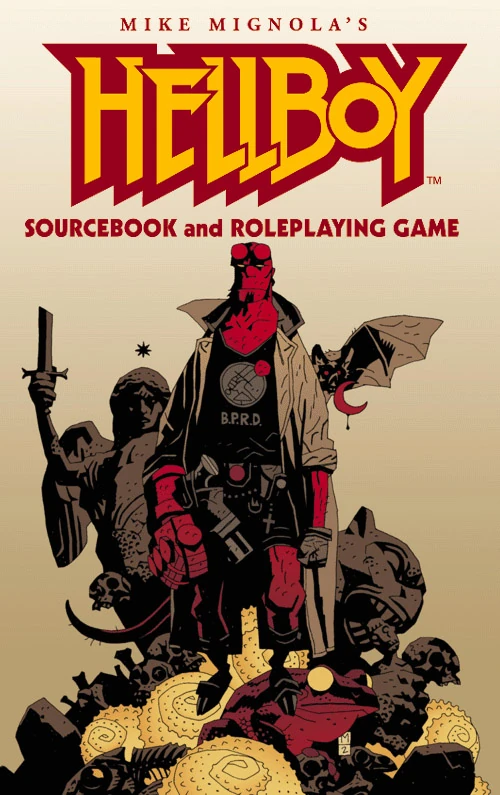MIKE MIGNOLA

*[《海中城》（The City in the Sea）](/entry/The_City_in_the_Sea)*
[Christopher Golden](/entry/Christopher_Golden) &amp; [Mike Mignola](/entry/Mike_Mignola)
*《奇谈》（Weird Tales）* #367
May 2023
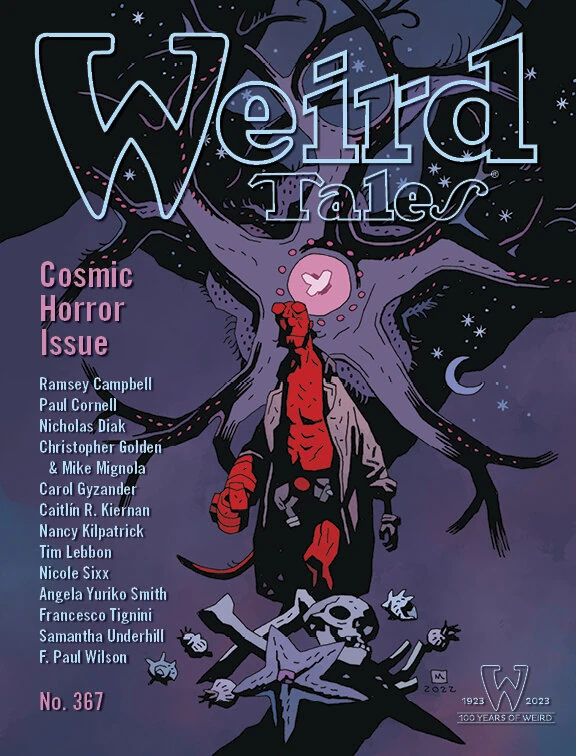MIKE MIGNOLA

</tbody>

## 正史

作者 [Christopher Golden](/entry/Christopher_Golden) 撰写了多部《地狱男爵》[小说](/entry/wikipedia%3ANovel)。最早的两部——《迷失军团》和《巨人之骨》——都被收入了 *[《地狱男爵指南》（Hellboy: The Companion）](/entry/Hellboy__The_Companion)* 中刊载的漫画官方时间线，短篇小说《纳克拉维》同样如此。此外，尽管 Golden 创造的角色 [Anastasia Bransfield](/entry/Anastasia_Bransfield) 在《地狱男爵指南》出版之时尚未真正在漫画中登场，她在该书中也得到了介绍（不过她曾在 *[《亚伯·塞皮恩：溺亡》（Abe Sapien: The Drowning）](/entry/The_Drowning)* 中被间接地提及）。

在 2017 年的一次访谈中，[Mike Mignola](/entry/Mike_Mignola)、Christopher Golden 和 [Chris Roberson](/entry/Chris_Roberson) 讨论了哪些散文体故事属于正史。[1] Roberson 表示 Ginny（出自《夏天的另一面》）将在漫画的一段闪回中登场，Golden 则暗示我们可能会在未来的漫画中看到 Anastasia。此后 Anastasia 已被纳入漫画系列，在 *[《恋爱中的地狱男爵》（Hellboy in Love）](/entry/Hellboy_in_Love)* 系列中联合主演，而 Jenny 则在 *[《恐惧的对称》（Fearful Symmetry）](/entry/Fearful_Symmetry)* 中首次在漫画中登场。他们接着表示，Golden 撰写的小说以及 Roberson 和 Rio Youers 撰写的短篇小说应当被视为正史。

官方认定的正史散文体故事包括：

- *[《地狱男爵：迷失军团》（Hellboy: The Lost Army）](/entry/Hellboy__The_Lost_Army)*
- *[《地狱男爵：巨人之骨》（Hellboy: The Bones of Giants）](/entry/Hellboy__The_Bones_of_Giants_%28prose_novel%29)* —— 当被问及[漫画改编版](/entry/The_Bones_of_Giants_%28comic_miniseries%29)所做的改动时，Golden 表示，当散文小说与漫画发生冲突时，应以漫画为准。
- *《纳克拉维》（The Nuckelavee）*（出自 *[《地狱男爵：杂务》（Hellboy: Odd Jobs）](/entry/Hellboy__Odd_Jobs)*）
- *[《地狱男爵：龙潭》（Hellboy: The Dragon Pool）](/entry/Hellboy__The_Dragon_Pool)*
- *《许诺的微笑》（The Promised Smile）*（出自 *[《地狱男爵：恐怖集锦》（Hellboy: An Assortment of Horrors）](/entry/Hellboy__An_Assortment_of_Horrors)*）
- *《夏天的另一面》（The Other Side of Summer）*（出自 *[《地狱男爵：恐怖集锦》（Hellboy: An Assortment of Horrors）](/entry/Hellboy__An_Assortment_of_Horrors)*）
- *《海中城》（The City in the Sea）*（出自 *《奇谈》（Weird Tales）\#367*）

## 参考资料

[1] <http://www.multiversitycomics.com/interviews/mignolaverse2017-part1/>
