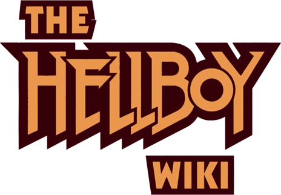

  

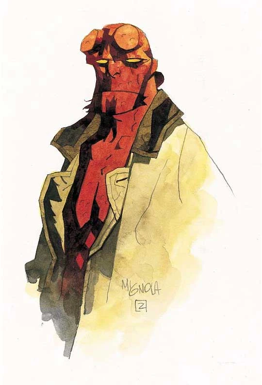

**地狱男爵维基（Hellboy Wiki）**是一座协作式数据库，收录与[迈克·米格诺拉](/entry/Mike_Mignola)的***[《地狱男爵》](/entry/Hellboy_(series))***系列及其[相关作品](/entry/The_Hellboy_Universe_Comics)，以及它们在电影、小说、[游戏](/entry/Hellboy%3A_The_Board_Game)等所有其他媒介中登场的一切内容。任何人都可以创建和编辑本站的页面，让我们共同打造一座全面的数据库。入门请务必查阅**[帮助页面](https://community.fandom.com/wiki/Help:Contents)**！

已有超过 **200** 个故事拥有独立条目！其中包括[地狱男爵](/entry/Hellboy_(character))担任标题角色的**每一部**漫画。完整列表见**这里**。想了解所有最新消息，包括最新的书刊预告和新书预览链接，请前往 Comic Book Resources 上的**地狱男爵官方论坛**。

还有许多页面有待完善，尤其是存根页面和需要清理的页面。  
  

***来 Mignolaverse Discord 加入讨论吧***  
（那里甚至有一个专门讨论地狱男爵维基编辑工作的频道。）

  

|                  |
|:-----------------|
| 出版产品线 |

  

|              |
|:-------------|
| 出版物 |

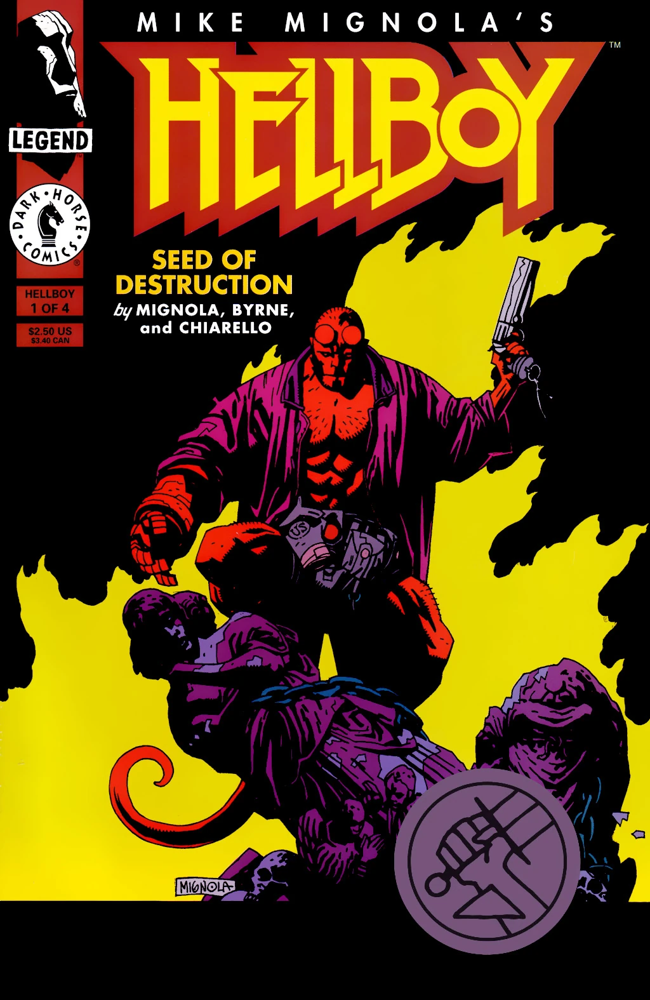

单行本

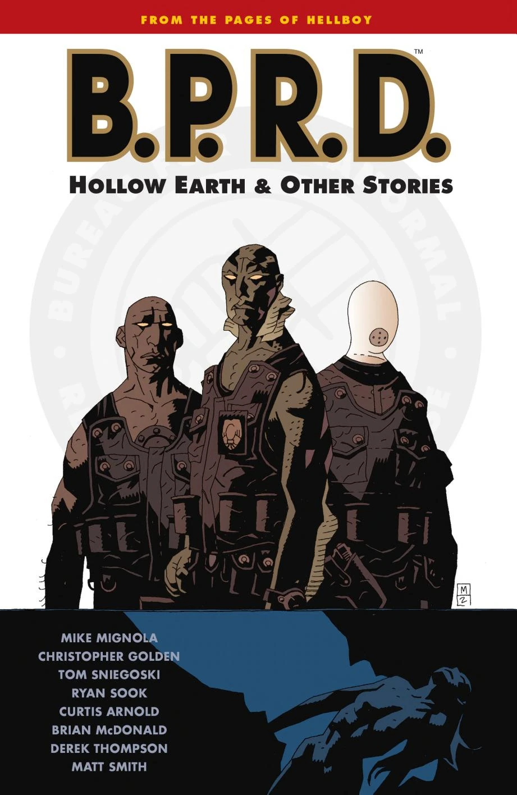

平装合订本

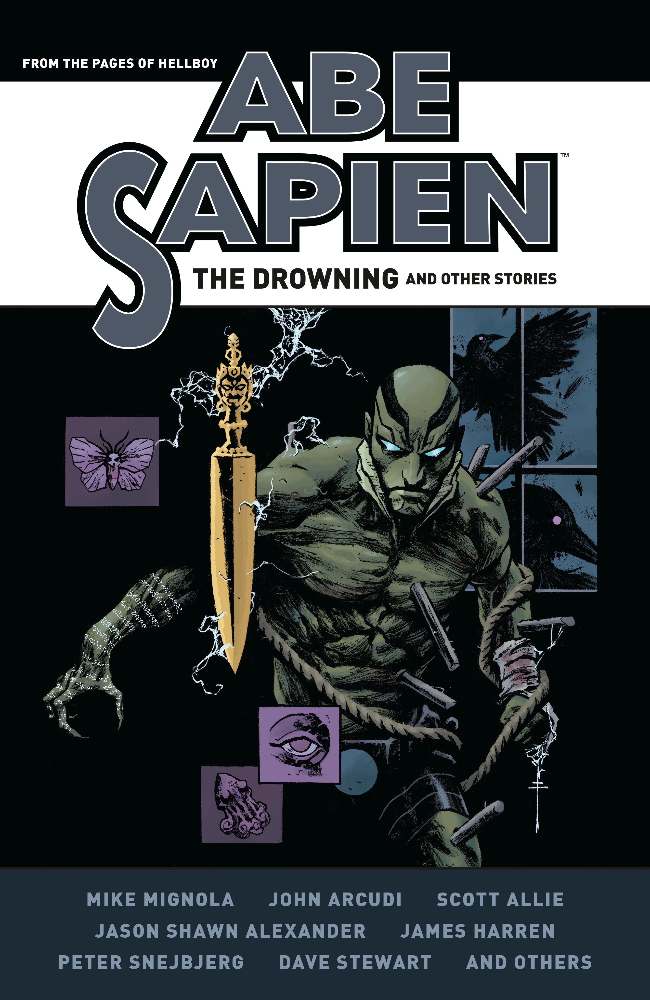

合辑本

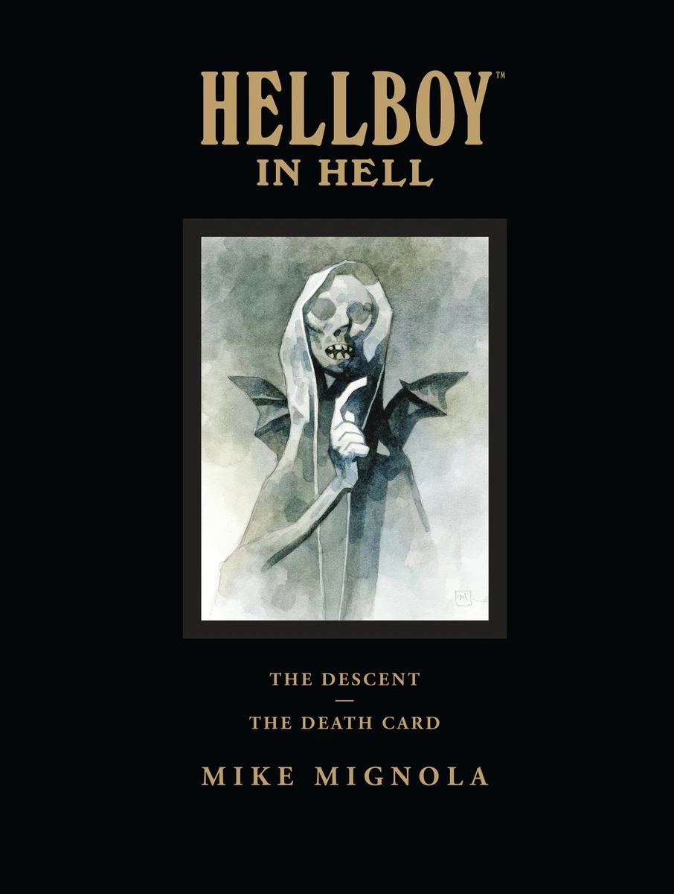

图书馆典藏版

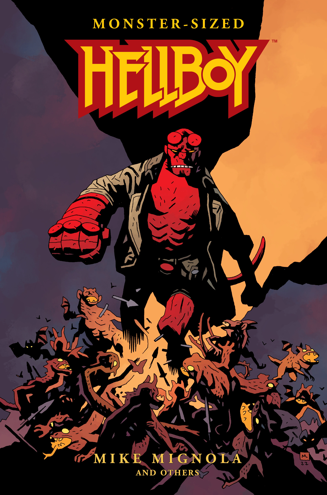

大全集版

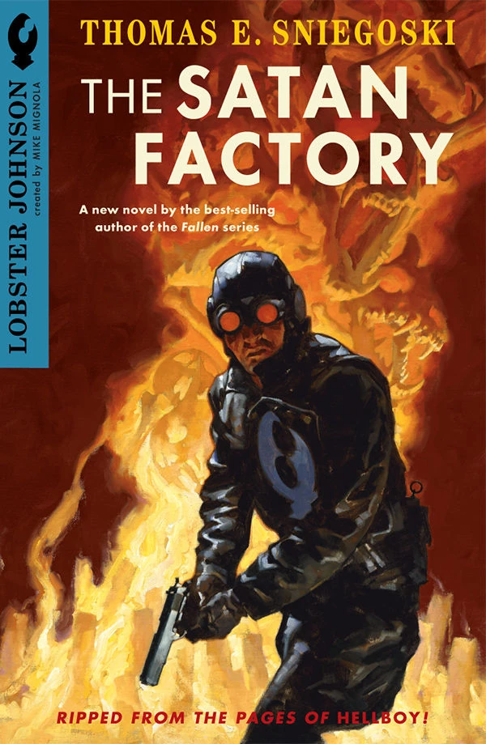.jpg)

文字故事

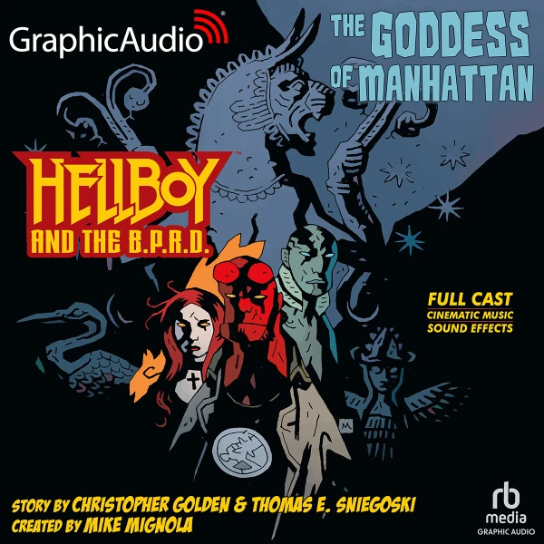

广播剧

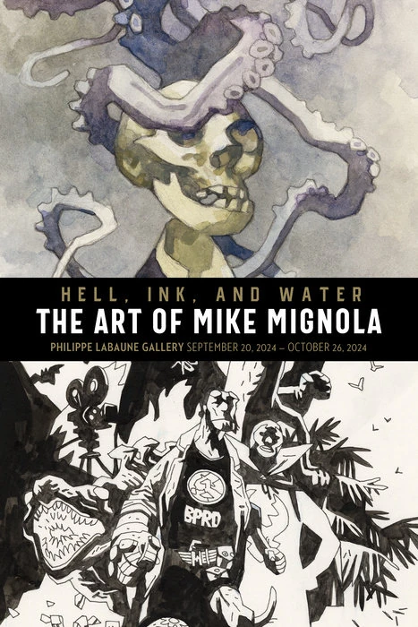

画集

  

|       |
|:------|
| 电影 |

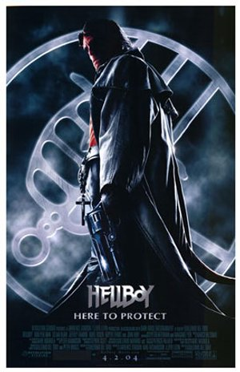
《地狱男爵》（2004 电影）
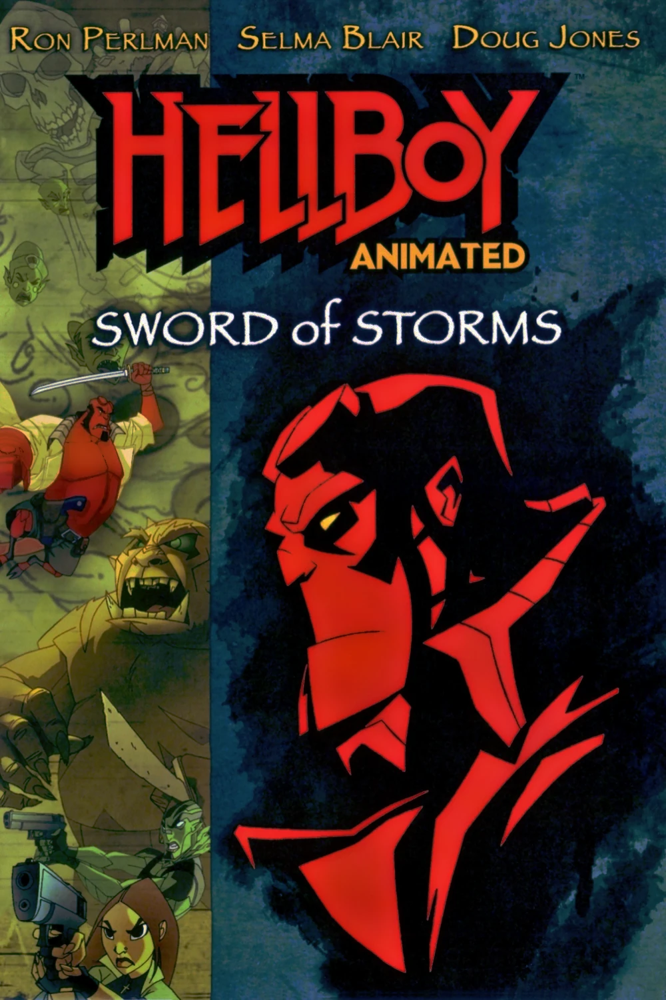
《地狱男爵动画版：
风暴之剑》
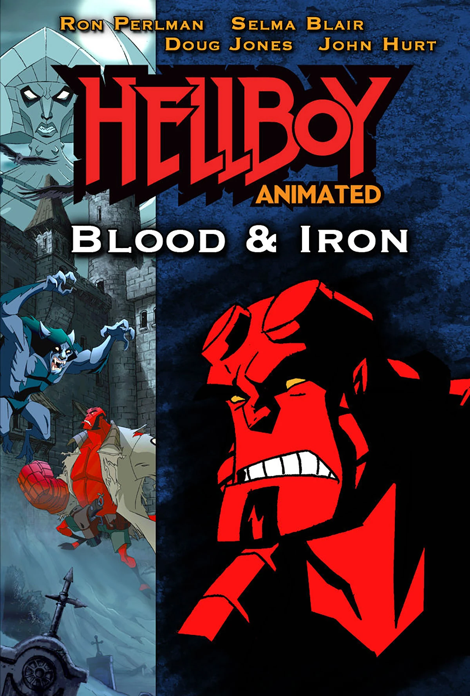
《地狱男爵动画版：
铁血惊魂》

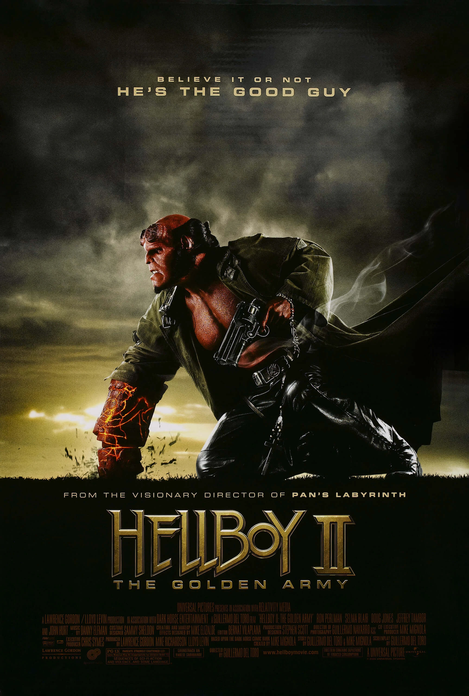
《地狱男爵 2：黄金军团》
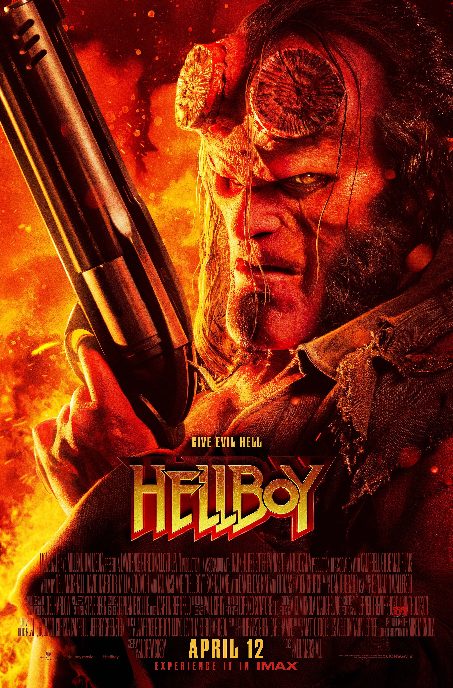
《地狱男爵》（2019 电影）
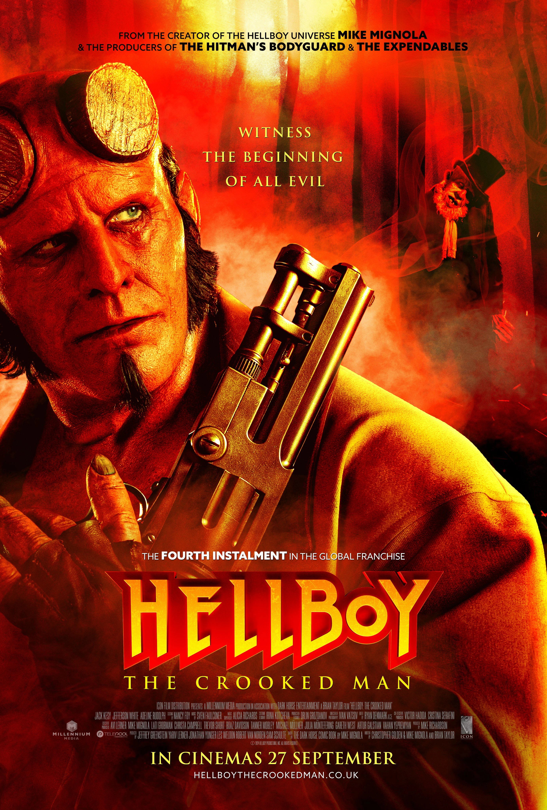
《地狱男爵：扭曲人》

  

|                   |
|:------------------|
| 即将出版 |

|         |      |          |
|---------|------|----------|
| 单行本 |      |          |
| 封面   | 信息 | 创作者 |

合订本

封面
信息
创作者

&#10;
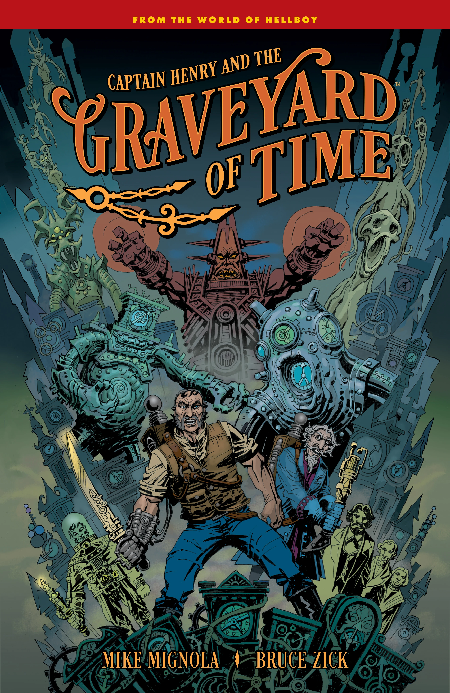
2026 年 7 月 21 日

《亨利船长与时间墓地》

在这部穿越时空、通往另一个维度的故事中，探索地狱男爵漫画宇宙的一处新角落！

19 世纪 80 年代英格兰的一个漆黑夜晚，一向热衷冒险的惠蒂尔家族与爱德华·格雷一道，试图把一个人送入现实与彼岸之间的领域，去解救一位被困的惠蒂尔家叔父的灵魂。但他这场穿越空间——与时间——的探险，将把他带到连猎巫人都闻所未闻的地方。

《亨利船长与时间墓地》跟随一位无畏的时间旅行探险家踏上前往新维度的旅程。他很快发现，自己遭遇的怪物并非唯一的麻烦——时间本身或许才是更大的危险。

迈克·米格诺拉与布鲁斯·齐克（Bruce Zick）共同编写剧本，齐克（曾画《雷神》《原子军团》）执笔作画；这部全新系列将探索地狱男爵宇宙中一处未经测绘的角落！

收录《亨利船长与时间墓地》第 1–4 期及附赠内容。

故事
迈克·米格诺拉
布鲁斯·齐克

作画
布鲁斯·齐克

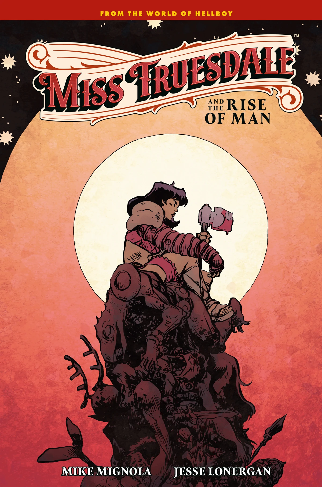
2026 年 8 月 18 日

《特鲁斯代尔小姐与人类的崛起》

地狱男爵的创造者迈克·米格诺拉与画师 Jesse Lonergan 在这部全新漫画迷你系列中，继续讲述广受好评的特鲁斯代尔小姐传奇。

阿努姆·亚萨（Anum Yassa）终于与自己的诸般前世和解，如今却必须为保护未来而战，因为一股黑暗势力正企图将其摧毁。

人类的命运掌握在她的手中。

由秘书特鲁斯代尔变身的角斗士阿努姆·亚萨在森林中漫游，探寻自己的生命——过去、现在与未来。一只又一只怪物，一个又一个敌人，阿努姆·亚萨奋力击退——但在这一切背后，藏着某物或某人。这位角斗士秘书必须抢在一股强大的邪恶势力之前守护人类的未来，以免它阻断人类的宿命、代之以更黑暗的命运——而邪恶势力不会轻易罢手。

收录《特鲁斯代尔小姐与人类的崛起》第 1–4 期及附赠内容。

故事
迈克·米格诺拉

作画
Jesse Lonergan

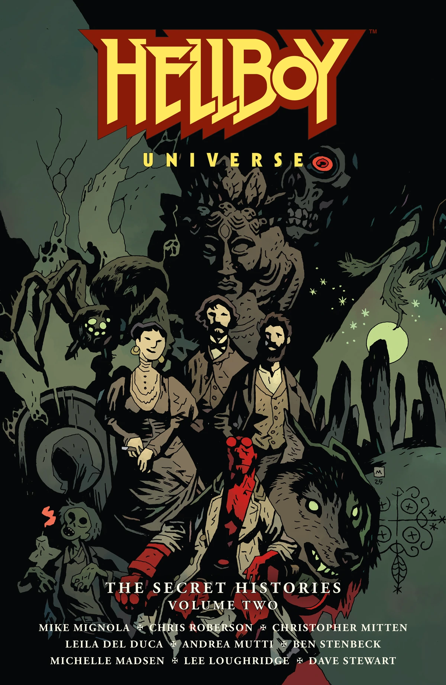
2026 年 9 月 22 日

《地狱男爵宇宙：秘史——第二卷》

四位迷人配角的故事在本卷中得到完整呈现；这些独立成篇的漫画故事结集为第二卷，是任何地狱男爵粉丝书库的完美补充。

在黑焰威胁超自然调查防御署——乃至整个世界——之前，他力量的源泉是什么？地狱男爵的西蒙舅舅是何许人也，他与银灯俱乐部调查过哪些神秘学谜案？银灯俱乐部成员、侦探莎拉·朱厄尔能否在自己也沦为受害者之前，在一桩密室谋杀谜案中找出凶手？而在一座恪守奇特传统的宁静英国小镇，村庄的历史是否可能关联着某些他们无从想象的、更宏大也更重大的事件？潜入这些超自然谜团吧——这些独立成篇的故事结集为第二卷，是任何地狱男爵粉丝书库的完美补充。

地狱男爵的创造者迈克·米格诺拉与编剧 Chris Roberson，以及画师 Christopher Mitten、Leila del Duca、Andrea Mutti、Ben Stenbeck 等人一道，将这些地狱男爵宇宙中的谜案公之于世。

收录《黑焰的崛起》第 1–5 期、《失落地平线之屋》第 1–5 期、《英国超自然学会：忘却的时光》第 1–4 期、《地狱男爵：银灯俱乐部》第 1–5 期及附赠内容。

故事
迈克·米格诺拉
Chris Roberson

作画
Christopher Mitten
Leila Del Duca
Andrea Mutti
Ben Stenbeck

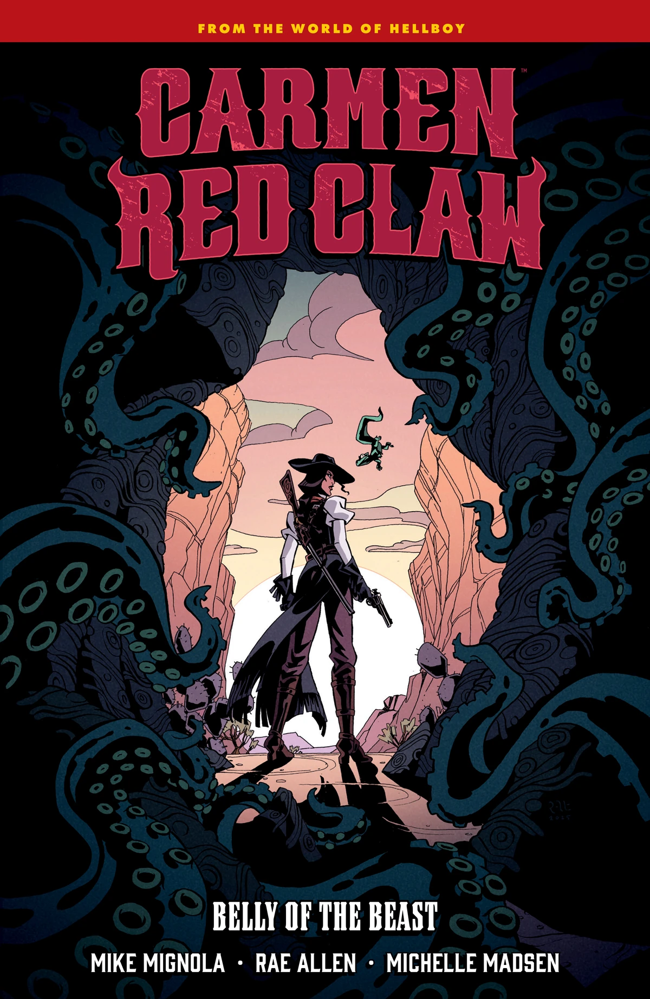
2026 年 9 月 29 日

《卡门·雷德克劳：巨兽之腹》

埃尔·博加万特（El Bogavante）的一位后裔大战卓柏卡布拉、黑帮以及更多怪物——一场西部荒野风的超自然冒险！

超自然雇佣兵、臭名昭著的埃尔·博加万特会变形的后裔卡门·雷德克劳（Carmen Red Claw）在调查一片据称受到诅咒的牧场土地时，遭遇了一种新型怪物。某种东西正在整片地区各处的牧场杀死牛群；一路上她既要大战卓柏卡布拉、追逐一列失控的火车，还得应付家族风波。但卡门必须查明，制造这些杀戮的究竟是不是一头野兽——抑或真正的怪物其实是人类。

编剧兼画师 Rae Allen（曾作《曼德菲尔德恶魔》《百万双眼睛之城》）加入地狱男爵宇宙；这场超自然西部冒险以 19 世纪 70 年代的新墨西哥领地为舞台！

收录《卡门·雷德克劳：巨兽之腹》第 1–4 期及附赠速写本内容

故事
迈克·米格诺拉
Rae Allen

作画
Rae Allen

|                                                               |
|:--------------------------------------------------------------|
| 角色 |

<li>地狱男爵</li>
<li>丽兹·舍曼</li>
<li>亚伯·塞皮恩</li>
<li>凯特·考瑞根</li>
<li>罗杰</li>
<li>本·达米奥</li>
<li>约翰·克劳斯</li>
<li>潘雅</li>
<li>菲尼克斯·埃斯佩霍</li>
<li>泰德·霍华德</li>
<li>阿什利·斯托德</li>
<li>J·H·奥唐纳教授</li>
<li>特雷佛·布鲁姆教授</li>

<li>西蒙·安德斯</li>
<li>雅各布·斯特格纳</li>
<li>阿奇博尔德·穆拉罗</li>
<li>苏珊·项</li>
<li>伍德罗·法瑞尔</li>
<li>爱德华·格雷爵士</li>
<li>莎拉·朱厄尔</li>
<li>“龙虾”（大螯虾强生）</li>
<li>哈里·麦克泰尔</li>
<li>辛西雅·泰南</li>
<li>弗兰肯斯坦</li>
<li>科西切</li>
<li>瓦尔瓦拉</li>

<li>奥古·桀哈</li>
<li>赫卡特</li>
<li>黑焰</li>
<li>撒旦</li>
<li>血皇后妮缪</li>
<li>格里高利·拉斯普廷</li>
<li>卡尔·鲁普雷希特·克焰人</li>
<li>利奥波德·克茨</li>
<li>赫尔曼·冯·卡朗普特</li>
<li>雅加婆婆</li>
<li>棕精灵</li>
<li>马丁·吉尔弗里德（梅姆南·萨）</li>
<li>古斯塔夫·斯特罗布尔</li>

**奇幻电影**

*想获取相关资讯，或想为你自己的维基寻求帮助，请访问这些站点！*

《纳尼亚传奇》•《驯龙高手》•《黑暗物质三部曲》•《星光继承者》• 吸血鬼猎人巴菲宇宙 • Rickpedia：《木乃伊》• 奇幻电影 •《最终幻想》•《龙与地下城》•《哈利·波特》•《地狱男爵》•《风云际会》•《指环王》•《加勒比海盗》•《黑夜传说》•《绿野仙踪》

*想让你的社区也被收录？来看看怎么做！*

地狱男爵维基与 Dark Horse Database（黑马漫画数据库）结为姊妹站点。
