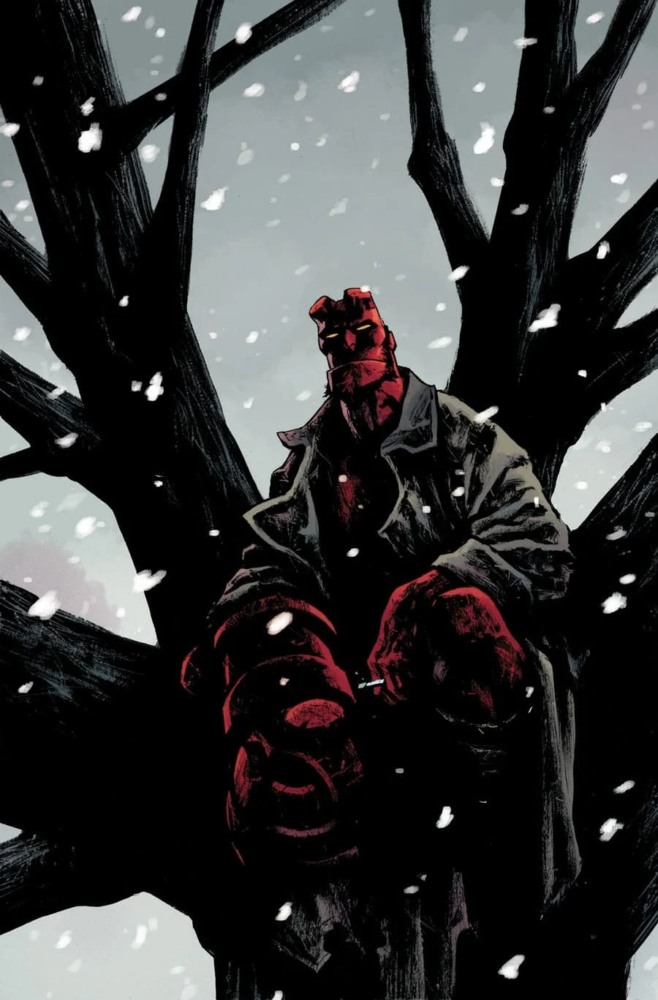
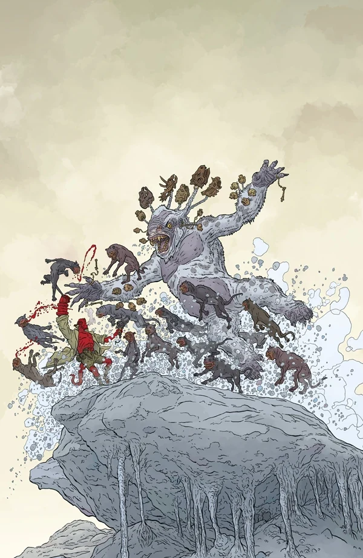
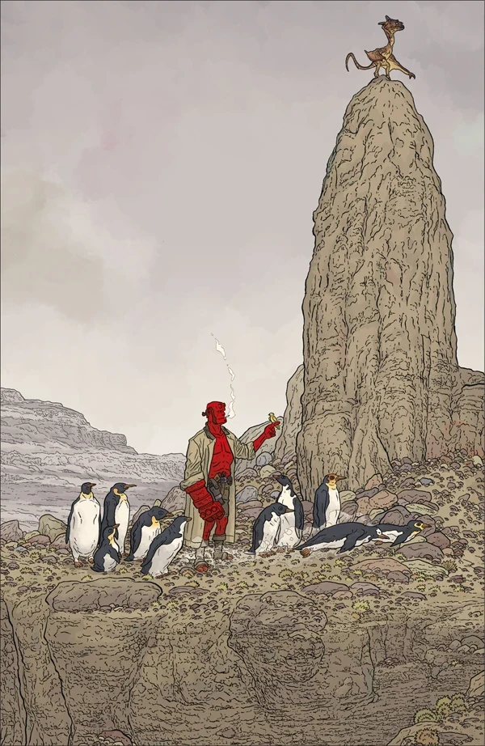

一部收录三个故事的漫画特刊。这部漫画是蒂姆·塞尔（Tim Sale）、迈克尔·沃尔什（Michael Walsh）、克里斯·罗伯森（Chris Roberson）和切尔西·凯恩（Chelsea Cain）在地狱男爵宇宙中的首次亮相。这部单行本是《[地狱男爵冬季特刊](/entry/Hellboy_Winter_Special)》（Hellboy Winter Special）选集的第二辑。

## 征订预告

三个怪谈故事串联起地狱男爵世界的悠悠岁月：在 1890 年代的伦敦，爱德华·格雷与近期《黑焰崛起》（*Rise of the Black Flame*）系列的主角莎拉·朱厄尔并肩登场。在 1980 年代的新英格兰，地狱男爵、亚伯·塞皮恩和丽兹·谢尔曼出发寻找几名失踪儿童，这本是一桩简单的搜寻任务，却遇上了一个渴望与人分担痛苦的受折磨亡魂。

此外，保罗·格里斯特（*Kane*、*Jack Staff*）加盟创作团队，带来一则 1950 年代的《地狱男爵》故事，让人得以一窥米格诺拉宇宙中下一部即将登场的全新刊物。

## 收录内容

- 《[大暴风雪](/entry/The_Great_Blizzard)》（The Great Blizzard），编剧：迈克·米格诺拉、克里斯·罗伯森；作画：克里斯托弗·米滕
- 《[上帝赐你们喜乐](/entry/God_Rest_Ye_Merry)》（God Rest Ye Merry），编剧：迈克·米格诺拉、克里斯·罗伯森；作画：保罗·格里斯特
- 《[费尔菲尔德最后的女巫](/entry/The_Last_Witch_of_Fairfield)》（The Last Witch of Fairfield），编剧：迈克·米格诺拉、斯科特·阿利；作画：塞瓦斯蒂安·菲乌马拉

## 图集

