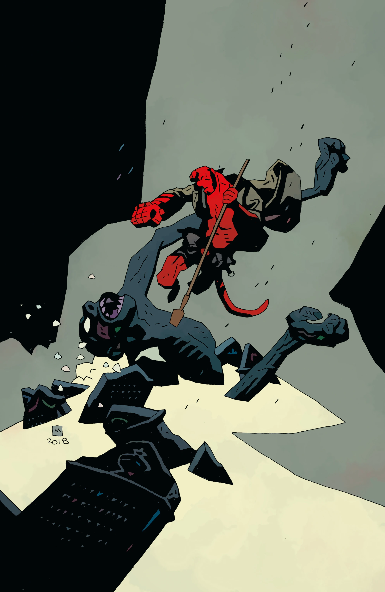
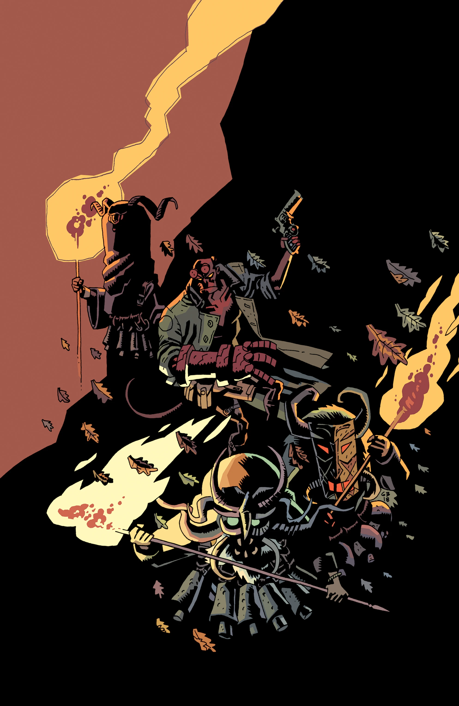
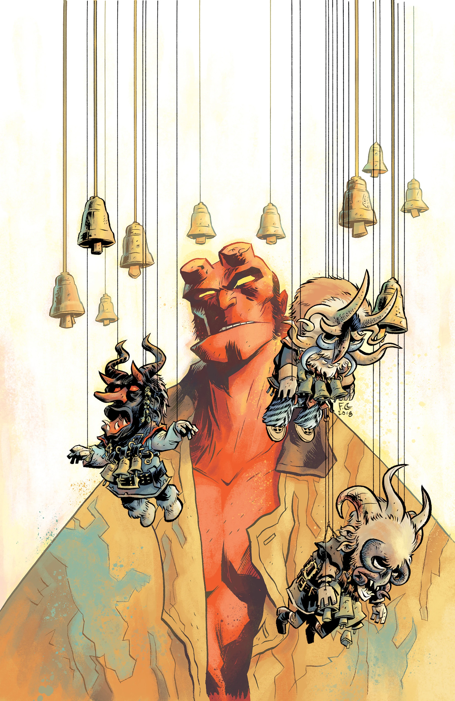

***《地狱男爵冬季特刊（2018）》*（Hellboy Winter Special (2018)）**是 2018 年 12 月的一部选集特刊，收录三个故事。这本单刊延续了松散的 *[《地狱男爵冬季特刊》（Hellboy Winter Special）](/entry/Hellboy_Winter_Special)* 系列。

## 出版历史

编辑卡蒂·奥布赖恩（Katii O'Brien）在黑马 2018 年 6 月 6 日的 NCBD Rundown 节目中宣布了这本漫画。[1] 完整的征订简介在 2018 年圣迭戈国际动漫展上揭晓，是 *地狱男爵* 25 周年纪念发布内容的一部分。

## 征订简介

三个冬日故事：[迈克·米格诺拉](/entry/Mike_Mignola)与本·斯滕贝克（Ben Stenbeck）联手，讲述地狱男爵造访英格兰一户人家时，一场跨年夜降神会出了岔子；法比奥·穆恩（Fábio Moon）和加布里埃尔·巴（Gabriel Bá）以一篇全新联动故事重回《B.P.R.D.：吸血鬼》（B.P.R.D.: Vampire）；通奇·宗伊奇（Tonci Zonjic）回归，自编自绘龙虾约翰逊的故事。

## 收录内容

- *[《新年快乐，艾娃·加卢奇》（Happy New Year, Ava Galluci）](/entry/Happy_New_Year%2C_Ava_Galluci)*，[迈克·米格诺拉](/entry/Mike_Mignola) 编剧，[本·斯滕贝克](/entry/Ben_Stenbeck) 绘画
- *[《迷失者》（Lost Ones）](/entry/Lost_Ones)*，[法比奥·穆恩](/entry/F%C3%A1bio_Moon) 和 [加布里埃尔·巴](/entry/Gabriel_B%C3%A1) 自编自绘
- *[《空椅子》（The Empty Chair）](/entry/The_Empty_Chair)*，[通奇·宗伊奇（Tonci Zonjic）](/entry/Tonci_Zonjic)自编自绘

## 封面画廊

## 参考资料

[1] [Katii O'Brien 在黑马 2018 年 6 月 6 日 NCBD Rundown 节目中谈地狱男爵宇宙](https://www.youtube.com/watch?v=0VCS7AWbOi4&feature=youtu.be&t=759)
