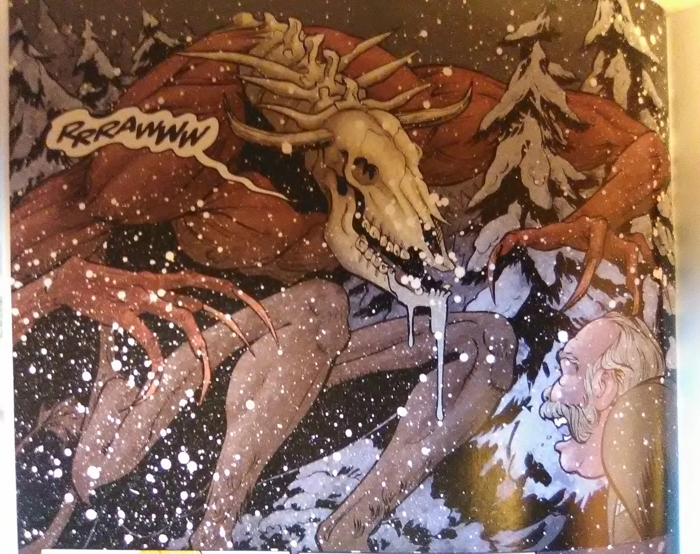
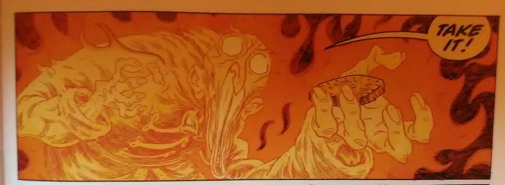

这是一部收录三个故事的漫画特刊。本期是 Márk László、Leila del Duca 与 Andrea Mutti 首次在地狱男爵宇宙中亮相。这部单刊是 *《地狱男爵冬日特刊》* 系列选集的第四部。奇怪的是，尽管它是2019年的冬日特刊，实际却在2020年才出版。

## 征订预告

以纯正的地狱男爵之风庆祝这个时节吧！

在另一个现实中遇见幽灵般的吝啬鬼，在纽约乡间令人生畏的布加姆（Boogam）面前胆寒，并在这三则神秘冬日故事中迎接圣哈根之怒！地狱男爵、Sarah Jewell 以及传说中的圣哈根骑士团这些熟悉的面孔，将陪你在无尽寒意中敲响新年的钟声——而并非所有寒意都来自天气！

一期之内，三个短篇故事！

## 收录内容

- *[《吝啬鬼的礼物》](/entry/The_Miser's_Gift)*，编剧 [Mike Mignola](/entry/Mike_Mignola)，作画 [Márk László](/entry/M%C3%A1rk_L%C3%A1szl%C3%B3)
- *[《最长之夜》](/entry/The_Longest_Night)*，编剧 [Chris Roberson](/entry/Chris_Roberson)，作画 [Leila del Duca](/entry/Leila_del_Duca)
- *[《英格尔海姆之兽》](/entry/The_Beast_of_Ingelheim)*，编剧 [Scott Allie](/entry/Scott_Allie)，作画 [Andrea Mutti](/entry/Andrea_Mutti)

## 画廊

地狱男爵冬日特刊 2019  
封面作者 [Mike Mignola](/entry/Mike_Mignola)  
[Dave Stewart](/entry/Dave_Stewart) 上色

布雷斯伍德的布加姆

吝啬鬼托博克

|braithwood boogam

|tobok the miser
