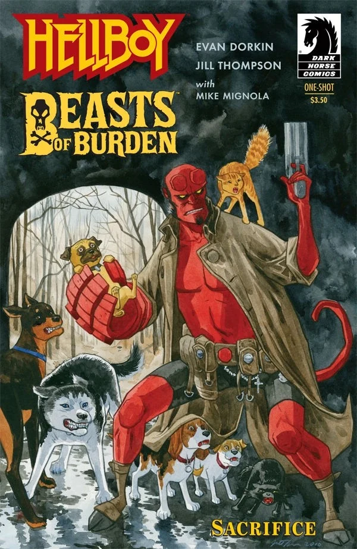

*《地狱男爵／负重之兽：献祭》（Hellboy / Beasts of Burden: Sacrifice）*是由[黑马漫画](/entry/Dark_Horse_Comics)出版的一部联动漫画。剧本由《负重之兽》（Beasts of Burden）的作者 [Evan Dorkin](/entry/Evan_Dorkin) 与《地狱男爵》的作者 [迈克·米格诺拉](/entry/Mike_Mignola) 共同撰写。《负重之兽》的常驻画师 [Jill Thompson](/entry/Jill_Thompson) 负责内页作画。

## 剧情简介

在宾夕法尼亚州兰开斯特县为一个阿米什人社区解决了一桩吸血鬼麻烦之后，一只流浪狗找上了[地狱男爵](/entry/Hellboy_(character))。流浪狗把他领到了“智犬会”（Wise Dog Society）面前，随即便消失不见。随后智犬会请地狱男爵帮忙调查三只猫惨遭仪式化杀害的案件。他们发现了一场旨在复活巫师卡尔（Karl）的血祭仪式。智犬会成员帕格斯利（Pugsley）朝仪式上撒尿，污染了仪式。污染使复活的巫师变得虚弱，最终被地狱男爵击败。

击败巫师之后，地狱男爵再次发现了那只流浪狗的身影，便跟了上去，结果那只狗又一次凭空消失。随后真相揭开：这只流浪狗是另一只狗的灵体投射，它以自己的生命为代价，将地狱男爵引到了智犬会。同时还揭示，这只狗此前至少这样做过一次——那一次它引领的是[大螯虾强生](/entry/The_Lobster)。

## 封面画廊

[Jill Thompson](/entry/Jill_Thompson) 绘制封面

[迈克·米格诺拉](/entry/Mike_Mignola) 与[戴夫·斯图尔特](/entry/Dave_Stewart)绘制变体封面

|Cover by Jill Thompson
## 外部链接

- DarkHorse.com 上的《地狱男爵／负重之兽：献祭》产品页
