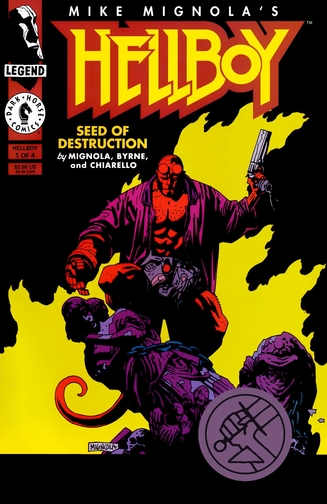
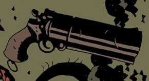
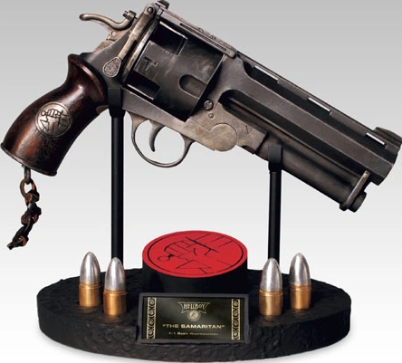

*关于[2004–2008 年电影中地狱男爵](/entry/Hellboy_(2004%E2%80%932008_film_character))使用的左轮手枪，见[《撒玛利亚人》](/entry/The_Samaritan)。*

[地狱男爵](/entry/Hellboy_(character))在[整个漫画系列](/entry/Hellboy_(series))中使用过好几**把枪**，其中最主要的是一把他携带了半个世纪的单发手枪。

## 单发手枪

地狱男爵最常被描绘为手持一把超大号的单发折开式手枪。这件武器是[自由火炬](/entry/The_Torch_of_Liberty)赠予他的；自由火炬还教授了地狱男爵射击技术。这把枪最终在 2002 年 10 月之后的某个时候遗失在[海底某处](/entry/The_Third_Wish)。

这把手枪被画成配有木质握把片，有时握把片底部附近刻有三或四道凹槽。偶尔，一截磨破的挂枪绳系在枪柄底部的挂环上。

尽管这把枪只能装一发子弹、每开一枪都必须重新装填，但在一些画面中它被画出了带凹槽的弹巢，暗示它像左轮手枪一样有多个弹膛；这在机械结构上与超大号枪管无法相容。把枪管这样画的画师可能是被米格诺拉独特的画风搞混了——他会在弹巢和枪管上画出粗黑线条来表示阴影。

地狱男爵为他的枪装填子弹

[邓肯·费格瑞铎](/entry/Duncan_Fegredo)画出的左轮转膛

[迈克·米格诺拉](/entry/Mike_Mignola)画出的类左轮手枪

地狱男爵的可动人偶、雕像及其他周边商品最常表现的就是他拿着这把枪，不过往往带有前面讨论过的类左轮转膛。

## 其他枪械

### 超自然调查防御署制式左轮

在[地狱男爵早年](/entry/Hellboy_and_the_B.P.R.D.)担任[超自然调查防御署](/entry/Bureau_for_Paranormal_Research_and_Defense)探员期间，他配备的是一把标准配发的制式左轮手枪。

在这一阶段的某些场合，他也会使用一把标准的半自动手枪（大概是 M1911）。

### 超自然调查防御署新式手枪

1994 年 5 月，地狱男爵在[前往格里亚特（Griart）执行任务](/entry/The_Wolves_of_Saint_August)时带了一把新枪。然而他还没来得及使用，这件武器就在他与同为超自然调查防御署探员的[凯特·考瑞根](/entry/Katherine_Corrigan)脚下地板塌陷时遗失了。

### Zinco 手枪

1997 年 3 月，地狱男爵被派往久雷斯库城堡时，配备了一把印有[辛科公司（Zinco Corporation）](/entry/Zinco_Corporation)品牌的半自动手枪。这把枪在抵挡[鸟身女妖](/entry/Witches)时一度表现良好，但很快卡壳，不久便在地狱男爵手中炸了膛。

### M1911A1 手枪

2007 年 6 月，地狱男爵被海水冲到[哈里·米德尔顿（Harry Middleton）](/entry/Harry_Middleton)家附近上岸，与后者的鬼魂一同歇息了一个月。当地狱男爵准备告辞时，米德尔顿送给他一把 1941 年的 M1911A1，替换他遗失的佩枪。这把枪甚至配的是左手枪套，正适合地狱男爵的左撇子射击姿势。

左轮手枪（*[《神秘情报》](/entry/Occult_Intelligence)* 第 \#1 期）

“我想赶赶时髦。”

地狱男爵的 Zinco 手枪以极具戏剧性的方式哑火。

“1941 年的美国陆军点四五，配左手枪套。”

## 趣闻

> 
>
> 够了！再也不用枪了。再也不用这些该死的机器了！我需要的……是没有活动部件的东西。
>
> 
>
> ——地狱男爵在 Zinco 手枪出故障后发泄挫败感

- 地狱男爵是出了名的神射手绝缘体，通常更喜欢用拳头或近战武器战斗。
  - [迈克·米格诺拉](/entry/Mike_Mignola)曾形容地狱男爵频繁地*拔*枪，却极少真正*开*枪。“他大多时候是拿它来砸东西。”
- 地狱男爵通常用左手射击，因为[毁灭之右手](/entry/Right_Hand_of_Doom)的手指太粗，塞不进普通的扳机护圈。
- 从最早登场起，地狱男爵就被描绘为在一个印有“US”字样的枪套里别着一把大枪。
  - 这个枪套的扣子不扣，大概是为了方便拔枪，这样他就不必用右手去摆弄扣子。
- 1964 年，地狱男爵用手枪打飞了[雅加婆婆](/entry/Baba_Yaga_(character))的一只眼睛，由此结下一段持续半个世纪的仇怨。

- 2004 年电影 *[《地狱男爵》](/entry/Hellboy_(2004_film))* 及其续集 *[《地狱男爵 2：黄金军团》](/entry/Hellboy_II__The_Golden_Army)* 中，[地狱男爵](/entry/Hellboy_(2004%E2%80%932008_film_character))使用一把造型独特的巨型左轮手枪，名为“[《撒玛利亚人》](/entry/The_Samaritan)”。电影的流行，尤其是这件武器的人气，使许多人错误地以为这个名字和/或设计源自漫画，或者能在漫画中看到。
  - “撒玛利亚人”的设计确实与漫画中的单发左轮有一些细微相似之处（尺寸巨大、装在皮质 US 枪套中、挂环上系着截短的挂枪绳），但二者终究有本质区别。
  - 漫画中地狱男爵使用的任何一把枪都从未被赋予过“撒玛利亚人”这样的专名。
  - “撒玛利亚人”的人气还使得许多其他地狱男爵改编作品让他使用左轮手枪，例如 *[《不义联盟 2》](/entry/Injustice_2)*、[2019 年电影](/entry/Hellboy's_revolver_(2019_film))或 *[《歪男人》](/entry/Hellboy%3A_The_Crooked_Man_(film))*；这些左轮手枪同样没有被正式命名为“撒玛利亚人”。

## 另见

- [《撒玛利亚人》](/entry/The_Samaritan)
- [地狱男爵的左轮手枪（2019 年电影）](/entry/Hellboy's_revolver_(2019_film))
