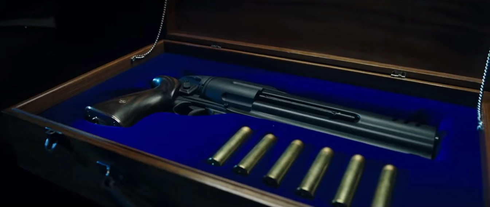

.png)

[地狱男爵](/entry/Hellboy_(character))在 2019 年电影 *[《地狱男爵》](/entry/Hellboy_(2019_film))* 中挥舞着一把特制的**左轮手枪**。

## 武器规格

这把左轮手枪是地狱男爵标志性的定制武器，与[超自然调查防御署](/entry/Bureau_for_Paranormal_Research_and_Defense)的标准配发枪械截然不同。在外观上，该武器采用了现代化设计，拥有流线型的转轮和加长的枪管。其转轮可容纳六发子弹，口径为 .55。

### 设计

这把左轮手枪以一把老式钢制 Gasser M1870 左轮手枪为基础改造而成。它由该片的首席军械师 Marin Takov 负责定制与设计。为了让它看起来更具威力、更富奇幻色彩，制作方对转轮、枪管、枪身和握把都进行了加长与加大。该片总共制作了四把定制左轮手枪：两把可以发射空包弹，另外两把为不能击发的版本，用于特写镜头和细节拍摄。

## 画廊

一把正在改装过程中的 Gasser M1870。

成品左轮手枪，陈列在它的超自然调查防御署便携箱中。

地狱男爵在电影海报中挥舞着他的左轮手枪。

## 趣闻

- 尽管这把枪并没有正式的专属名称，但摄制组成员在非正式场合称它为“魔鬼左轮手枪”。
  - 一些粉丝误以为这把枪名叫“撒马利亚人”（The Samaritan），那其实是[2004—2008 年系列电影中那把左轮手枪](/entry/The_Samaritan)的名字。然而，这个名称从未与 2019 年的电影正式关联过。
    - 官方授权的周边商品用“定制左轮手枪”或“地狱男爵佩枪”之类的通用说法来称呼这把枪。
    - Chronicle Collectibles 曾在 2018 年纽约漫展上展出过一把标注为“Samaritan”的手枪复制品。但那是一把自动手枪，而非这把特制左轮手枪；Chronicle 工作人员的评论表示，那个标签是个错误。最终，Chronicle Collectibles 从未推出过任何《地狱男爵》枪械复制品（无论左轮手枪还是自动手枪）。

## 登场

- *[《地狱男爵》](/entry/Hellboy_(2019_film))*（2019）
