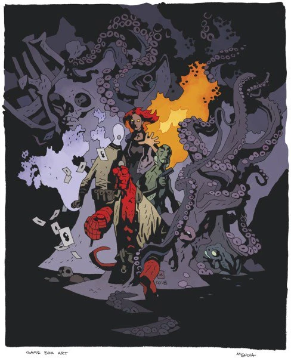

.jpg)

***《地狱男爵：桌游》（Hellboy: The Board Game）***是 Mantic Games 于 2019 年推出的一款桌游，由 Needy Cat Games 的 James M. Hewitt 与 Sophie Williams 设计。该项目于 2018 年 1 月 5 日首次公布，同时发布新闻稿称将于当年 4 月在 Kickstarter 上发起众筹。按照与黑马漫画达成的协议，*[《地狱男爵》](/entry/Hellboy_(series))* 创作者[迈克·米格诺拉](/entry/Mike_Mignola)对游戏的所有方面拥有最终审定权。

## 基础游戏

包含三个超自然调查防御署剧本，以及进行游戏所需的全部内容。尽管[约翰·克劳斯](/entry/Johann_Kraus)直到 2002 年才加入[超自然调查防御署](/entry/Bureau_for_Paranormal_Research_and_Defense)（见 *[《B.P.R.D.：空心地球》](/entry/Hollow_Earth)*），迈克·米格诺拉仍特别要求让这个角色成为基础游戏的四位核心探员之一。

- 规则手册
- 4 名英雄（[地狱男爵](/entry/Hellboy_(character))、[丽兹·舍曼](/entry/Elizabeth_Sherman)、[亚伯·塞皮恩](/entry/Abraham_Sapien)、[约翰·克劳斯](/entry/Johann_Kraus)）
- 游戏图板
- 门与家具指示物
- 定制骰子
- 总部版图
- 行动方块
- 18 个喽啰
- 3 个 Boss（[拉斯普廷](/entry/Grigori_Rasputin)、[触手怪物](/entry/Sadu-Hem)、[巨蛙怪物](/entry/Frog_monster)）
- 卡牌：
  - 核心探员卡
  - 遭遇牌组
  - 征用牌组
  - 末日牌组
  - 案件档案牌组
  - 敌人牌组

## 扩展

### *《征服之虫》*

包含 [*《征服之虫》*](/entry/Conqueror_Worm_(story)) 剧本。

- 新游戏图板
- 15 名纳粹士兵
- 1 个 Boss（[征服之虫](/entry/Conqueror_Worm_(Ogdru_Hem))）
- 卡牌：
  - 新的遭遇牌组卡牌
  - 新的征用牌组卡牌
  - 新的末日牌组卡牌
  - 《征服之虫》案件档案牌组
  - 《征服之虫》敌人牌组

### 超自然调查防御署档案

包含用于自创剧本的各种素材。

- 18 种野兽与怪物
- 卡牌：
  - 新的遭遇牌组卡牌
  - 超自然调查防御署档案案件档案牌组
  - 超自然调查防御署档案敌人牌组

### *《地狱男爵在墨西哥》*（限量版）

包含两个 *[《地狱男爵在墨西哥》](/entry/Hellboy_in_Mexico)* 剧本。此扩展不做商业发售，只能通过 Kickstarter 或在漫展上购买。

- 4 名英雄（墨西哥摔角手地狱男爵、[埃斯特万和他的兄弟们](/entry/Hellboy_in_Mexico_(story))）
- 游戏图板
- 15 个喽啰
- 1 个 Boss（卡马佐茨）
- 卡牌：
  - 探员卡
  - 新的遭遇牌组卡牌
  - 新的征用牌组卡牌
  - 新的末日牌组卡牌
  - 《地狱男爵在墨西哥》案件档案牌组
  - 《地狱男爵在墨西哥》敌人牌组

### *《黑暗召唤》*

包含两个 *[《黑暗召唤》](/entry/Darkness_Calls)* 剧本。

- 1 名英雄（[亨利·胡德](/entry/Henry_Hood)（Henry Hood））
- 1 名后备探员（狼）
- 游戏图板
- 15 个亡灵喽啰
- 1 个 Boss（[科西切](/entry/Koshchei_(character))）
- 2 个小 Boss（女巫）
- 卡牌：
  - 探员卡
  - 新的遭遇牌组卡牌
  - 新的征用牌组卡牌
  - 新的末日牌组卡牌
  - 《黑暗召唤》案件档案牌组
  - 《黑暗召唤》敌人牌组

### 未来扩展

Mantic 计划继续推出扩展，探索 *[《地狱男爵》](/entry/Hellboy_(series))* 和 *[《B.P.R.D.》](/entry/B.P.R.D._(series))* 的故事线。未来的扩展将包括[本·达米奥](/entry/Benjamin_Daimio)等经典角色。

## 2018 年 Kickstarter 众筹活动

Mantic Games 于 2018 年 4 月 25 日在 Kickstarter 上为这款游戏发起众筹。游戏在最初几个小时内就达到了 10 万英镑的筹资目标，并在头 26 小时内突破了 100 万美元。这最终成为 Mantic 迄今为止最成功的 Kickstarter 项目，解锁了全部 64 个延伸目标。

### 延伸目标

- 探员：
  - [罗杰](/entry/Roger)
  - [大螯虾强生](/entry/The_Lobster)
  - [访客](/entry/The_Visitor_(character))（The Visitor）
- 敌人：
  - [赫卡特](/entry/Hecate) + 对决
  - [温施（Unmensch）](/entry/Unmensch) + 对决
  - [赫尔曼·冯·卡朗普特](/entry/Herman_von_Klempt) + 对决
  - [克里格阿费（Kriegaffe）](/entry/Kriegaffe) + 对决
  - [雅加婆婆](/entry/Baba_Yaga_(character)) + 剧本
  - [圣伦纳德之龙](/entry/The_Nature_of_the_Beast) + 对决
  - [弗拉基米尔·久雷斯库](/entry/Vladimir_Giurescu) + 对决（《满满一盒邪恶》）
  - [漂浮头颅](/entry/Heads)（Floating Heads）（《满满一盒邪恶》）
  - 鬼（Oni）（《满满一盒邪恶》）
  - [伊戈尔·布罗姆黑德](/entry/Igor_Bromhead)（《满满一盒邪恶》）
- 剧本：
  - 新的巨蛙怪物剧本
  - 新的拉斯普廷剧本
  - 新的触手怪物剧本
  - 新的征服之虫剧本
  - 另一个雅加婆婆剧本
  - 赫尔曼·冯·卡朗普特剧本
- 指示物：
  - 升级版“收集到的情报”指示物
  - 毁灭之右手指示物
  - 火焰追踪标记
  - 目标优先级胸像（地狱男爵、丽兹、亚伯、约翰、罗杰、大螯虾强生）
  - 升级版线索指示物
  - 升级版伤害计数器
- 物品卡：
  - [辛科](/entry/Zinco_Corporation)火箭背包
  - [铁鞋](/entry/The_Iron_Shoes)
  - [煎饼](/entry/Pancakes)
  - [布岑神父的头](/entry/Wake_the_Devil)（Father Budzen's Head）
  - 巫妖蜡烛
  - 伪装
  - 香烟
  - 荣耀之手
  - 5 张新征用卡
- 额外一套定制游戏骰子
- 游戏图板厚度升级
- 案件档案升级为塔罗牌尺寸
- 卡牌升级为 310GSM
- 20 美元黑马数字漫画代金券

### Kickstarter 独占延伸目标

- 探员：
  - [特雷佛·布鲁姆教授](/entry/Trevor_Bruttenholm)
  - [“煎饼”地狱男爵](/entry/Pancakes)
  - [凯特·考瑞根](/entry/Katherine_Corrigan)
  - [长角地狱男爵](/entry/Wake_the_Devil)
  - [Scott Clark](/entry/Scott_Clark)
  - [西德尼·利奇](/entry/Sidney_Leach)
  - [巴德·沃勒](/entry/Bud_Waller)
- 敌人：
  - “他有枪！”小人偶
  - 另一个铁娘子形象的[赫卡特](/entry/Hecate) + 对决
  - 另一个[拉格纳·洛克](/entry/Ragna_Rok)形象的[拉斯普廷](/entry/Grigori_Rasputin) + 对决
  - [伊尔莎·豪普斯坦（Ilsa Haupstein）](/entry/Ilsa_Haupstein) + 剧本
  - [克焰人](/entry/Karl_Ruprect_Kroenen) + 对决
  - [乌阿拉克](/entry/Ualac) + 对决
  - [邪恶火鸡](/entry/Hellboy_in_Mexico_(story))（Evil Turkey）+ 末日牌组卡牌
- 硬核末日牌组
- 新手末日牌组
- 游戏美术版画（[迈克·米格诺拉](/entry/Mike_Mignola) 与 [戴夫·斯图尔特](/entry/Dave_Stewart) 作）
- 黑白游戏美术版画（[迈克·米格诺拉](/entry/Mike_Mignola) 与 [戴夫·斯图尔特](/entry/Dave_Stewart) 作）
- 升级版包装盒
- 《满满一盒邪恶》（Box Full of Evil）（包装附加物）

### 可选加购

- 3D 场景
- 3D 门
- 折叠骰盘
- 额外骰子
- 超自然调查防御署骰袋
- 树脂微缩模型
- 《地狱男爵在墨西哥》限量版扩展
- 《黑暗召唤》扩展
- 《满满一盒邪恶》（包含《地狱男爵在墨西哥》和《黑暗召唤》两个扩展）

## 2021 年 Kickstarter 众筹活动

Mantic 已在其博客上提到，他们将在 2021 年为更多扩展发起一次众筹。
