***《地狱男爵：怪谈》（Hellboy: Weird Tales）*** 是一部非正史漫画系列，在[第一部《地狱男爵》电影](/entry/Hellboy_%282004_film%29)制作期间出版。[Mike Mignola](/entry/Mike_Mignola) 在电影制作期间非常忙碌，没有时间创作新的《地狱男爵》漫画。《地狱男爵：怪谈》是一种在电影上映前的预热阶段以及电影上映期间让新的《地狱男爵》内容出现在货架上的方式。

该系列从 2003 年 2 月至 2004 年 4 月共发行八期，以双月刊的形式出版。每期都收录由不同创作团队创作的多个短篇故事。

## 各期

期号
出版日期
封面
故事
编剧
画师
附加内容

<tbody>

1
February 26, 2003
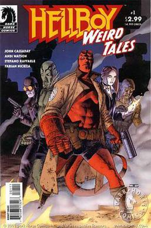[JOHN CASSADAY](/entry/John_Cassaday)
*[《大马戏团地狱男爵》（Big-Top-Hell-Boy）](/entry/Big-Top-Hell-Boy)*
[John Cassaday](/entry/John_Cassaday)
*《糖衣钢丝 feat. Karl Ruprect Kroenen 博士》（Sugar Coated Wire feat. Dr. Karl Ruprect Kroenen）* pin-up 插画，作者 [TyRuben Ellingson](/entry/TyRuben_Ellingson)

*[《扫兴鬼》（Party Pooper）](/entry/Party_Pooper)*
[Andi Watson](/entry/Andi_Watson)

*[《黑冢之子》（Children of the Black Mound）](/entry/Children_of_the_Black_Mound)*
[Fabian Nicieza](/entry/Fabian_Nicieza)
[Stefano Raffaele](/entry/Stefano_Raffaele)

*[《霍洛博士的超级振动毁灭机：第 1 集》（Doc Hollow's Grand Vibro-Destructo Machine: Episode 1）](/entry/Doc_Hollow%26)*
[John Cassaday](/entry/John_Cassaday)

2
April 23, 2003
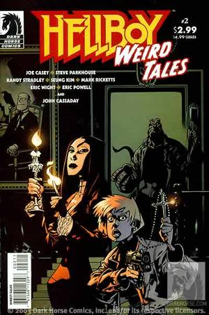[JASON PEARSON](/entry/Jason_Pearson)
*[《潜逃风险》（Flight Risk）](/entry/Flight_Risk)*
[Joe Casey](/entry/Joe_Casey)
[Steve Parkhouse](/entry/Steve_Parkhouse)
NA

*[《火辣》（Hot）](/entry/Hot)*
[Randy Stradley](/entry/Randy_Stradley)
[Seung Kim](/entry/Seung_Kim)

*[《闹鬼桌巾的诅咒》（Curse of the Haunted Doily）](/entry/Curse_of_the_Haunted_Doily)*
[Mark Ricketts](/entry/Mark_Ricketts)
[Eric Wright](/entry/Eric_Wright)

*[《午夜牛郎》（Midnight Cowboy）](/entry/Midnight_Cowboy)*
[Eric Powell](/entry/Eric_Powell)

*[《霍洛博士的超级振动毁灭机：第 2 集》（Doc Hollow's Grand Vibro-Destructo Machine: Episode 2）](/entry/Doc_Hollow%26)*
[John Cassaday](/entry/John_Cassaday)

3
June 25, 2003
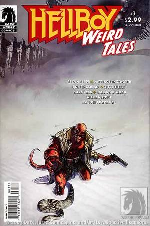[ALEX MALEEV](/entry/Alex_Maleev)
*[《胎死腹中》（Still Born）](/entry/Still_Born)*
[Matt Hollingsworth](/entry/Matt_Hollingsworth) &amp; [Alex Maleev](/entry/Alex_Maleev)
[Alex Maleev](/entry/Alex_Maleev)
*《地狱男爵大战拉斯普廷》（Hellboy v. Rasputin）* pin-up 插画，作者 [Galen Showman](/entry/Galen_Showman) 
&amp; 
*《地狱男爵在疯狂山脉》（Hellboy at the Mountains of Madness）* pin-up 插画，作者 [William Stout](/entry/William_Stout)

*[《休息时间》（Downtime）](/entry/Downtime)*
[Bob Fingerman](/entry/Bob_Fingerman)

*[《家族故事》（Family Story）](/entry/Family_Story)*
[Sara Ryan](/entry/Sara_Ryan)
[Steve Lieber](/entry/Steve_Lieber)

*[《霍洛博士的超级振动毁灭机：第 3 集》（Doc Hollow's Grand Vibro-Destructo Machine: Episode 3）](/entry/Doc_Hollow%26)*
[John Cassaday](/entry/John_Cassaday)

4
August 27, 2003
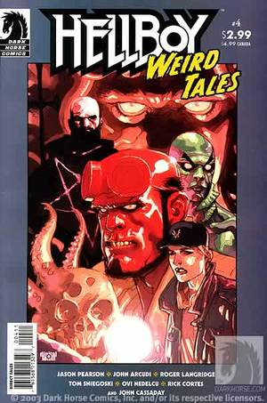[LEINIL FRANCIS YU](/entry/Leinil_Francis_Yu)
*[《内心恐惧》（The Dread Within）](/entry/The_Dread_Within)*
[Jason Pearson](/entry/Jason_Pearson)
*《碎裂》（Shred）* pin-up 插画，作者 [Rick Cortes](/entry/Rick_Cortes)

*[《亚伯·萨皮恩：B.P.R.D. 之星》（Abe Sapien: Star of the B.P.R.D.）](/entry/Abe_Sapien%3A_Star_of_the_B.P.R.D.)*
[John Arcudi](/entry/John_Arcudi)
[Roger Langridge](/entry/Roger_Langridge)

*[《幽魂缠身》（Haunted）](/entry/Haunted)*
[Tom Sniegoski](/entry/Tom_Sniegoski)
[Ovi Nedelcu](/entry/Ovi_Nedelcu)

*[《霍洛博士的超级振动毁灭机：第 4 集》（Doc Hollow's Grand Vibro-Destructo Machine: Episode 4）](/entry/Doc_Hollow%26)*
[John Cassaday](/entry/John_Cassaday)

5
October 15, 2003
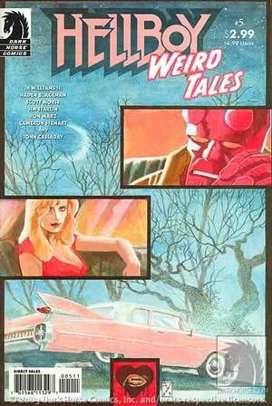[J.H. WILLIAMS III](/entry/J.H._Williams_III)
*[《爱比死亡更可怕》（Love is Scarier than Death）](/entry/Love_is_Scarier_than_Death)*
[J.H. Williams III](/entry/J.H._Williams_III) &amp; [Haden Blackman](/entry/Haden_Blackman)
[J.H. Williams III](/entry/J.H._Williams_III)
Pin-up 插画，作者 [Cameron Stewart](/entry/Cameron_Stewart)

*[《冷静一下》（Cool Your Head）](/entry/Cool_Your_Head)*
[Scott Morse](/entry/Scott_Morse)

*[《破碎》（Shattered）](/entry/Shattered)*
[Ron Marz](/entry/Ron_Marz)
[Jim Starlin](/entry/Jim_Starlin)

*[《霍洛博士的超级振动毁灭机：第 5 集》（Doc Hollow's Grand Vibro-Destructo Machine: Episode 5）](/entry/Doc_Hollow%26)*
[John Cassaday](/entry/John_Cassaday)

6
December 10, 2003
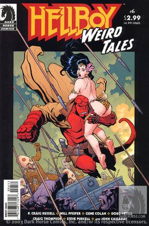[FRANK CHO](/entry/Frank_Cho)
*[《特别献演》（Command Performance）](/entry/Command_Performance)*
[Will Pfeifer](/entry/Will_Pfeifer)
[P. Craig Russell](/entry/P._Craig_Russell)
Pin-up 插画，作者 [Steve Purcell](/entry/Steve_Purcell)

*[《星期五》（Friday）](/entry/Friday)*
[Doug Petrie](/entry/Doug_Petrie)
[Gene Colan](/entry/Gene_Colan)

*[《我的地狱假期》（My Vacation in Hell）](/entry/My_Vacation_in_Hell)*
[Craig Thompson](/entry/Craig_Thompson)

*[《霍洛博士的超级振动毁灭机：第 6 集》（Doc Hollow's Grand Vibro-Destructo Machine: Episode 6）](/entry/Doc_Hollow%26)*
[John Cassaday](/entry/John_Cassaday)

7
February 11, 2004
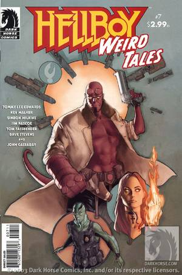[PHIL NOTO](/entry/Phil_Noto)
*[《一则爱情故事》（A Love Story）](/entry/A_Love_Story)*
[Tommy Lee Edwards](/entry/Tommy_Lee_Edwards)
[Tommy Lee Edwards](/entry/Tommy_Lee_Edwards)，[Don Cameron](/entry/Don_Cameron) 协助
Pin-up 插画，作者 [Dave Stevens](/entry/Dave_Stevens)

*[《死者剧院》（Theater of the Dead）](/entry/Theater_of_the_Dead)*
[Jim Pascoe](/entry/Jim_Pascoe) &amp; [Tom Fassbender](/entry/Tom_Fassbender)
[Simeon Wilkins](/entry/Simeon_Wilkins)

*[《长途来电》（Long Distance Caller）](/entry/Long_Distance_Caller)*
[Kev Walker](/entry/Kev_Walker)

*[《霍洛博士的超级振动毁灭机：第 7 集》（Doc Hollow's Grand Vibro-Destructo Machine: Episode 7）](/entry/Doc_Hollow%26)*
[John Cassaday](/entry/John_Cassaday)

8
April 14, 2004
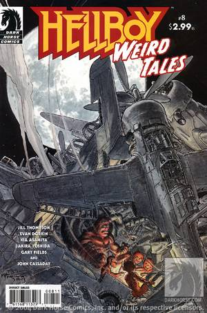[MICHAEL W. KALUTA](/entry/Michael_W._Kaluta)
*[《十五分钟……》（Fifteen Minutes...）](/entry/Fifteen_Minutes...)*
[Jill Thompson](/entry/Jill_Thompson)
Pin-up 插画，作者 [Gary Fields](/entry/Gary_Fields)

*[《玩具士兵》（Toy Soldier）](/entry/Toy_Soldier)*
[Akira Yoshida](/entry/Akira_Yoshida) &amp; [Kia Asamiya](/entry/Kia_Asamiya)
[Kia Asamiya](/entry/Kia_Asamiya)

*[《专业帮助》（Professional Help）](/entry/Professional_Help)*
[Evan Dorkin](/entry/Evan_Dorkin)

*[《霍洛博士的超级振动毁灭机：第 8 集》（Doc Hollow's Grand Vibro-Destructo Machine: Episode 8）](/entry/Doc_Hollow%26)*
[John Cassaday](/entry/John_Cassaday)

</tbody>

## 合订本

该系列最初被结集为两本平装合订本，后来又被收入一本精装大全集。该大全集后来又以平装合订本形式重新发行。此外，部分故事还曾以口袋本（digest）尺寸的合集形式重印。

### 平装合订本

最初的两本平装合订本各自收录连续的四期《地狱男爵：怪谈》单刊。

书名
出版日期
封面
收录内容

<tbody>

*《地狱男爵怪谈：第 1 卷》（Hellboy Weird Tales: Volume 1）*
December 17, 2003
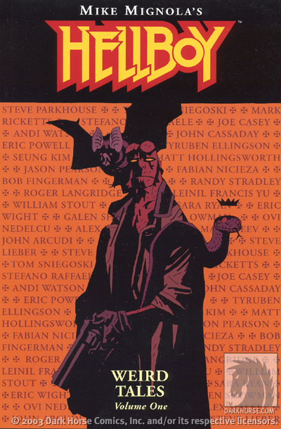MIKE MIGNOLA
*《地狱男爵怪谈》（Hellboy Weird Tales）* #1–4

*《地狱男爵怪谈：第 2 卷》（Hellboy Weird Tales: Volume 2）*
October 27, 2004
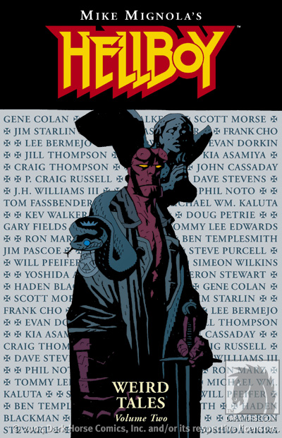MIKE MIGNOLA
*《地狱男爵怪谈》（Hellboy Weird Tales）* #5–8

</tbody>

### 大全集

除了收录《地狱男爵：怪谈》#1–8 之外，《地狱男爵：怪谈》大全集还收录了两个正史故事：*[《柯希伊如何获得不死之身》（How Koshchei Became Deathless）](/entry/How_Koshchei_Became_Deathless)* 和 *[《芭芭雅嘎的盛宴》（Baba Yaga's Feast）](/entry/Baba_Yaga%27s_Feast)*。八集故事 *[《霍洛博士的超级振动毁灭机》（Doc Hollow's Grand Vibro-Destructo Machine）](/entry/Doc_Hollow%27s_Grand_Vibro-Destructo_Machine)* 在这本合集中被改名为"《龙虾约翰逊：动作侦探冒险》（Lobster Johnson: Action Detective Adventure）"。

在平装版中，故事 *[《玩具士兵》（Toy Soldier）](/entry/Toy_Soldier)* 被移除，可能是因为它由 [C. B. Cebulski](/entry/C.B._Cebulski) 以其有争议的笔名"Akira Yoshida"创作。[Scott Allie](/entry/Scott_Allie) 撰写的序言也被移除。

书名
出版日期
封面
收录内容
附加内容

<tbody>

*《地狱男爵：怪谈》（Hellboy: Weird Tales）* 
（精装）
November 26, 2014
 MIKE MIGNOLA
<ul>
<li>*《地狱男爵怪谈》（Hellboy Weird Tales）* #1–8</li>
<li>*[《柯希伊如何获得不死之身》（How Koshchei Became Deathless）](/entry/How_Koshchei_Became_Deathless)*</li>
<li>*[《芭芭雅嘎的盛宴》（Baba Yaga's Feast）](/entry/Baba_Yaga%26)*</li>
</ul>
序言作者 [Scott Allie](/entry/Scott_Allie)

*《地狱男爵：怪谈》（Hellboy: Weird Tales）* 
（平装）
November 9, 2022
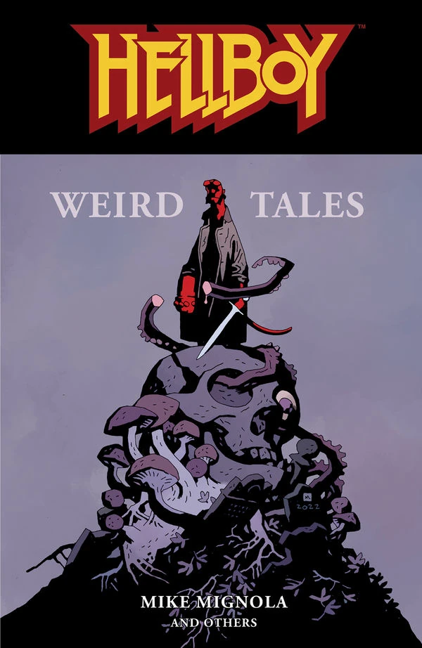MIKE MIGNOLA
<ul>
<li>*《地狱男爵怪谈》（Hellboy Weird Tales）* #1–8 
（不含"*《玩具士兵》（Toy Soldier）*"）</li>
<li>*[《柯希伊如何获得不死之身》（How Koshchei Became Deathless）](/entry/How_Koshchei_Became_Deathless)*</li>
<li>*[《芭芭雅嘎的盛宴》（Baba Yaga's Feast）](/entry/Baba_Yaga%26)*</li>
</ul>

</tbody>

### 口袋本尺寸合集

《死者剧院及其他故事》（The Theatre of the Dead & Other Stories）曾与 [《地狱男爵动画版：铁血惊魂》（Hellboy Animated: Blood & Iron）](/entry/Hellboy_Animated%3A_Blood_%26_Iron) DVD 捆绑销售，通过 Trans World Entertainment Corporation 旗下门店（Sam Goody、Suncoast、FYE 等）购买即可获得。它收录了《怪谈》连载中精选的若干故事。

书名
出版日期
收录内容 |- id=""
*《死者剧院及其他故事》（The Theatre of the Dead &amp; Other Stories）*
May, 2007
<ul>
<li>*[《大马戏团地狱男爵》（Big-Top-Hell-Boy）](/entry/Big-Top-Hell-Boy)*</li>
<li>*[《闹鬼桌巾的诅咒》（Curse of the Haunted Doily）](/entry/Curse_of_the_Haunted_Doily)*</li>
<li>*[《午夜牛郎》（Midnight Cowboy）](/entry/Midnight_Cowboy)*</li>
<li>*[《幽魂缠身》（Haunted）](/entry/Haunted)*</li>
<li>*[《破碎》（Shattered）](/entry/Shattered)*</li>
<li>*[《星期五》（Friday）](/entry/Friday)*</li>
<li>*[《死者剧院》（Theater of the Dead）](/entry/Theater_of_the_Dead)*</li>
<li>*[《十五分钟……》（Fifteen Minutes...）](/entry/Fifteen_Minutes...)*</li>
</ul>

<tbody>
</tbody>

## 外部链接

- [DarkHorse.com 上的 *《地狱男爵：怪谈》\#1* 产品页](https://www.darkhorse.com/Comics/11-329/Hellboy-Weird-Tales-1)
- [DarkHorse.com 上的 *《地狱男爵：怪谈》\#2* 产品页](https://www.darkhorse.com/Comics/11-333/Hellboy-Weird-Tales-2)
- [DarkHorse.com 上的 *《地狱男爵：怪谈》\#3* 产品页](https://www.darkhorse.com/Comics/11-336/Hellboy-Weird-Tales-3)
- [DarkHorse.com 上的 *《地狱男爵：怪谈》\#4* 产品页](https://www.darkhorse.com/Comics/12-313/Hellboy-Weird-Tales-4)
- [DarkHorse.com 上的 *《地狱男爵：怪谈》\#5* 产品页](https://www.darkhorse.com/Comics/12-471/Hellboy-Weird-Tales-5)
- [DarkHorse.com 上的 *《地狱男爵：怪谈》\#6* 产品页](https://www.darkhorse.com/Comics/12-472/Hellboy-Weird-Tales-6)
- [DarkHorse.com 上的 *《地狱男爵：怪谈》\#7* 产品页](https://www.darkhorse.com/Comics/12-473/Hellboy-Weird-Tales-7)
- [DarkHorse.com 上的 *《地狱男爵：怪谈》\#8* 产品页](https://www.darkhorse.com/Comics/12-474/Hellboy-Weird-Tales-8)
- [DarkHorse.com 上的 *《地狱男爵：怪谈》第 1 卷* 产品页](https://www.darkhorse.com/Books/11-341/Hellboy-Weird-Tales-Volume-1-TPB)
- [DarkHorse.com 上的 *《地狱男爵：怪谈》第 2 卷* 产品页](https://www.darkhorse.com/Books/12-480/Hellboy-Weird-Tales-Volume-2-TPB)
- [DarkHorse.com 上的 *《地狱男爵：怪谈》* 精装大全集产品页](https://www.darkhorse.com/Books/24-712/Hellboy-Weird-Tales-HC)
- [DarkHorse.com 上的 *《地狱男爵：怪谈》* 平装大全集产品页](https://www.darkhorse.com/Books/3011-095/Hellboy-Weird-Tales-TPB)
