***《地狱男爵：夜之犬》***(Hellboy: Dogs of the Night)是 2000 年由 Cryo Studios 开发的一款美国电脑游戏。2003 年，Hoplite Research 将其移植到 PlayStation 平台，名为 ***《地狱男爵：避难所追寻者》***(Hellboy: Asylum Seeker)。

[地狱男爵](/entry/Hellboy_(character))由 David Gasman 配音。

## 剧情

游戏发生在 1962 年 1 月的布拉格，时值地狱男爵早年为[超自然调查防御署](/entry/B.P.R.D.)(Bureau for Paranormal Research and Defense)工作期间。调查局的一名线人近期突然患上一种令人虚弱的怪病，他声称这是[诺霍克斯·卡尼斯](/entry/Nohox_Kanis)(Nohox Kanis)的邪恶阴谋所致。约 700 年前，诺霍克斯·卡尼斯曾试图进入我们的世界，带来永恒的黑夜。当时，他们被一位名叫[米特里](/entry/Mitri)(Mitri)的修士击败。

如今，一场迫在眉睫的月食将为诺霍克斯·卡尼斯提供再次进入我们世界的机会。调查局最优秀的侦察特工之一[彼得·约翰逊](/entry/Peter_Johnson)(Peter Johnson)被派往捷克斯洛伐克的一家精神病院，那里长期以来一直流传着令人不安的谣言。现在看来，这家精神病院自始至终都与诺霍克斯·卡尼斯的回归有关，而彼得已经失踪。

地狱男爵与[萨拉·考特维尔](/entry/Sara_Courteville)(Sara Courteville)正在调查失踪特工彼得一案。揭开这起失踪事件背后的真相、拨乱反正的重任落在了地狱男爵肩上。

## 角色

### 主要角色

- [地狱男爵](/entry/Hellboy_(character))
- [萨拉·考特维尔](/entry/Sara_Courteville)
- [彼得·约翰逊](/entry/Peter_Johnson)
- [米特里](/entry/Mitri)

### 敌人

- [僵尸](/entry/Zombies)
- [巨鸟](/entry/Giant_Bird)
- [诺霍克斯·卡尼斯](/entry/Nohox_Kanis)
- [护士](/entry/Nurse)
- [伊戈尔们](/entry/Igors)
- [桑切斯](/entry/Sanchez)
- [巨猴](/entry/Giant_Monkey)
- [审判官](/entry/Inquisitor)
- [卡林](/entry/Kalin)

## 玩法

玩家以第三人称视角操控地狱男爵闯过六个关卡。各关卡由不同的阶段组成，以谜题和敌人分隔，每个关卡的内容各不相同。游戏主要是一款图形冒险游戏，玩家必须解开谜题才能推进剧情，途中散布着一些与敌人的战斗。在与对手搏斗时，地狱男爵要么使用双拳——包括他那石头般的"毁灭之右手"——要么使用在游戏各处可以找到的各种武器，包括火把、枪和剑。

## 评价

Windows 版在 GameRankings 上的评分为 11.50%。《美国官方 PlayStation 杂志》（2003 年 10 月号）的 Jason Babler 给这款游戏打出了 5 分制中的 0.5 分。

## 画廊

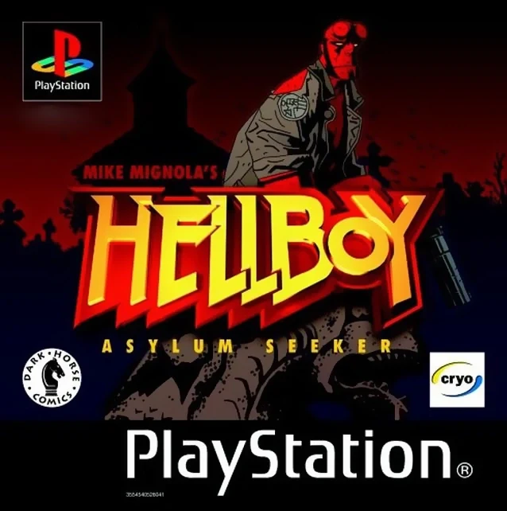

|Hellboy: Asylum Seeker PS cover.

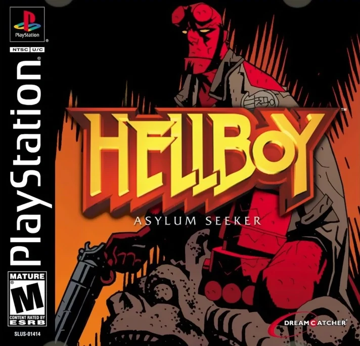

|Hellboy: Asylum Seeker PS another cover.

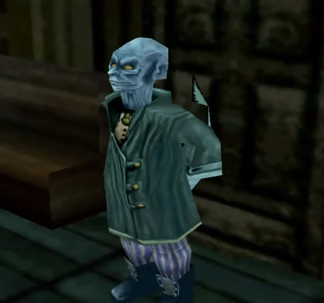

|

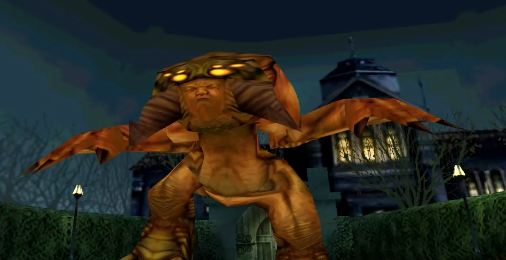

|

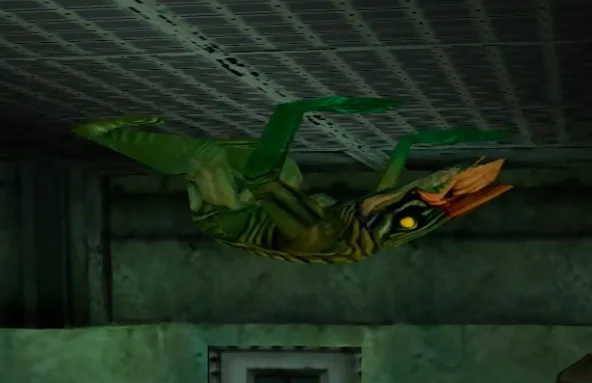

|

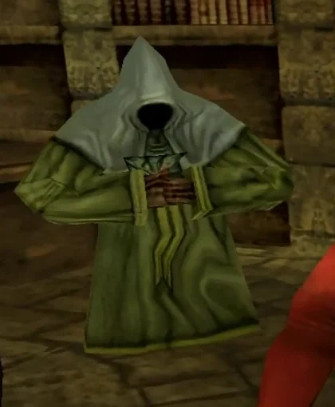

|

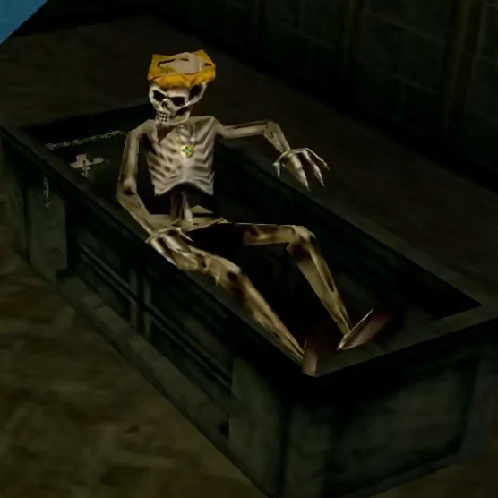

|

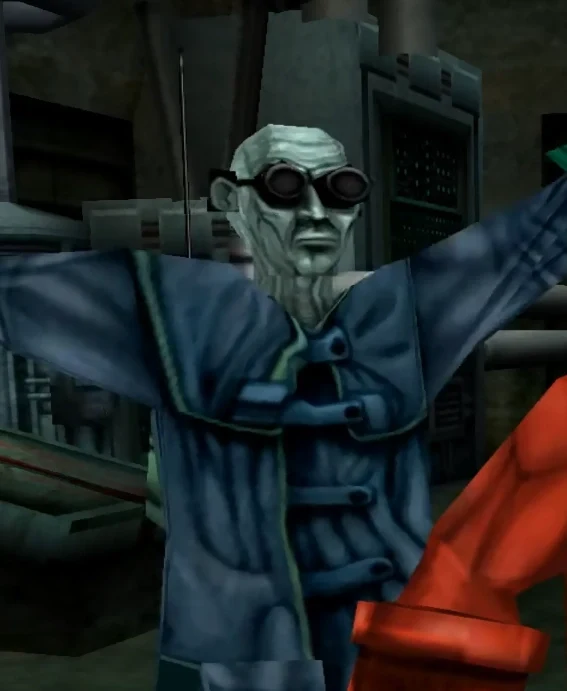

|

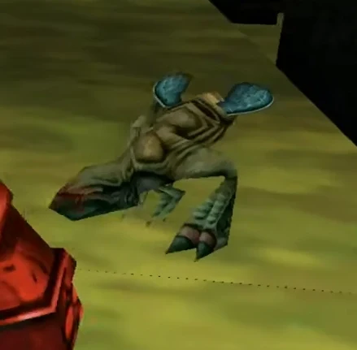

|

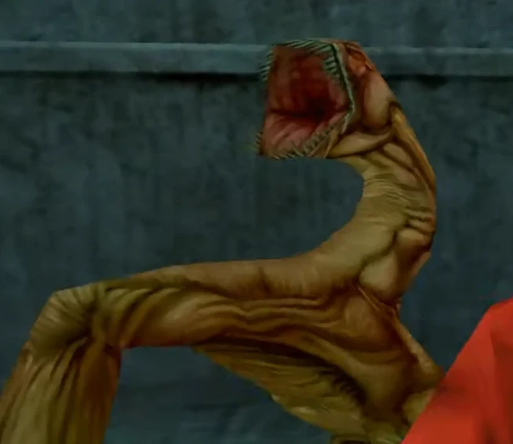

|

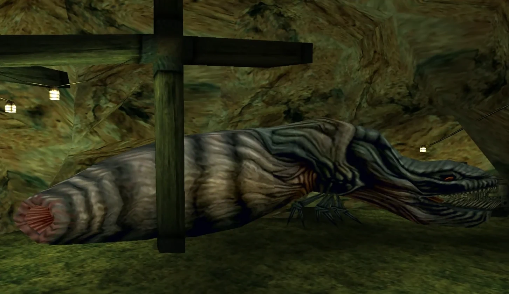

|

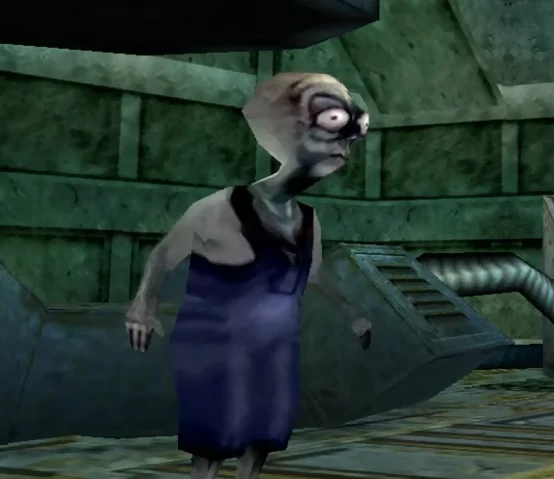

|

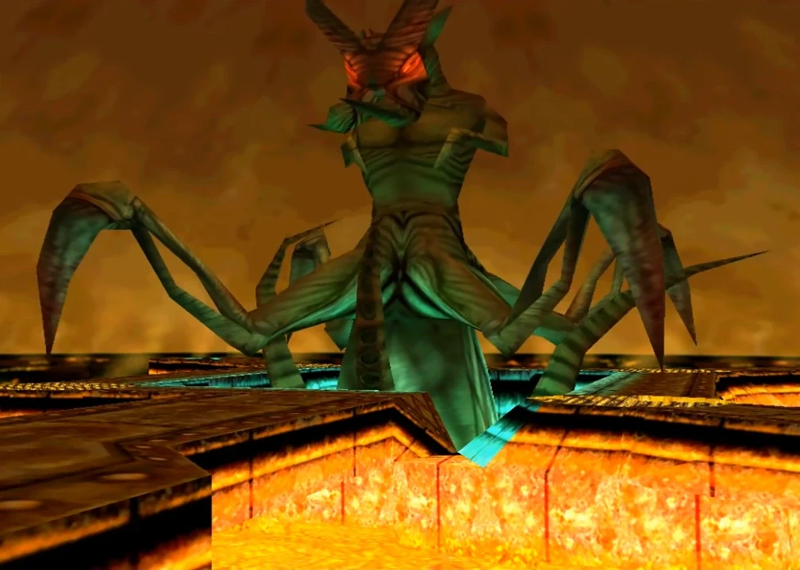

|
### 封面

*《地狱男爵：夜之犬》*电脑版封面。

*《地狱男爵：避难所追寻者》*PS 版封面。

*《地狱男爵：避难所追寻者》*PS 版另一款封面。

### 未命名角色/生物

### 影片

Hellboy Asylum Seeker - 全部过场动画（游戏电影 - 1080p）

过场动画合集（PSX）

## 趣闻

- *《夜之犬》*是第一部*[地狱男爵](/entry/Hellboy_(series))*电子游戏，Gasman 也是第一位为该角色配音的演员。

## 外部链接

- Hellboy: Dogs of the Night 在 MobyGames 上的页面
