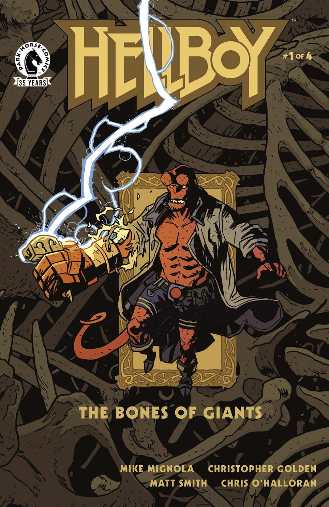
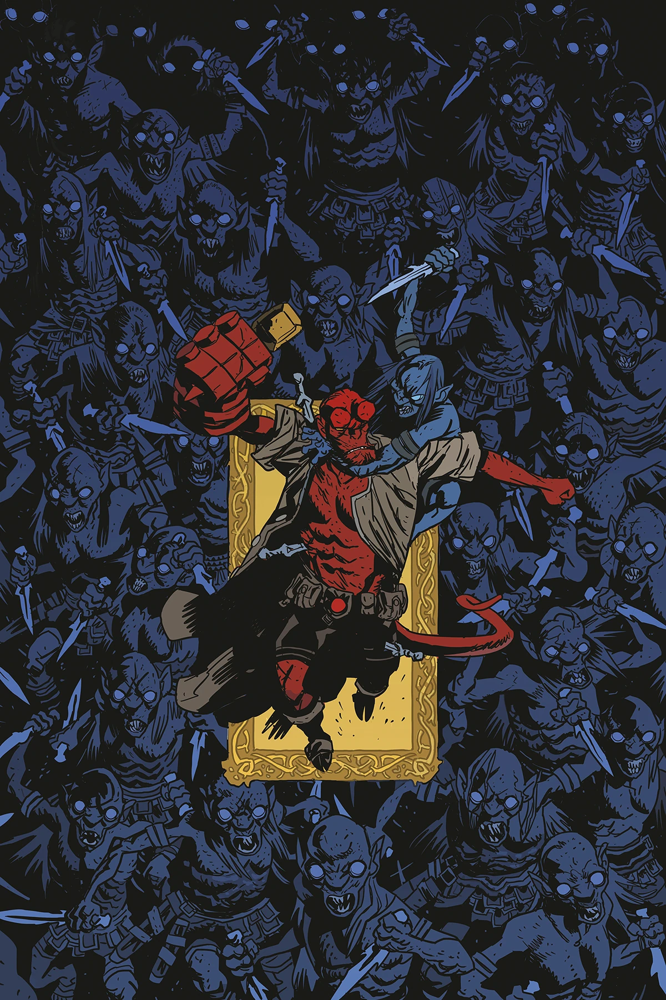
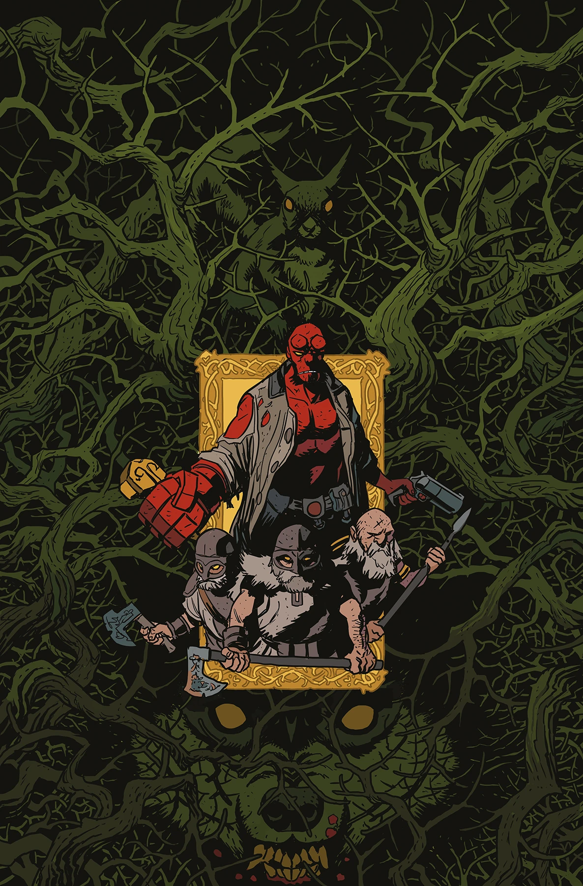
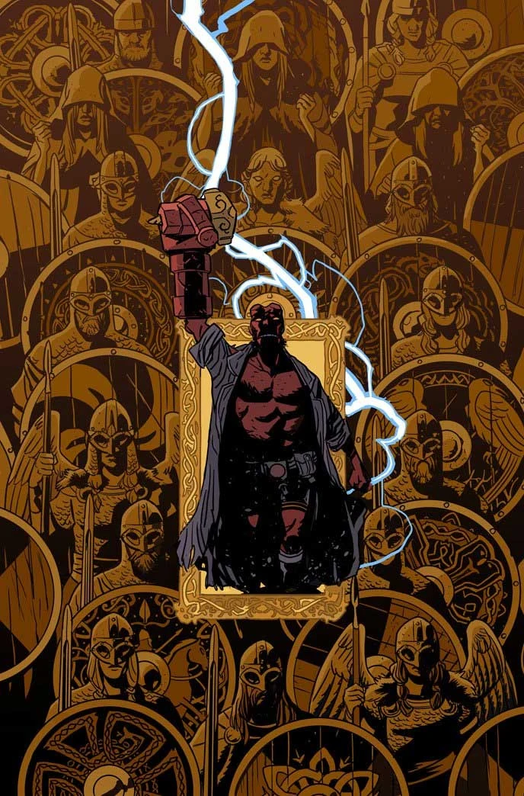

***《巨人之骨》（The Bones of Giants）***是一部四期迷你系列，于 2021 年 11 月推出，由[迈克·米格诺拉](/entry/Mike_Mignola)和[克里斯托弗·戈尔登](/entry/Christopher_Golden)编剧，[马特·史密斯](/entry/Matt_Smith)作画。它改编自 2001 年的文字小说*[《地狱男爵：巨人之骨》（Hellboy: The Bones of Giants）](/entry/Hellboy__The_Bones_of_Giants_%28prose_novel%29)*，该小说同样由米格诺拉和戈尔登撰写。

## 出版历史

## 剧情梗概

### 第一部分

当瑞典有了一项惊人的发现时，B.P.R.D. 派出地狱男爵和亚伯·塞皮恩前去调查。随之而来的是一场狂野冒险，充满了北欧传说、神话生物，以及一个不仅可能让地球、还可能让北欧神话中的九大世界屈膝臣服的威胁。

### 第二部分

地狱男爵身不由己地成为北欧神祇托尔的容器，他和他那支杂牌小队追击着被释放到世间的古老邪恶。然而，即便有神锤妙尔尼尔（Mjollnir）的威力和神话生灵的援助，可能仍不足以阻止即将到来的毁灭。

### 第三部分

地狱男爵体内仍寄居着北欧神祇托尔的灵魂，他与复活不久的冰霜之王索列姆（Thrym）首次正面交锋！但由于尚未恢复全部力量，索列姆脱身溜走，只留下地狱男爵沿着一条血腥恐怖的道路追寻他们的下一次遭遇。

### 第四部分

地狱男爵一行人前往幽灵之城乌特加德（Utgard）寻找索列姆。但挡在 B.P.R.D. 拯救世界之路上的巨人不止一个。矮人、女武神，以及北欧雷神本人齐聚一堂，展开终极对决，为这部精彩绝伦的系列画上句号！

## 故事时间线

虽然原版[《地狱男爵：巨人之骨》文字小说](/entry/Hellboy__The_Bones_of_Giants_%28prose_novel%29)的故事发生在 1999 年 8 月，但漫画改编版的故事发生在 1988 年 2 月。克里斯托弗·戈尔登没有对这一改动的原因作出评论，但他确实表示，当文字小说与漫画内容冲突时，应以漫画为准史。

## 内容

### 角色

#### [B.P.R.D.（超自然调查防御署）](/entry/Bureau_for_Paranormal_Research_and_Defense)

- [地狱男爵](/entry/Hellboy_%28character%29)
- [亚伯·塞皮恩](/entry/Abe_Sapien)

#### 平民

- [扬-奥拉夫·谢利（Jan-Olaf Kjell）](/entry/Jan-Olaf_Kjell)
- [卡尔·阿龙松（Karl Aronsson）](/entry/Karl_Aronsson)教授
- [弗雷德里克·克拉尔（Fredrik Klar）](/entry/Fredrik_Klar)
- [比林（Billing）](/entry/Billing)医生
- 护士[埃利亚斯（Elias）](/entry/Elias)
- [威尔顿（Wilton）](/entry/Wilton)先生
- 艾克曼（Aickman）一家
  - [埃德蒙·艾克曼（Edmond Aickman）](/entry/Edmond_Aickman)
  - [佩妮拉·艾克曼（Pernilla Aickman）](/entry/Pernilla_Aickman)

#### 北欧神话

- 北欧诸神
  - [托尔（Thor）](/entry/Thor)
- 约顿巨人（Jötunn）
  - [索列姆（Thrym）](/entry/Thrym)
  - [赫拉斯维尔格（Hraesvelg）](/entry/Hraesvelg)
  - [耶梦加得（Jormungand）](/entry/Jormungand)（出现于诸神黄昏的回忆中）
  - [芬里尔（Fenrir）](/entry/Fenrir)（出现于诸神黄昏的回忆中）
- [沃尔德王（King Vold）](/entry/King_Vold_%28character%29)（回忆登场）
- [拉塔托斯克（Ratatosk）](/entry/Ratatosk)
- [斯瓦塔耳法（Svartalves，黑精灵）](/entry/Svartalves)
- [矮人（Dwarves）](/entry/Dwarf)
  - [布罗克（Brokk）](/entry/Brokk)
  - [伊特里（Eitri）](/entry/Eitri)
- [女武神（Valkyrjur）](/entry/Valkyrjur)
  - [米斯特（Mist）](/entry/Mist)
- [加姆（Garm）](/entry/Garm)

### 地点

- [瑞典](https://en.wikipedia.org/wiki/Sweden)
  - [斯德哥尔摩](https://en.wikipedia.org/wiki/Stockholm)
    - [斯德哥尔摩大学](https://en.wikipedia.org/wiki/Stockholm_University)
    - [动物园岛（Djurgården）](https://en.wikipedia.org/wiki/Djurg%C3%A5rden)
- [维格里德（Vigrid）](/entry/Vigrid)（出现于诸神黄昏的回忆中）
- [阿斯加德（Asgard）](/entry/Asgard)（出现于诸神黄昏的回忆中）
- [乌特加德（Utgard）](/entry/Utgard)

### 重要器物

- [妙尔尼尔（Mjollnir）](/entry/Mjollnir)

## 画廊

所有封面均由[马特·史密斯](/entry/Matt_Smith)绘制。

 第 1 期

 第 2 期

 第 3 期

 第 4 期
