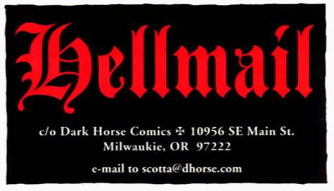

 》第 1 期](1st_Hellmail.jpg "1st Hellmail, from Seed of Destruction #1")"Hellmail"是地狱男爵及相关[漫画](/entry/Hellboy_Comics)各期末尾读者来信栏目的名称。尽管许多漫画已经停办读者来信栏目，Hellmail 仍继续出现在大多数期数的末尾。

该栏目通常刊登若干封读者来信，以及编辑[斯科特·阿利](/entry/Scott_Allie)的一些评论；不过包括[迈克·米格诺拉](/entry/Mike_Mignola)在内的其他人也曾写过评论。阿利常常在栏目中感谢当期的供稿者、回复来信中的问题，并预告即将推出的地狱男爵和黑马（Dark Horse）项目。

栏目通常以一张预告图收尾，宣传下一部与地狱男爵相关的漫画。
